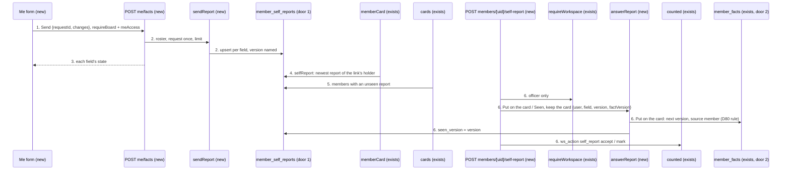
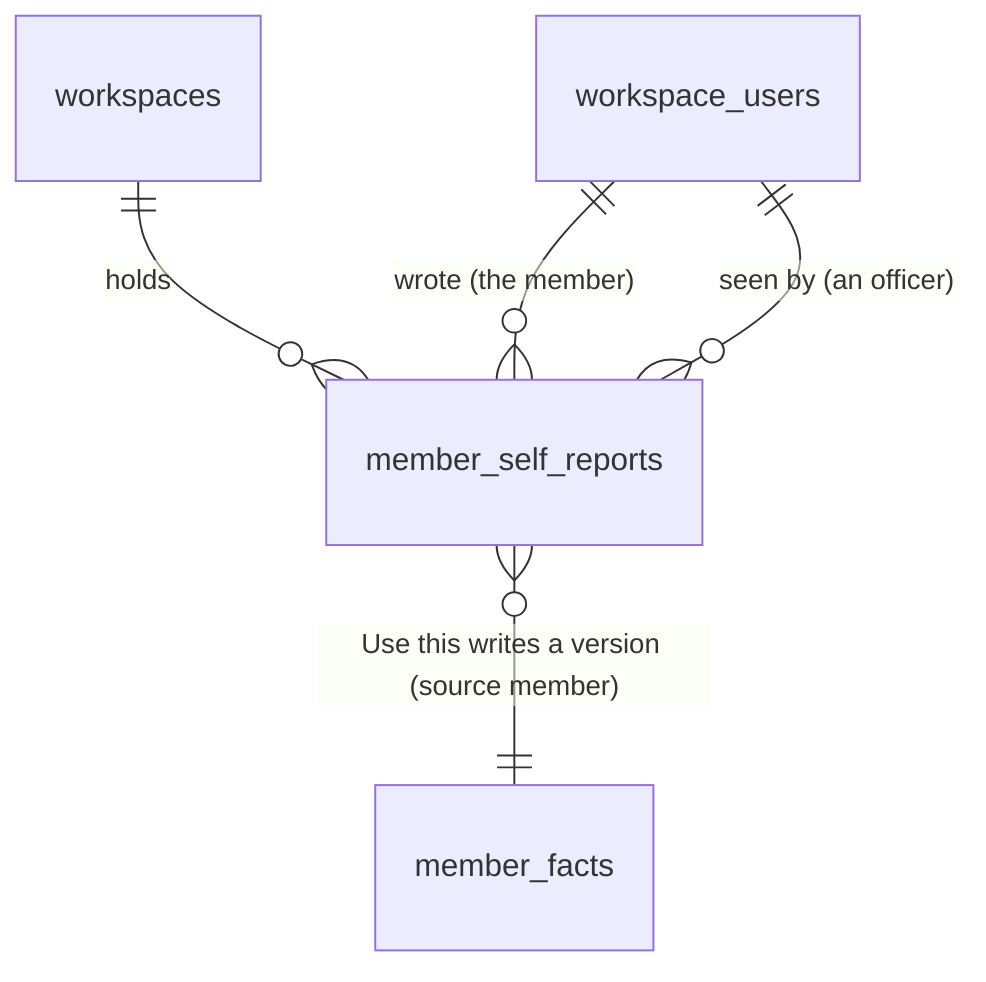
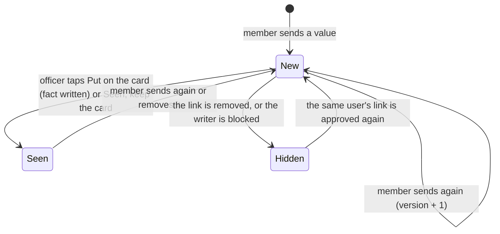

# Member self-report: a member tells the officers their AD Tech, time zone and languages on Me (#301)

**Approved**: 2026-11-22 - user: "301 is very interesting, validate it and think this feature through properly and carefully with the personas, and build it." (owner, 2026-11-22, in the orchestrator's task for issue 301); panel verdicts: [Validation](#validation).

Size: M (a new member write path with two roles: a migration, two routes, a new decision). One PR.

## Problem

Officers record each member's Alliance Duel tech %, time zone and languages by hand (D80): they ask in Discord or in game mail, wait for the answer, then type it on the member card or paste the message. The member is the one person who knows these three facts, and they cannot say them anywhere in the app. Today:

- a new member's card says "Still to ask: AD Tech, time zone, languages" for days, and Follow-up lists those facts to ask (D140);
- a member whose time zone or languages changed has to find an officer who reads the right language;
- the officers of OGs read only English, only Portuguese or only French (D71), so the question is asked and answered through a translation bot.

Evidence: the owner's triage on #301 (2026-11-22: "Starting point: the triage's narrow version. A member with an approved link submits their own facts on Me (AD Tech %, time zone, languages), marked 'self-reported' until an officer marks them seen"), the members' panel of 2026-11-16 on #301 ("self-report (away, onboarding facts, theft)" under Later), D105's "Not built (later, issue 301): … self-report". No measurement of how many asks officers send exists.

What is different when this ships: a member whose "This is me" link an officer approved opens their own page, taps "Tell your officers", sets their AD Tech %, time zone (one tap for the phone's own zone) and languages, and taps Send. The officers see it on that member's card, marked as said by the member, with the day it was sent and "New" until an officer looks. An officer taps "Put on the card", or "Seen, keep the card" to keep the card as it is. Nothing else in the app changes because of what a member sent until an officer taps "Put on the card".

## Shape

Reuses the board's door (`requireBoard`, `meAccess`), D80's field values and versions (`VALUES`, the version-named write, `saveFacts`' conflict rule), the facts editor's time-zone picker and language chips, the card's fact text (`factText`), and Home's "To review" pattern (D142's links). The rules (who may write, which uid, request once, the limit, what an officer sees, what "Put on the card" writes) run in `lib/private/self-report.ts` and `lib/repo/self-reports.ts`, which the PGlite route tests reach.

1. member on Me taps Send -> `POST /api/w/[slug]/me/facts` (new) -> `requireBoard` (exists), the `board` feature (exists), `meAccess` (exists: an approved link only; the uid is the link's)
2. `sendReport` (new, `lib/private/self-report.ts`) - the member is in the newest roster (`ownDays`'s listed check, exists, as Me); the request id was not stored yet (D100); the member's daily limit (`auth_attempts`, exists); each field written on its own, named by the version the member saw, into `member_self_reports` (door 1)
3. out: each field's new state (version, value, sent day, seen or not) -> Me shows "Sent to your officers" and each field's line
4. officer opens the card -> `GET /api/w/[slug]/members/[uid]` (exists) -> `memberCard` (exists) adds `selfReport` (new): each field's newest report whose writer holds the approved link to this uid now, with the card's own value beside it
5. Home -> `cards` (exists, `home-cards.ts`) adds the members with an unseen report (new read), shown in "To review" and counted in Home's number
6. officer taps "Put on the card" or "Seen, keep the card" -> `POST /api/w/[slug]/members/[uid]/self-report` (new) -> `requireWorkspace` (exists) -> `answerReport` (new): the report is still the one the officer saw; "Put on the card" writes the member fact through D80's rule with source `member` (door 2), then marks the report seen; "Seen, keep the card" only marks it seen; `counted` (exists) sends `ws_action` `self_report` / `accept` or `mark`

**Changes underneath**

| Front       | What changes                                                                                                                                                                                                                                                                                                                                                             |
| ----------- | ------------------------------------------------------------------------------------------------------------------------------------------------------------------------------------------------------------------------------------------------------------------------------------------------------------------------------------------------------------------------ |
| domain      | A fact's `source` gains `member` ("from the member"): an officer tapped "Put on the card" on what the member sent. Readers of `source`: the card's fact lines and the editor's source line (`SOURCE_KEY`), History's earlier values. "Self-reported" is a new glossary word: what a member sent about themselves, not yet on the card                                    |
| stored data | New table, nothing to migrate. `member_facts_source_check` is replaced by one that also allows `member`; no row changes                                                                                                                                                                                                                                                  |
| readers     | the member card (header block and Info line), Home's "To review", Me, the workspace download (D125, a new `member-self-reports.csv`) and the workspace deletion (D125, deletes the rows). Every other reader of facts (`factsOf`: Members, Follow-up, roll calls, caravans, Raid prep, Insights, thanks) sees a member's value only after "Put on the card", as any fact |

New: `member_self_reports` and its two references to `workspace_users`. One-way constraints: unique (workspace_id, user_id, field) (door 1); `member_facts.source` may be `member` (door 2).

## Surface

| Route                                          | In                                                                                                                                                                                                       | Out                                                                             | Status                                                                                                                                                                                                                                                            | Who                                                                                                                         |
| ---------------------------------------------- | -------------------------------------------------------------------------------------------------------------------------------------------------------------------------------------------------------- | ------------------------------------------------------------------------------- | ----------------------------------------------------------------------------------------------------------------------------------------------------------------------------------------------------------------------------------------------------------------- | --------------------------------------------------------------------------------------------------------------------------- |
| `POST /api/w/[slug]/me/facts`                  | `{requestId: uuid, changes: [{field: "adTech" or "timeZone" or "languages", version: int ≥ 0, value: <D80's value> or null}]}`, 1–3 changes, fields unique, strict (an unknown key such as `uid` is 400) | `{results: [{field, status: "saved" or "conflict", version, value, at, seen}]}` | 200; 409 with the newer state when another tab sent that field since; 400 `bad_request`; 401 `signed_out`; 403 `forbidden` (not same origin), `turned_off` (board off), `not_linked` (no link, or pending); 409 `left` (not in the newest roster); 429 `too_many` | the member whose link an officer approved, for their own link's uid only; an officer previewing their own page the same way |
| `POST /api/w/[slug]/members/[uid]/self-report` | `{user: int, field, version: int ≥ 1, action: "use" or "seen", factVersion: int ≥ 0}` (`factVersion` only and always with `use`), strict                                                                 | `{ok: true}`, or for a stale fact `{field, version, value, source}`             | 200; 404 `changed` (the report is no longer that version from that user, or the user no longer holds the approved link); 409 with the newer fact; 400; 401 `signed_out` (no session, a member's, another workspace's)                                             | officers of this workspace                                                                                                  |

## Landing

| One-way door                                                          | Literal shape                                                                                                                                                                                                                                                                                                                                                                                                                                                                                                                                                                                                                 | Alternative rejected                                                                                                                                                                                                                                                                                                                                                                                                                                              |
| --------------------------------------------------------------------- | ----------------------------------------------------------------------------------------------------------------------------------------------------------------------------------------------------------------------------------------------------------------------------------------------------------------------------------------------------------------------------------------------------------------------------------------------------------------------------------------------------------------------------------------------------------------------------------------------------------------------------- | ----------------------------------------------------------------------------------------------------------------------------------------------------------------------------------------------------------------------------------------------------------------------------------------------------------------------------------------------------------------------------------------------------------------------------------------------------------------- |
| 1. `member_self_reports` table (migration `0070_member_self_reports`) | `id serial pk`, `workspace_id int not null → workspaces on delete cascade`, `user_id int not null → workspace_users on delete cascade` (the member who sent it), `uid bigint not null` (their link's player when sent), `field text not null` check in (`adTech`, `timeZone`, `languages`), `value jsonb` (null: removed), `version int not null` (1 for the first send of that field by that user), `request_id text not null`, `written_at timestamptz not null`, `seen_version int not null default 0`, `seen_by int → workspace_users on delete set null`, `seen_at timestamptz`; unique `(workspace_id, user_id, field)` | (a) writing the member's value into `member_facts` with source `member`: `latestFacts` would make it the newest value at once, so it would overwrite an officer's value silently and feed Follow-up, roll calls, caravans and statuses (D75) with no officer looking; (b) an append-only row per send: grows with every send (D149) for nothing an officer reads, since only the newest report is shown; the accepted values keep their history in `member_facts` |
| 2. `member_facts.source` may be `member`                              | `check (source in ('message', 'officer', 'sheet', 'tracker', 'member'))`, the constraint dropped and added again in the same migration                                                                                                                                                                                                                                                                                                                                                                                                                                                                                        | writing `officer` on "Put on the card": the card and History could no longer tell a value the member gave from one an officer typed (data honesty)                                                                                                                                                                                                                                                                                                                |

- Keyed by the workspace user, not the uid: an impostor's reports and the real member's are different rows, and only the reports of the user who holds the approved link now are ever shown.
- Nothing else in this change is hard to reverse.

## Criteria

### S1: a member tells the officers (P1)

A member with an approved link sends their own three facts from Me and sees what they sent.

**Acceptance Criteria**

1. WHILE a member's link is approved and they are in the newest roster, Me SHALL show the section "Tell your officers" with AD Tech %, time zone and languages, each filled with the member's own last sent value (never the officers' value), and Send.
2. WHEN the member sets a field and taps "Send to your officers" THEN the system SHALL store it for their own link's uid and show "Sent. Your officers see it on your member card." and, under the field, "You sent this on Sun, Nov 22 · not seen yet"; while a change is not sent, the Send bar stays in view and says "Not sent yet: 1 change".
   - one field changed → only that field is sent; all three → three rows; a field unchanged → not sent
3. WHEN the member taps "Use this phone's time zone (Lisbon)" THEN the time-zone field SHALL hold the browser's IANA zone, before Send.
4. WHEN the member empties a field they sent and taps Send THEN the system SHALL store it as removed (null) and Me SHALL show the field empty with "You took back what you sent, on Sun, Nov 22 · not seen yet".
5. WHILE an officer has answered a field (Put on the card, or Seen, keep the card), Me SHALL say "You sent this on Sun, Nov 22 · an officer has seen it", never whether it was used, and never the officers' value. A send of the same value again stores nothing and stays seen.
6. IF the link is pending, rejected, removed or absent THEN the route SHALL answer 403 `not_linked` and store nothing; Me shows no form (the picker or the waiting line, as today).
7. IF the member is not in the alliance's newest roster THEN the route SHALL answer 409 `left` and store nothing; Me shows the closed page only, as today.
8. The route SHALL write only the uid of the session's approved link: the body has no uid, and a body with `uid` (or any other key) is 400.
   - member linked to Esk Vale sends `{…, uid: <another member>}` → 400, nothing stored; without it → stored under Esk Vale's uid only
9. IF a request id was stored already THEN the route SHALL answer as the first time (200, the stored state) and store and count nothing (D100).
10. IF the member sent 20 times in a rolling day already THEN the route SHALL answer 429 `too_many` and store nothing; a repeat of a stored request id is not counted.
    - 20th send → 200; 21st → 429; a repeat of the 20th's id → 200
11. IF the version a field names is not the stored one (another tab or phone sent it since) THEN that field SHALL be refused with 409 and the stored state, and the other fields saved.
12. The route SHALL refuse a value outside D80's: AD Tech outside 0–100, a zone `Intl` does not know, a language outside the 18 codes, an empty language list → 400 (an empty list is sent as null).
13. WHEN a member's session calls the officer route THEN it SHALL get 401 `signed_out` from the officer route, and the member-session walker SHALL list the new member route as excluded, with its reason, and the officer route in its fixtures.

### S2: officers see it and answer (P1)

**Acceptance Criteria**

14. WHILE a member has an unseen report from the user who holds the approved link to them, the card's header SHALL show a block of its own, "Sent by the member", with one line per field: the field with "New", "Member says: <value>" (as the card writes facts), "Self-reported · Sun, Nov 22", and the card's own value ("On the card: Europe/Lisbon · UTC+0" or "On the card: nothing yet").
15. WHEN an officer taps "Put on the card" THEN the system SHALL write the member fact as the next version with source `member`, mark the report seen, and the card SHALL show the value on the Info tab with "from the member".
16. IF another officer saved that fact since the card was read THEN "Put on the card" SHALL be refused (languages too, never combined) with 409 and the newer value shown ("Another officer saved … since"), and the report stays unseen.
17. WHEN an officer taps "Seen, keep the card" THEN the report SHALL be marked seen, the fact SHALL not change, and the "New" line SHALL leave the header; it stays seen after a reload.
18. WHILE a seen report's value differs from the card's fact, the Info tab SHALL show under that fact "Member says: <value> · Sun, Nov 22 · not on the card".
19. IF the report changed since the card was read (the member sent again) or its writer no longer holds the approved link THEN the answer SHALL be 404 `changed`, nothing written, and the card read again.
20. WHEN the member's link is removed, or the writer is blocked, THEN their reports SHALL no longer show on the card or on Home; when the same user's link is approved again they show again.
21. WHEN the reported value equals the card's fact THEN the header line SHALL say "Same as on the card." and offer only "Seen, keep the card".
22. WHILE any member in the newest roster has an unseen report, Home's "To review" SHALL list "<player> sent their own info: Time zone, Languages" linked to their card. It is not counted in the Home tab's number (read on every desk page; it would need the roster there too).
23. WHILE a report is a removal the card SHALL show "Member took back what they sent" with "Seen, keep the card" only; "Put on the card" on it is 409 `removed`.

### S3: nothing happens by itself (P1)

24. A member's report SHALL not change any status, reason, Follow-up list, roll call, caravan suggestion, Raid prep, Insights, thanks or "Still to ask" until an officer taps "Put on the card": `factsOf` never reads the reports table (D75).
25. Nothing a member sends SHALL be logged, sent to Discord, sent to AI or translation, put in a shared cache, or sent to analytics as a value; the only analytics are the events in the plan below, with no value.

## Analytics

- Add browser `ws_self_report_sent` `{change: "save" | "remove"}` (remove: every change of the send was a removal), from the Me form after a 200. Question: do members tell their officers, and how many come back to change it? Insights: weekly unique members by `alliance`; funnel Me `$pageview` → `ws_self_report_sent`.
- Add `ws_action` feature `self_report`, actions `accept` (Put on the card) and `mark` (Seen, keep the card). Question: do officers answer what members send, and how often do they use it? Insight: weekly count by `action` and `alliance`; the share `accept` / (`accept` + `mark`).
- No value, field name or member in any event. Change, remove: nothing.
- Go / no-go (product persona): four weeks after release, at least 30 % of members with an approved link have sent once, at least 70 % of reports are answered within 7 days (`seen_at − written_at`, database, read-only), and "Still to ask" falls for linked members. Otherwise revisit before adding fields.

## Out of scope

| Excluded                                           | Why                                                                                                                                                              |
| -------------------------------------------------- | ---------------------------------------------------------------------------------------------------------------------------------------------------------------- |
| Main squad might                                   | the tracker reads it every night (D117)                                                                                                                          |
| Troops tier, an away note, notes, a status         | not in the triage; an away note would change roll calls and caravans by itself (D75) and needs its own decision; free text would need translation and moderation |
| Push or Discord notice to officers of a new report | outward-facing; Home's "To review" is the way in. Follow-up if officers miss them                                                                                |
| A per-alliance switch for self-report              | it lives under the board switch (D126); nothing happens without an officer; follow-up if an alliance asks                                                        |
| Showing the member which value officers kept       | D142: a member never sees officers' facts                                                                                                                        |
| A report history (each send kept)                  | only the newest is ever read; accepted values keep their history in member facts                                                                                 |

## Assumptions

| Assumption          | Chosen default                                                                                                                         | Rationale                                                                                                 | Confirmed? |
| ------------------- | -------------------------------------------------------------------------------------------------------------------------------------- | --------------------------------------------------------------------------------------------------------- | ---------- |
| Which fields        | AD Tech %, time zone, languages                                                                                                        | the owner's starting point; squad might dropped (D117)                                                    | y          |
| Limit               | 20 sends a day per workspace user, counted from the first send (an `auth_attempts` day key); a send that stores nothing is not counted | a member editing three fields a few times a day stays far under; spam is bounded and the rows do not grow | n          |
| An officer's own Me | can send like a member                                                                                                                 | an officer's link is approved (D87); harmless, the card says "self-reported"                              | n          |

**Open questions:** none - all resolved or logged above.

## Differences from the source

None - no capture binds; the product matches the issue

## Sources

- Issue #301 and its comments (owner, 2026-11-16 and 2026-11-22) - binding - the scope
- D71, D75, D80, D99, D100, D105, D115, D117, D142, D149 - binding - privacy, versions, doors, request once, cost
- No capture: the screens are outcomes, laid out with the design system

## Validation

All on invented data (subagents; screenshots of the local production build at 360×780).

**Plan review (2026-11-22).**

- Officers (six: UK, PH, FR, US, UA, CH) and the data-honesty reviewer: **approve with changes**. MUSTs applied: every string in EN, PT-BR and FR; "Put on the card" instead of "Use this"; "Mark seen" says the card does not change; both values labelled ("Member says", "On the card") in a block set apart. SHOULDs applied: the Info line says "not on the card"; the download's README says what the file is. Left: "Put all on the card"; "Still to ask" and Follow-up saying a report waits.
- Members (new, long-standing, EN second language) and product strategy: **approve with changes**. Applied: PT and FR; a lead saying the officers decide and that the form shows only what the member sent; "Alliance Duel tech (AD Tech), in %"; "You took back what you sent" instead of "Removed"; members who left out of Home; the go / no-go measure.
- Privacy and security, adversarial: **approve with changes** each. Already held by the shape: reports keyed by user and shown only for the user holding the approved link now (MUST 9), the `day:` counter key (MUST 1). Applied: the counter is deleted with the workspace; the officer route matches workspace, uid, user, field and version (MUST 2); request ids scoped to the user and the forgotten-id case stated (MUST 3); a stale fact version refused for languages too (MUST 10); `privately`; `ph-no-capture`; Postgres integer bounds; a same-value send stays seen; "Put on the card" on a removal refused; a member who sent again while an officer put the older value on the card stays new. No private-field widening, no read of another person, no data dropped or rewritten, nothing outward-facing (both reviewers).

**First-glance tests.**

- Round 1. Member on Me, "How do I tell the officers my time zone?": 4/5; a hurried member picked the zone and left without Send, confident. Officer on the card: (a) "Which did the member say themselves?" 6/6, (b) "What does the card hold?" 5/6 ("—" read as loading), (c) the two answers 4/6 ("Mark seen" read as approve).
- Changes: Send kept at the bottom of the screen with "Not sent yet: 1 change"; the lead rewritten ("After you send, what you sent shows under each field"); the take-back line moved up; "On the card: nothing yet"; "Seen, keep the card".
- Round 2: member 5/5, no confident wrong answer (PASS); officers 6/6 on (a), (b), (c) and (d), no confident wrong answer (PASS). SHOULDs left as follow-ups: Send off until something changed; room under the sticky bars; "Seen, keep the card" could say the item leaves To review.

Basis for approval: the owner's words above; every panel approved with its MUSTs applied; both first-glance tests pass.
