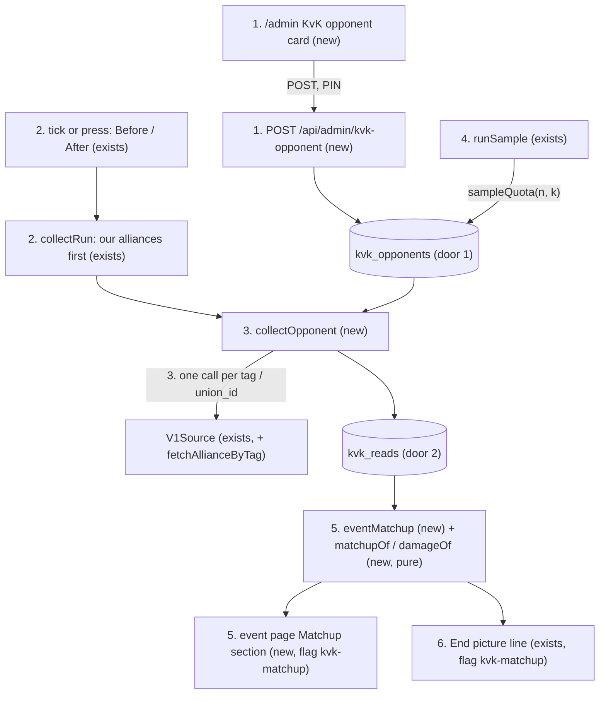
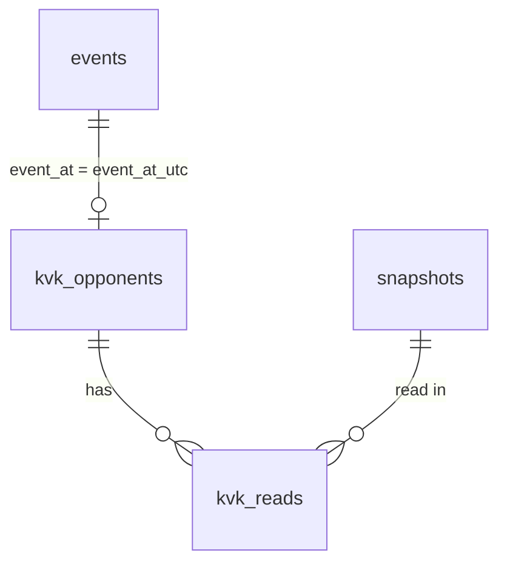

# KvK matchup, slice 1: the opponent on /admin, its Start and End reads, the matchup card, the damage report and the Discord line (#306)

**Approved**: 2026-11-22 - owner, issue #306, 2026-11-19: "wanted, with these additions. … **Quota:** about 15 enemy alliances × 2 (Start and End), about 30 calls on our key, inside the KvK reserve. … **Privacy:** alliance-level aggregates only, and never enemy member names."; and user: "go with what you and the personas recommend" (owner, 2026-11-21, standing approval in CONTRIBUTING.md § Working rules); product-strategy verdict: [Validation (b)](#validation); adversarial verdict: [Validation (d)](#validation). The one-way doors below (two additive tables, the quota spend, another server's stored members) are the ones the owner's 2026-11-19 comment approves; they are listed for the owner in the handoff.

Size: L (more than one PR: slice 1 here; the public suggestion form and ranks-board discovery are later slices). Part of #306; folds in the "KvK opponent and its result" part of #286 (closed into #306 on 2026-11-22).

## Problem

The tracker measures only our own server in a KvK. On 2026-11-14 we lost the city to server 322; on 2026-11-16 a hand test (owner-approved quota) showed 322's top 14 had less might than ours (44.9 B vs 51.0 B) but more kills (528 M vs 368 M) and more members with at least 60 M might (124 vs 113). Nobody could see that before the war, and after it nobody can see what we did to them: the event page shows our own might change and kills only. Officers plan the war with a gut feeling, and the owner checks a third-party site by hand to see the enemy's losses.

The upstream API has no server-level listing: the enemy's alliance tags must be supplied by a person (they are visible in the game's KvK ranking). `GET /v1/alliances/{server}/{tag}?fresh=1` worked for 14 of server 322's top 15 tags; one tag (`TKR1`) answered 404. The plan (§2) notes that a tag lookup can answer 409, because tags are not unique.

What is different when slice 1 ships: the owner types the next opponent's server and up to 15 tags on /admin. At the Start, the tracker reads those alliances once each, and at the End once more, by the `union_id` the Start found. The event page then shows a matchup card (our top n against theirs, n = the alliances both sides have a fresh Start reading for), and after the End a damage report: each side's might change and kills gained, per side and per alliance, over the members in both readings. The Discord End picture gets one line. The owner records the result (won or lost) on /admin; it is not shown publicly.

## Shape

This reuses the collector's phase run (claim, quota check, `attemptHook` call counting, the run deadline and abort signal, run_logs), the `/v1` adapter's request path, the event page's shared public read (D143) and the End picture (D58). Rules that change an outcome run in pure functions (`lib/kvk.ts`) and in `lib/collector-opponent.ts` / `lib/queries/kvk.ts`, which Vitest reaches on PGlite and the memory repo.

1. The owner saves the opponent on /admin -> `POST /api/admin/kvk-opponent` (new) - PIN auth, zod, writes `kvk_opponents` (door 1) keyed by the scheduled event's `event_at`; invalidates the public cache
2. The tick or a press runs a Before or an After -> `runSnapshot` / `collectRun` (exists, `lib/collector.ts`) - our alliances first, unchanged, under their own quota check (`requiredQuota(n)`)
3. `collectOpponent` (new, `lib/collector-opponent.ts`) - after our reads have settled (after the run's deadline race, before `finish`), in the time left of the run's 100 s: when the event is not a rehearsal and not manual and an opponent row has `event_at = events.event_at_utc`, reads the opponent's alliances, one attempt each (no retry), on `LAP_API_KEY` only, each call counted into the run's `calls` but with its own hook, deadline and abort signal, so a cap, a 429 or its deadline never sets our run's `capped`, `abort` or `deadlineHit`; only when the run's estimated remaining (`lowest.remaining − (calls − lowest.calls)`) is at least `requiredQuota(n + k)`, k = the reads still due this phase. Start: each saved tag without a Start row while the opponent has fewer than 15 Start rows, by `GET /v1/alliances/{server}/{tag}?fresh=1` (new `V1Source.fetchAllianceByTag`), only before the war (`events.event_at_utc`). End: each usable Start row (fresh, no error, read before the war) whose tag is still saved and that has no End row, by `GET /v1/alliances/{union_id}?fresh=1`. Persists `kvk_reads` (door 2): totals and the members as uid/might/kills arrays, no names, no `raw_json`
4. A sample (exists, `runSample`) - its quota rule counts the opponent's End reads still due: `sampleQuota(n, k)`; the reserves outside the run (`eventReserve` for the squads read, lookups and the Raid Shield morning check, and the event term of `dailyReadQuota`) count the worst case, `MAX_OPPONENT_TAGS` (15) more alliances in `requiredQuota`
5. The event page (exists, `getEventPage`) -> `eventMatchup` (new, `lib/queries/kvk.ts`) - the opponent's rows and our Start/End rows (member sums in SQL) -> `matchupOf` / `damageOf` (new, pure, `lib/kvk.ts`) -> the `Matchup` section (new, `app/_ui/Matchup.tsx`) while the `kvk-matchup` flag is on (D91)
6. The End's public Discord message (exists, `lib/run-notify.ts`) -> one line in the End picture (exists, `lib/event-image.tsx`) while the flag is on
7. out: the /admin card shows each tag's Start and End outcome (read, not found, not unique, wrong server, failed) and the result picker

**Changes underneath**

| Front       | What changes                                                                                                                                                                                                                                                                                                                                                                                                               |
| ----------- | -------------------------------------------------------------------------------------------------------------------------------------------------------------------------------------------------------------------------------------------------------------------------------------------------------------------------------------------------------------------------------------------------------------------------- |
| domain      | "opponent" (new glossary term): the server our server meets in a scheduled event's KvK, with up to 15 alliance tags the owner types; "matchup" and "damage report" (new terms)                                                                                                                                                                                                                                             |
| stored data | nothing to migrate: two new tables, empty until the owner saves an opponent                                                                                                                                                                                                                                                                                                                                                |
| quota       | at most 15 Start calls and 15 End calls per KvK, ever (rows are never deleted, so a re-run, a forced re-run or edited tags cannot add more), owner-approved 2026-11-19. `sampleQuota` gains the opponent's End reads; `eventReserve` and the daily read's event reserve gain 30 on the KvK's quota day. Our own reads' quota check (`requiredQuota(n)`) is unchanged, so an opponent can never make our Start or End abort |
| readers     | the event page (new section, flagged), the End picture (one line, flagged), /admin (new card). Every other reader of `alliance_snapshots` is untouched: opponent rows live in their own table, so the ledger, alliance pages, history, movers, turnout, compare, the API and samples never see them                                                                                                                        |

New: `kvk_opponents`, `kvk_reads`. One-way constraints: `kvk_opponents.event_at` unique (door 1); `kvk_reads (opponent_id, phase, tag)` unique (door 2).

## Surface

| Route                          | In                                                                                 | Out                                | Status                                                                                                                                                                                                                                                                                                                                                                                             | Who                                                                                                 |
| ------------------------------ | ---------------------------------------------------------------------------------- | ---------------------------------- | -------------------------------------------------------------------------------------------------------------------------------------------------------------------------------------------------------------------------------------------------------------------------------------------------------------------------------------------------------------------------------------------------- | --------------------------------------------------------------------------------------------------- |
| `POST /api/admin/kvk-opponent` | `{event_at, server, tags}` or `{event_at, result}` (`won`, `lost` or null), strict | `{event_at, server, tags, result}` | 200; 400 `bad_request`; 404 `not_a_kvk` (not one of the scheduled Saturdays /admin offers); 409 `snapshot_running` (the event's Before or After is running); 409 `opponent_read` (server changed after its Start was read: a conditional update `where not exists (select 1 from kvk_reads …)`); 409 `war_started` (tags or server changed at or after `event_at`, the war time from the schedule) | PIN (`x-edit-pin`, `authorize(..., {pin: true, cron: false})`); others 401 / 429 as every PIN route |

## Landing

| One-way door                             | Literal shape                                                                                                                                                                                                                                                                                                                                                                                                               | Alternative rejected                                                                                                                                                                                                         |
| ---------------------------------------- | --------------------------------------------------------------------------------------------------------------------------------------------------------------------------------------------------------------------------------------------------------------------------------------------------------------------------------------------------------------------------------------------------------------------------- | ---------------------------------------------------------------------------------------------------------------------------------------------------------------------------------------------------------------------------- |
| 1. `kvk_opponents` table (migration)     | `id serial pk, event_at timestamptz not null unique, server integer not null check (server between 1 and 9999), tags text[] not null default '{}' check (cardinality(tags) <= 15), result text check (result in ('won','lost')), created_at, updated_at`                                                                                                                                                                    | a column on `events`: the scheduled event's row exists only a day ahead, and the owner sets the opponent earlier in the week                                                                                                 |
| 2. `kvk_reads` table (migration)         | `id serial pk, opponent_id → kvk_opponents, snapshot_id → snapshots, phase ('before' or 'after'), tag text not null, union_id bigint, sid integer, name text, member_count, total_power, total_kills, member_uids bigint[], member_power bigint[], member_kills bigint[], source_updated_at, cached, is_fresh not null, error text, read_at not null`; unique `(opponent_id, phase, tag)`. No `member_names`, no `raw_json` | rows in `alliance_snapshots` with a server column: about 37 readers of a phase would each need a filter, and one missed filter puts the enemy in our ledger; and `raw_json` would store another server's blocked roster keys |
| 3. Quota spend                           | at most one attempt per opponent alliance per phase (`maxRetries: 0`), at most 15 rows per phase per opponent, every sent call leaves a row (so it is never spent twice), only when the estimated remaining `>= requiredQuota(n + k)`; `sampleQuota(n, k) = requiredQuota(n + k) + 1 + 4n`; `eventReserve` uses `requiredQuota(alliances + 15)`                                                                             | the phase's 3 retries: up to 120 calls a KvK, four times the approval                                                                                                                                                        |
| 4. A new `/v1` path                      | `GET /v1/alliances/{server}/{encodeURIComponent(tag)}?fresh=1`, the documented by-tag lookup (plan §2), Start only; the End reads by `union_id`                                                                                                                                                                                                                                                                             | the ranks board of the other server (`internal.ts` `fetchRanks(server)`): not recorded in any decision, left out by the triage                                                                                               |
| 6. Another server's members stored       | `kvk_reads.member_uids/member_power/member_kills` of the opponent's alliances, kept like every roster (D2), never returned by a query or logged; no names, no `raw_json`                                                                                                                                                                                                                                                    | aggregates only: the Start-to-End change over the members in both readings needs both readings' uids; storing names would add nothing                                                                                        |
| 5. A new public section and Discord line | behind the new PostHog flag `kvk-matchup` (`lib/flags.ts`), off until the owner turns it on                                                                                                                                                                                                                                                                                                                                 | always on: D91 hides public features until their flag is on                                                                                                                                                                  |

- Nothing else in this change is hard to reverse

## Criteria

### S1: the owner sets the opponent, the Start and End read it, the event page and the End picture show the matchup (P1)

The outcome: on 2026-11-28 the event page shows both servers at the Start and from Start to End.

**Acceptance Criteria**

**Admin**

1. WHEN the owner opens /admin THEN the system SHALL show a "KvK opponent" card with a picker of the next scheduled event and the 4 before it (by date), and for the picked one a server field and a tags field (prefilled when saved)
2. WHEN the owner saves server `326` and tags `AAA BBB, CCC` for the next scheduled event THEN the system SHALL store server 326 and tags `["AAA","BBB","CCC"]` (split on spaces and commas, trimmed, duplicates dropped, order kept) and the card SHALL show them after a reload
3. IF the tags field holds more than 15 tags, a tag longer than 12 code points (after NFC), a tag with whitespace, `/ ? # % \\` or a control character, a tag made only of dots, a server outside 1–9999, or our own server (325) THEN the route SHALL answer 400 `bad_request` and store nothing; duplicates are dropped case-sensitively (tags are case-sensitive, plan §2)
   - 15 tags → 200; 16 → 400; `..` → 400; `A/B` → 400; `Берс` → 200; server 325 → 400; `abc ABC` → both kept
4. IF the owner changes the server after the event's Start read at least one of its tags THEN the route SHALL answer 409 `opponent_read`
5. IF the owner changes the server or the tags at or after the event's war time (`event_at_utc`) THEN the route SHALL answer 409 `war_started`; the result SHALL still save
6. WHEN the owner picks "Won" or "Lost" (or "Not set") for an event THEN the system SHALL store it and show it on the card after a reload; the result SHALL appear on no public page, route or Discord message
   6a. The card SHALL say "Copy the tags from the game's KvK ranking. Each costs one call at the Start and one at the End."
7. WHEN the event's Start or End has read the opponent THEN the card SHALL list each tag with its outcome per phase: read (with the alliance's name), not found, not unique, wrong server, stale, or failed
8. IF the request has no valid PIN THEN the route SHALL answer 401 and store nothing
   8a. IF the event's Before or After is running THEN a change of server or tags SHALL answer 409 `snapshot_running`

**Collector**

9. WHEN the Start of a scheduled, non-test event runs and that event has an opponent with k tags THEN the run SHALL, after our alliances, make exactly one `GET /v1/alliances/{server}/{tag}?fresh=1` call per tag without a Start row, and store one `kvk_reads` row per tag
   - 3 tags, all 200 → 3 calls, 3 data rows; a re-run → 0 calls
10. WHEN the End runs for such an event THEN the run SHALL make exactly one `GET /v1/alliances/{union_id}?fresh=1` call per Start data row without an End row, and SHALL read no tag that has no Start data row
11. IF an opponent call fails (404, 409, 5xx, timeout, schema) THEN the run SHALL store an error row for that tag with no retry, and continue with the other tags
    - 404 → `not found`; 409 → `not unique`; 502 → one call, error row `http 502`
12. IF the answer's `sid` differs from the opponent's server, or an End answer's `union_id` differs from the Start's THEN the row SHALL be an error row (`wrong server` / `wrong alliance (id)`) with no data
13. IF the clock is at or after the event's `event_at_utc` before an opponent Start call (checked before each call, not once per run) THEN the run SHALL not make it
14. IF the run's estimated remaining (`lowest.remaining − (calls − lowest.calls)`) is below `requiredQuota(n + k)` when the opponent's turn comes THEN the run SHALL make no opponent call and log `opponent.quota`; the opponent stays unread for that phase unless a later run of the phase happens
    14a. IF fewer than 5 s of the run's 100 s are left before an opponent call THEN the run SHALL not make it; an opponent call SHALL time out within the time left
15. The opponent's reads SHALL never change the snapshot's status or error: a run whose own alliances are all fresh is `complete` even when every opponent read failed, hit the call cap, a 429 or the time limit
16. The opponent's calls SHALL count toward `callsUsed` and `MAX_UPSTREAM_CALLS`; at the cap no further opponent call is sent; a 429 on an opponent call SHALL store that tag's error row and stop the other opponent calls
    16a. Every opponent call that was sent SHALL leave a row (data or error), so no later run sends it again
17. WHEN a sample's quota check runs for an event with an opponent THEN its minimum SHALL be `sampleQuota(n, k)` with k the opponent's Start data rows without an End row
    - n = 20, k = 15: 2 × (20 + 15 + 5) + 1 + 80 = 161; k = 0: 131 (unchanged)
18. A manual round or a rehearsal SHALL make no opponent call, and an opponent applies only to the event whose `event_at_utc` equals its `event_at`
19. An opponent row SHALL store no member name and no `raw_json`
    19a. Collecting SHALL never read the `kvk-matchup` flag: the reads are stored while the flag is off
    19b. IF an End answer shares less than `SAME_ROSTER_MIN` (20 %) of its members with that alliance's Start `member_uids` THEN the row SHALL be an error row `wrong alliance (roster)`
    19c. IF a Start answer's `union_id` is already stored for another tag of the same opponent THEN the row SHALL be an error row `duplicate` (one alliance counts once)
    19d. An opponent row is fresh when its `source_updated_at` is within 20 minutes of its `read_at`
    19e. WHEN a Start is re-run before the war THEN the run SHALL read only saved tags with no Start row, while the opponent has fewer than 15 Start rows; error rows are kept, never read again (unlike D62 for ours), so a corrected tag is read and a failed one costs nothing more
    19f. An End SHALL read each `union_id` once, and only the usable Start rows whose tag is still saved

**Event page (flag `kvk-matchup` on)**

20. WHEN the event has an opponent with at least one usable Start row THEN the event page SHALL show a section "Matchup at the Start" headed "Server 325 vs server {server} · top {n} alliances each" with each side's reading time ("Start 10:03 server time"); a row is usable when it has no error, is fresh, and was read before the war (`read_at` / our `source_updated_at` < `event_at_utc`)
    - ours 20 usable, theirs 14 → n = 14 on both sides; our side is our top 14 by Start might
21. The opponent side SHALL say how many tags were read: "{read} of {k} tags read" and, when any failed, "· {f} not read"
22. Per side the section SHALL show: might at Start, lifetime kills at Start, kills per 1B might (Σkills / Σmight over the same n alliances, "higher: more kills for its size"), and "Members 60M+: {h} of {m}" (members of the n alliances with a non-null Start might of at least 60M, of the side's members)
23. WHEN the viewer opens "Alliance by alliance" THEN the system SHALL show each side's n alliances as its own list ranked by Start might (tag, name, might, kills), with no "vs" pairing
24. WHILE the event has no End row THEN the section SHALL say "Start to End appears after the End ({time} server time)."
25. WHEN the End has run THEN the section SHALL show "Start to End": per side, the might change and the kills gained over the same n alliances chosen at the Start (never re-ranked), summed over the members in both readings ("over {m} members in both readings"), and per alliance the same two numbers
    - a member with a null might (or kills) in either reading is left out of that figure; a fall in kills counts as 0 (as D83 `stayedGains`)
26. IF an alliance's End row is not usable THEN Start to End SHALL show no change for it ("No change: a reading is stale or missing"), leave it out of its side's sums, and the side's headline SHALL say "{c} of {n} alliances counted"
27. Start to End SHALL say "Kills count every kill, whoever the target." and "Only members in the alliance at Start and End are counted."
28. Both sides SHALL use the same neutral colours; the copy SHALL use no win, loss or blame words
29. WHILE the `kvk-matchup` flag is off, or the event has no opponent or no usable opponent Start row, the event page SHALL show no matchup section
30. The section SHALL show alliance tags, names and alliance-level numbers only: no member name, uid or per-member number of either side
31. The section SHALL read at 360 px with no horizontal scroll: each side's figures in cards below 640 px, touch targets of 44 px, compact numbers (D68: no chart library)

**Discord**

32. WHEN the End's public picture is drawn for an event whose Start to End counts at least one alliance on each side, and the flag is on THEN the picture SHALL carry one block: "vs server {server} · {a} v {b} alliances", then "Might {ours} us · {theirs} them" and "Kills +{ours} us · +{theirs} them"; with 0 counted on either side, no block

**Decision and docs**

33. The change SHALL add decision D152 (dated 2026-11-22) and glossary entries for opponent, matchup and damage report

## Out of scope

| Excluded                                                            | Why                                                                                                                                                                                                                                            |
| ------------------------------------------------------------------- | ---------------------------------------------------------------------------------------------------------------------------------------------------------------------------------------------------------------------------------------------- |
| The public "suggest the next opponent" form and its /admin list     | triage: later slice                                                                                                                                                                                                                            |
| Discovering the enemy's tags through the other server's ranks board | triage: later slice; needs its own decision on `internal.ts`                                                                                                                                                                                   |
| A day-before tag check                                              | it spends about 15 more calls a KvK, past the owner's approval; the /admin card shows each tag's Start outcome instead                                                                                                                         |
| A "read the opponent now" button                                    | no approval for presses beyond the Start and End. A Start re-run before the war reads tags that have no row; a complete Start re-runs only with force, which also reads our alliances again, so a failed tag usually stays unread for that KvK |
| Samples of the opponent                                             | issue: "Samples stay ours only"                                                                                                                                                                                                                |
| The result on public pages or in Discord                            | #286's closing comment: public KvK results need their own decision                                                                                                                                                                             |
| Enemy member names or per-member numbers                            | owner, 2026-11-19: alliance-level aggregates only                                                                                                                                                                                              |
| Per-alliance `*` member-change mark (D69) on Start to End rows      | the side line says how many members are counted; the mark is a follow-up                                                                                                                                                                       |

## Assumptions

| Assumption                        | Chosen default                                                                        | Rationale                                                                                                                              | Confirmed? |
| --------------------------------- | ------------------------------------------------------------------------------------- | -------------------------------------------------------------------------------------------------------------------------------------- | ---------- |
| Which events can have an opponent | the scheduled events (Saturday), the next one and the 4 before it                     | KvK is the scheduled Saturday event (glossary, Raid Shield check); past ones only to record the opponent and result                    | n          |
| Heavy-hitter threshold            | 60 M might, fixed                                                                     | the issue's table                                                                                                                      | n          |
| Our side's set                    | our top n alliances by Start might among our usable Start rows                        | rank-paired like the issue's table                                                                                                     | n          |
| Might change, not "might lost"    | signed change, a loss shown with "−"                                                  | a side can gain might; a signed number cannot mislead                                                                                  | n          |
| UI names                          | "Matchup at the Start" and "Start to End" (code and glossary: matchup, damage report) | officers and product: "damage report" reads as damage we caused                                                                        | n          |
| Discord block                     | a heading and two figure lines, not one line                                          | the owner asked for one line; officers and data honesty ask for kills and the counts beside might, which do not fit one line at 360 px | n          |
| Result picker kept in slice 1     | next event and the 4 before it                                                        | product asked to defer it; the task prompt folds #286's opponent-and-result recording into this slice                                  | n          |
| Result values                     | won, lost, not set                                                                    | the issue names a loss; a draw has not been seen                                                                                       | n          |

**Open questions:** none - all resolved or logged above.

## Differences from the source

None - no capture.

## Sources

- Issue #306 and its comments (owner 2026-11-19: "wanted, with these additions"; adversarial review 2026-11-16) - binding
- Issue #286 closing comment (orchestrator 2026-11-22) - binding: the opponent and result recording, admin-entered, no public result
- Orchestrator triage in the task prompt (2026-11-22) - binding: slice 1 scope and exclusions

## Validation

Four reviewers on invented data, 2026-11-22. Each answered "approve with changes"; the adopted changes are in the criteria above.

- **(a) Six officers (UK, PH, FR, US, UA, CH; 20s–50s): approve with changes.** Adopted: coverage per side ("{read} of {k} tags read"), "Start to End" instead of "damage report", kills in the Discord block, reading times, short labels ("Kills per 1B might", "Members 60M+", "Only members in the alliance at Start and End are counted"), a line before the End, two ranked lists instead of "#1 vs #1" pairs, neutral colours for both sides, the counted count in the side's headline.
- **(b) Product strategy: approve with changes.** Adopted: the re-run limit said plainly (Out of scope), collecting never reads the flag (19a), the owner's release steps in the handoff, neutral copy, an /admin hint, no rank pairing. Not adopted: deferring the result picker (the task prompt folds it into this slice).
- **(c) Data honesty: approve with changes.** Adopted: the End roster check (19b), the Discord counts, the set fixed at the Start, readings before the war only (13, 20), "{n} of {k} tags read", kills at Start vs kills gained and Σ/Σ for the ratio, nulls left out (25), one row per alliance (19c), the 60M+ base, the members counted, freshness against `read_at` (19d). Not adopted: the per-alliance `*` mark (Out of scope).
- **(d) Adversarial (quota, privacy, sources): approve with changes.** Adopted: the hard 15 + 15 cap with rows never deleted (19e, 19f, door 3), the opponent reads outside our run's deadline race with their own hook so our status cannot change (15, 16), the reserves outside the run (`eventReserve`, the daily read's event term), the estimated remaining (14), `409 snapshot_running` and the conditional update (8a, door), tag validation and our own server refused (3), a row for every sent call (16a), the scheduled-event gate (18), usable Start rows only at the End (19f), arrays only and the site key (door 6). No use of `lib/sources/internal.ts` and no game-client read. Deviation for the handoff: the 2026-11-16 day-before tag check is not built (it costs about 15 more calls).
