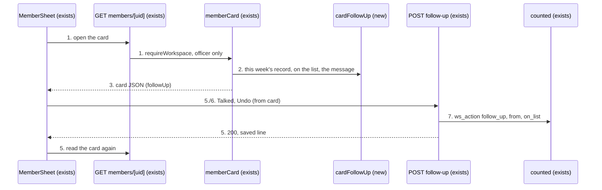
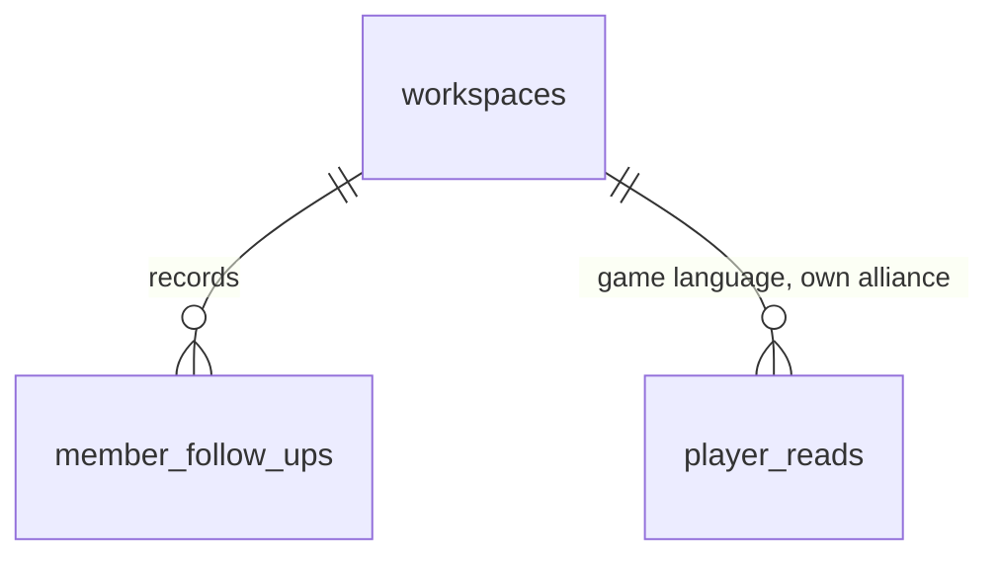

# Member card: the Follow-up action and a message to send; the Raid Shield reading waits for the owner (#516)

**Approved**: 2026-11-22 - user: "go with what you and the personas recommend" (owner, 2026-11-21, standing approval in CONTRIBUTING.md § Working rules); product-strategy verdict: [Validation (c)](#c-persona-panel-and-product-strategy-approve-with-changes); adversarial verdict: [Validation (d)](#d-adversarial-privacy-d71d137d142-d75-approve-with-changes). Covers slice 1 only: it has no one-way door. Slice 2 has one and waits for the owner's reply (coordinator, 2026-11-22: "Do not build: the shield line").

Size: M (two features on the card; slice 2 changes a decision's privacy rule). Part of #516: the triage kept the Follow-up action with the ready message and the Shield line. **Slice 1 is built in this PR; slice 2 is not.** Left out: the History tab (waits for the owner, D75), the short squad's empty slots and the `daily_rosters` index (done in the triage), the header avatar and the tests the review noted (other items of #516).

## Problem

An officer who opens a member's card from Members today cannot answer two questions the card is the natural place for:

- **"Did this member get a hello this week?"** The card's Overview shows the last 7 days and nothing about follow-ups. A "Talked" record of this week is only in the History tab, among every older note. To say hello and record it, the officer leaves the card, opens Follow-up, finds the member (there only when on the week's list) and taps "Talked to them" or copies the panel's ready message. D136 left this out until #460 shipped ("Not built here … the Overview's #460 action and 'Copy a hello'"); #460 (D140) shipped and `lib/private/ready-message.ts` was made shared for this (#523).
- **"Does this member have a shield up?"** The card shows no shield data. On raid night the officer leaves the card for Raid prep and finds the member's tile (slice 2).

Evidence: the issue (#516, owner, 2026-11-20) and D136. The first-glance test before the change (Validation (a)): Q1 had 0 of 5 right, 2 of them confident wrong answers (a MUST). No PostHog numbers were available to this build (no access); the queries are in the Analytics plan.

What is different when slice 1 ships: for a member on the week's Follow-up list, or one followed up this week, the card's Overview says what was noted this week ("This week: Talked Thu, Nov 19 · Officer LNK", the note on its own line, or "This week: no follow-up note yet."); "Talked to them" records it in one tap with Undo; "Message to send ▾" opens the same ready message as Follow-up, in the member's language, with its two copies.

## Shape

Reuses Follow-up's route (`POST /api/w/[slug]/follow-up`), its ready-message builder and its message block (`Message` in `FollowUpPanelParts.tsx`); no new route, table or column. The rules that decide what the card shows (which record is this week's, whether the member is on the list, which message) run in `lib/private` functions the PGlite tests reach.

1. officer opens a card -> `GET /api/w/[slug]/members/[uid]` (exists) -> `requireWorkspace` (exists): officers of this workspace only; a member's session gets 401 (`refuse("member")`, INVARIANT `workspace.member-board-only`)
2. `memberCard` (exists) - as today, plus, only while the `follow_up` feature is on, `cardFollowUp` (new, `lib/private`): the newest live follow-up record since Monday 00:00 ST (`followUpsOf`, `weekStart`, exist); whether the member is on the week's list now (`worklist`, exists, with this week's records); the ready message from the member's work item with no record counted, so it stays the same after a Talked (`worklist` and the coins tip, exist; the tip's helper exported from `follow-up.ts`), in the language from recorded languages then the game's (`gameLanguages`, exists, one uid); the texts in EN, PT-BR and FR (`readyTexts`, new in `ready-message.ts`, also used by the Follow-up page, so both build the message in one function); the block's words in the card JSON, as `link.words` is, since the Members page has no `FollowUpWords`
3. out: the card JSON gains `followUp` (null while the feature is off): the week line (null for a member neither on the list nor followed up this week), the note, `onList`, the message and the words
4. `MemberCard` (exists, `MemberCards.tsx`) - Overview, after the reasons, in `ph-no-capture`: the week line and note, "Talked to them" (44 px `chip`), "Message to send ▾" (44 px `chip`, `aria-expanded`) opening `Message` (exists; takes the message and its words instead of a Follow-up row)
5. "Talked to them" -> `POST /api/w/[slug]/follow-up` (exists; record and undo gain optional `from: "card"` and `onList`) -> "Saved. Off the Follow-up list until Monday." while the member was on the list, else "Saved.", with Undo (44 px); Talked off while the line shows -> the card is read again by a local re-read (`MemberSheet`'s attempt, as `useCard`'s `reload`), so the week line shows the new record
6. Undo -> the same route, `action` `undo`, `target` the request id of that tap, `from` `card` -> "Undone."; a 409 says "Could not undo: the notes changed since." and reads the card again
7. `counted` (exists, `desk-action.ts`; gains optional properties) sends `ws_action` `follow_up` / `record` or `undo` with `from` (`card`, or `follow_up` when the body has none) and `on_list` (the body's, true when none); a copy in `Message` sends the browser event `ws_message_copied` with `where` (`card`, `follow_up`) and `to` (`game`, `discord`)

**Changes underneath**

| Front       | What changes                                                                                                                                                                                                                                                                                                               |
| ----------- | -------------------------------------------------------------------------------------------------------------------------------------------------------------------------------------------------------------------------------------------------------------------------------------------------------------------------- |
| domain      | `ws_action` `follow_up` gains `from` and `on_list`; before this release every record came from Follow-up (read a missing `from` as `follow_up`). New browser event `ws_message_copied`. D136 gets a dated amendment (the card's follow-up block)                                                                           |
| stored data | nothing to migrate; a Talked from the card is a `member_follow_ups` row like Follow-up's                                                                                                                                                                                                                                   |
| readers     | The card (Members; Follow-up's panel reads the same JSON and ignores the new field), Follow-up's list (a member talked to from the card leaves the week's list, as with any record), the card's History tab (the record shows there), Home's activity (lists the card's Talked as it lists any follow-up, "… talked to …") |

New: nothing - one more writer path to `member_follow_ups` (the same route).

## Surface

| Route                             | In                                                                                                                   | Out                     | Status                                          | Who                                                                      |
| --------------------------------- | -------------------------------------------------------------------------------------------------------------------- | ----------------------- | ----------------------------------------------- | ------------------------------------------------------------------------ |
| `GET /api/w/[slug]/members/[uid]` | unchanged                                                                                                            | `card` gains `followUp` | 200; 401 `signed_out`; 404 `not_member`         | officers of the workspace; a member's session 401, another workspace 404 |
| `POST /api/w/[slug]/follow-up`    | record and undo each add optional `from` (`"card"`) and `onList` (boolean); any other value or key 400 `bad_request` | unchanged               | unchanged: 200; 400; 401; 403 `turned_off`; 409 | unchanged: officers of the workspace                                     |

## Landing

None for slice 1 - no data deleted, no schema change, no change to who sees what (the card shows officers the follow-up records and ready message they already see on Follow-up and in History), no quota, no dependency. The analytics properties are additive and removable.

Slice 2's one-way door is listed under S2 and is not built.

## Criteria

### S1: Follow-up on the card (P1) - built in this PR

**Acceptance Criteria**

1. WHERE the `follow_up` feature is on, WHEN an officer opens the card of a member who has a record still counting since Monday 00:00 ST THEN the Overview SHALL show, after the reasons, "This week: {action} {date} · {officer}" ("This week: Talked Thu, Nov 19 · Officer LNK") and the note on its own line under it
   - a Talked on Thursday this week → that line; one at Sunday 23:59 ST of last week only → not this week's; one at Monday 00:00 ST → this week's; a Talked then its Undo → not counted
2. WHEN the member has no record this week and is on the week's Follow-up list THEN the Overview SHALL show "This week: no follow-up note yet."; WHEN the member has neither THEN no week line SHALL show (D75: nobody off the list is presented as owed a hello)
3. WHEN the officer taps "Talked to them" on the card THEN the system SHALL record `talked` for that member through Follow-up's route (a request id per tap), show "Saved. Off the Follow-up list until Monday." when the member was on the list and "Saved." otherwise, with a 44 px Undo, keep Talked off while that line shows, and read the card again so the week line names the new record
4. WHEN the officer taps Undo THEN that tap's record SHALL be withdrawn (Follow-up's undo with its request id), the card SHALL say "Undone." and read the card again; IF the undo is refused because the member's notes changed since (409) THEN it SHALL say "Could not undo: the notes changed since." and read the card again
5. WHEN the officer taps "Message to send ▾" THEN the card SHALL show, under it, Follow-up's message block: EN · PT · FR chips with the member's language pressed, the line naming the language, the text, "Copy for game mail" and "Copy for Discord"; the button SHALL carry `aria-expanded`, and a second tap hides the block
6. The card's message SHALL be built from the member's work item as Follow-up builds it, with this week's records not counted, so it is Follow-up's message for a member on the list and stays the same after a Talked; a member with no reason, tip or fact to ask gets the plain hello
   - quiet for 3 days, game language `pt` → the PT text with the quiet line, PT pressed; recorded languages `fr` over game `en` → FR; nothing known → the officer's language
7. WHERE the `follow_up` feature is off THEN the card SHALL show none of S1
8. IF the Talked request fails THEN the card SHALL say "Could not save. Try again." (Follow-up's words); a signed-out answer SHALL show the signed-out line (D99)
9. The card's follow-up fields SHALL come only from the workspace's own records and its own alliance's reads: another workspace's record or game language for the same player SHALL never show (issue 471 suite)
10. WHEN a Talked or Undo goes through THEN `ws_action` `follow_up` SHALL carry `from` = `card` from the card and `follow_up` otherwise, and `on_list` (the card's value; true from Follow-up); WHEN a copy of the message succeeds THEN the browser SHALL send `ws_message_copied` with `where` (`card`, `follow_up`) and `to` (`game`, `discord`); the tracking plan SHALL list them, with a dated "Changed" line
11. The week line and its note SHALL be inside `ph-no-capture`; the desk dictionary SHALL hold every new string in EN, PT-BR and FR; every new control SHALL be 44 px or taller
12. The card SHALL be checked at 360 × 780 in the worst case (two reason lines and a note): whether the week line and both buttons are in the first viewport is recorded in the handoff

### S2: The Raid Shield reading on the card (P1) - waits for the owner, not built

What the officer would see: in the card's header, the member's newest Raid Shield state, "Raid Shield · Morning check: no shield seen (map from 07:15 ST)", the older check muted under it.

**The one-way door.** D137's Privacy paragraph says the shield state is attack-relevant and "is read only by `lib/private/raid-prep.ts` … and by the tick". Showing it on the card adds a second reader and puts it in another route's JSON. The audience does not change (officers of the same workspace, own alliance, `requireWorkspace`, no-store), but the decision's privacy rule does: a one-way door under CONTRIBUTING ("a change to privacy or to what private fields reach"). The owner's reply is needed.

**The contradiction with D136.** The owner's rule of 2026-11-20 in D136: "squads and shields always show when the tracker saw them, on the server's clock and the viewer's". The panel's version shows the lines only from the night check until KvK starts (Saturday 12:00 ST), in server time only (Raid prep's tile rule, D137 2026-11-21). The owner chooses.

**Decisions it needs (as the panel and coordinator settled them, for the owner to confirm):**

- The officers' Shield mark leads when one exists (D137, 2026-11-21: "An officer's mark always wins"); the tracker's newest check otherwise, the older muted; a "Raid Shield" lead in EN, PT, FR.
- An away member (the roll call's away rule) gets no shield line, as Raid prep's away group and #624/#629.
- The lines are inside `ph-no-capture`.
- Never x, y, `online`, `last_online_at`, `avatar_url` or `shield_type`; the card added to the issue 471 isolation suite.

D136 and D137 are not edited for the shield in this PR.

## Out of scope

| Excluded                                                                                                                                                    | Why                                                                                                                   |
| ----------------------------------------------------------------------------------------------------------------------------------------------------------- | --------------------------------------------------------------------------------------------------------------------- |
| S2, the shield line                                                                                                                                         | One-way door and a contradiction with D136: waits for the owner (coordinator, 2026-11-22)                             |
| The History tab (roll call marks, thanks per member)                                                                                                        | Waits for the owner (D75); the triage left it out                                                                     |
| The other three Follow-up answers (On a break, Needs help, All fine) and a note on the card                                                                 | The brief names "mark Talked"; the others need the panel's version handling; "Edit info" already sets away and status |
| A nudge after a copy ("Sent it? Tap Talked to them.")                                                                                                       | Product persona's idea; a follow-up once `ws_message_copied` → Talked is measured                                     |
| The No-data circle beside "Main squad" read as a shield marker (first glance before)                                                                        | Coordinator: a handoff follow-up                                                                                      |
| Follow-up list's Undo 409 wording ("Could not undo: someone added a note since. Read the list again." is right there); `ph-no-capture` on Raid prep's tiles | Existing gaps the adversarial review found; handoff follow-ups                                                        |

## Assumptions

| Assumption                     | Chosen default                                                                                         | Rationale                                                                                                                                                                    | Confirmed?                |
| ------------------------------ | ------------------------------------------------------------------------------------------------------ | ---------------------------------------------------------------------------------------------------------------------------------------------------------------------------- | ------------------------- |
| "The Follow-up action"         | "Talked to them", one tap, with Undo, as on Follow-up's list                                           | The brief says "mark Talked"                                                                                                                                                 | y (brief)                 |
| Which week counts              | The game week, Monday 00:00 ST, as Follow-up's list (`weekStart`)                                      | One week everywhere on the desk                                                                                                                                              | n                         |
| Who gets a week line           | A member with a record this week, or on the week's list; nobody else                                   | Coordinator, 2026-11-22: "the week line only for members on the week's list, with no line for others (D75)"; a member talked to this week left the list and still answers Q1 | y (coordinator)           |
| The message after a Talked     | The work item's message with this week's records not counted, so it does not switch to the plain hello | Coordinator asked to decide; the officer may copy after tapping Talked                                                                                                       | y (coordinator delegated) |
| The words                      | "This week: …", "Message to send ▾", saved lines as in criterion 3                                     | Persona panel MUSTs, applied by the coordinator 2026-11-22                                                                                                                   | y (coordinator)           |
| Who may tap Talked on the card | Any officer, any current member, on the list or not                                                    | The route already takes any current member                                                                                                                                   | n                         |

**Open questions:** S2 - `blocks` S2 only: the owner's reply on the one-way door and the D136 contradiction.

## Validation

### (a) First-glance test, before (360 × 780, `before-card-360-light-fold.png`)

Invented member "Fennick Lowe": a "Talked" record on Thursday this week (only in History); the night check saw a shield, the morning check (Saturday, 07:15 ST map) saw none.

| Persona                            | Q1 "Did this member get a hello this week?"                             | Q2 "Does this member have a shield up?"                                                                  |
| ---------------------------------- | ----------------------------------------------------------------------- | -------------------------------------------------------------------------------------------------------- |
| R5, 40s, native English            | "Nothing here says anyone talked to him, so no hello yet." Wrong (MUST) | "Nothing about shields here. Can't tell." Can't tell                                                     |
| War lead, 30s                      | "Not on this screen. I'd dig in History." Can't tell                    | "No shield shown, so he's not shielded." Right by accident (from an empty card)                          |
| Officer, early 20s, English second | "I don't see. Maybe History?" Can't tell                                | "Shield is not here." Can't tell                                                                         |
| Discord-upkeep officer, 50s        | "No notes on him, so nobody's said hello." Wrong (MUST)                 | "The little empty circle by Main squad means no shield, I think." Right by accident (the No-data circle) |
| Product strategy                   | "The card doesn't say." Can't tell                                      | "Can't tell." Can't tell                                                                                 |

Q1: 0 of 5 right, 2 confident wrong. Q2: no supported answer (slice 2, not built).

### (b) Usage in PostHog

No access in this build. What to query (read-only) is in the Analytics plan below.

### (c) Persona panel and product strategy: approve with changes

All five personas approved with changes. MUSTs for slice 1, applied (coordinator, 2026-11-22): "Copy a hello" → "Message to send ▾" (it did not copy); the week line without stacked colons, the note on its own line. SHOULDs applied: full-ink, semibold state words; "Saved. Off the Follow-up list until Monday." when it applies; `ph-no-capture`; the worst-case fold check; `from` + `on_list`; `ws_message_copied`. Product strategy: count the card apart (`from`, `on_list`: does the card add hellos or move taps, does it reach members the list never shows) and the copies (`ws_message_copied`, as `ws_thanks_shared` counts a copy). Its nudge after a copy is a follow-up. Shield MUSTs (newest first, "Raid Shield" lead) belong to slice 2.

### (d) Adversarial (privacy D71/D137/D142, D75): approve with changes

Checked against the code: a member's session gets 401 (`access.ts` `refuse("member")`); another workspace cannot reach the card (`access.unionId`, 404 outside the alliance); the route is no-store; `privately` drops causes; nothing goes to analytics or AI beyond closed-list words; Follow-up's panel renders none of the new field. One-way door: yes, in the shield part (D137's privacy rule) with a D136 contradiction → slice 2 waits for the owner. Slice 1 SHOULDs applied: `from` on both record and undo (`.strict()`), undo's `target`, `from` defaulting to `follow_up`; the undo 409 says the notes changed and re-reads; a local re-read, not `router.refresh`; the week line only for members on the list (or followed up this week); the message kept after Talked; Talked off while "Saved." shows; labels in the card JSON; the Sunday 23:59 / Monday 00:00 ST test; the issue 471 suite for the follow-up fields.

## Analytics plan

- **Add** `ws_message_copied` (browser): `where` `card` | `follow_up`, `to` `game` | `discord`. Question: are the ready messages used, and from where? Funnel: `ws_message_copied` → `ws_action` `follow_up` / `record` within 1 hour, by `where`.
- **Change** `ws_action` `follow_up`: `from` (`card`, `follow_up`) and `on_list` (boolean) on `record` and `undo`. Question: does the card add hellos or only move taps from the Follow-up tab, and does it reach members Follow-up never lists? Dated "Changed" line: before this release every record came from Follow-up; read a missing `from` as `follow_up`.
- **Remove**: nothing.
- **PostHog side**: the Endpoints `lap_board_reach` and `lap_alliance_usage` count `ws_action` by feature; a new property changes neither. Nothing to change.
- After release (HogQL, read-only): records by source, weekly (`coalesce(properties.from, 'follow_up')`), 4 weeks before and after; undo rate per source; unique users of `$pageview` with `section = 'follow-up'` before and after; `ws_action` `follow_up` by `alliance`; `ws_message_copied` by `where` and `to`; the copy → Talked funnel.

## Differences from the source

None - no binding design source; the issue, D136 and D140 are the evidence.

## Sources

- Issue #516 (owner, 2026-11-20) and the orchestrator's brief, 2026-11-22 - binding - scope
- Coordinator's messages, 2026-11-22 - binding - the panel's MUSTs and SHOULDs, the split into slices
- D136 (owner rules of 2026-11-20, "Not built here", "Shields are not on the card") - binding
- D137 (Privacy, the 2026-11-21 amendments) - binding for slice 2
- D140 (the ready message, the panel) - binding
- D71, D75, D142 - binding
- DESIGN.md (Workspace components, Validation) - binding
