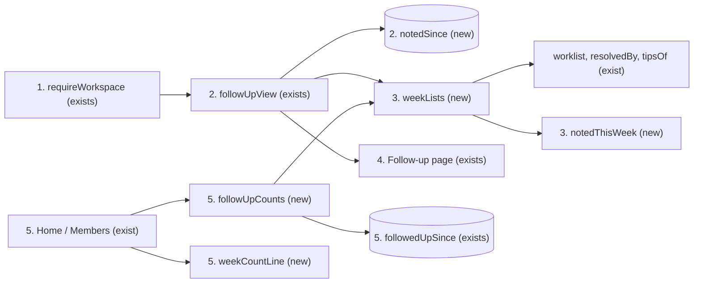
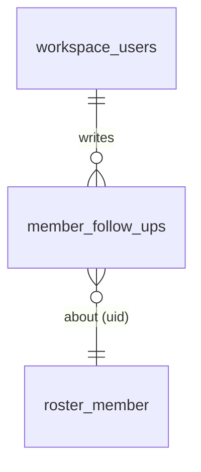
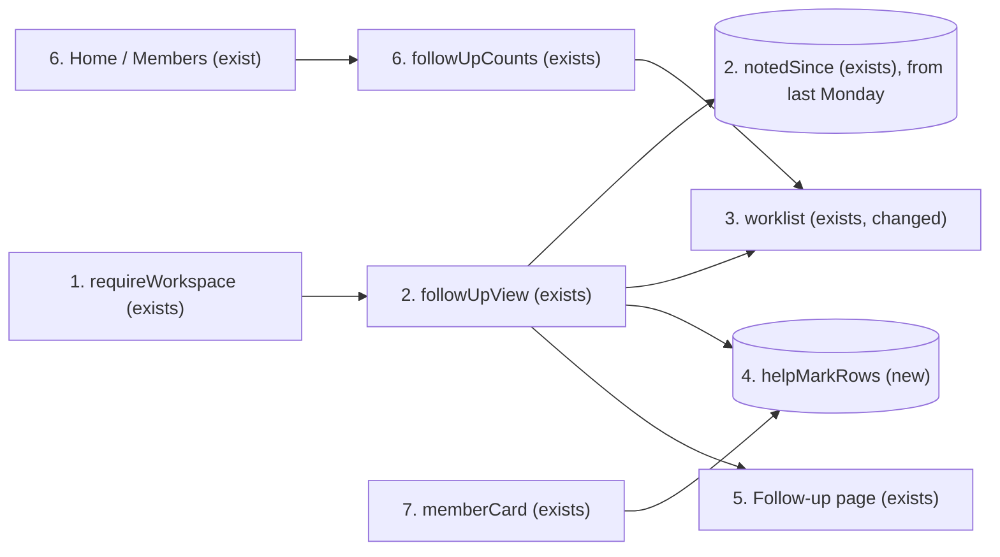

# One worklist: Follow-up answers "who needs me this week, and who was already noted" (#585 batch 3)

**Approved**: 2026-11-22 - user: "go with what you and the personas recommend" (owner, 2026-11-21, standing approval in CONTRIBUTING.md § Working rules); product-strategy verdict: [Plan review](#c-product-strategy-approve-with-changes); adversarial verdict: [Plan review](#d-adversarial-d75-privacy-d71d142-approve-with-changes)

**Approved (S2)**: 2026-11-22 - user: "go with what you and the personas recommend" (owner, 2026-11-21, standing approval in CONTRIBUTING.md § Working rules); product-strategy verdict: [Validation (f)](#f-s2-product-strategy-approve-with-changes); adversarial verdict: [Validation (g)](#g-s2-adversarial-d75-privacy-d71d142-correctness-approve-with-changes)

Size: L (more than one PR across Home, Members, Follow-up, Insights and the member card). This plan covers all slices; slice 1 (S1) was built in PR 640, **slice 2 (S2) is built in `feat/585-needs-help`** (its own size: M, a rule change across Follow-up, Home, Members and the card). Part of #585 (findings F3, F14, F15, F21, F29).

## Problem

Officers have four "who needs me" lists with four rules, and none of them says what the other officers already did this week. Measured on a local production build of `dev` (e46cf153, v5.48.0) with the invented 585 seed (about 100 members, 6 officers), the server clock at Sat 21 Nov 16:30 ST (`585-worklist/before/`):

- **Home** (margin note "Members this week") and **Members** (under the alliance's week line) say "3 people to check in with or help", linked to the Members list. The count is Members' status rule (`needsAWord(whoOf(m))`): it ignores what officers recorded this week, leaves out new members and the coins tip, and counts a member an officer marked "Needs help" with no reason left.
- **Follow-up** says "12 to look at · everyone else is fine" and "Check in · 1": the other two members Home counts were talked to this week, and the "Needs help" member is not on it.
- **Insights** lists 8 names under "Took a heavy hit — maybe offer help", with its own rule and no link to Follow-up.
- **What was done is invisible.** A member an officer talked to this week leaves Follow-up without a trace. The only place that says it is that member's card ("This week: Talked Thu, Nov 19 · Ana", #633). D104's own "Why" was "who to look at, why, and what the officers already did"; the last part was never built on the page. Two officers can message the same member, or each assume the other did.
- **Follow-up's first phone screen** (360 × 780) is five lines of explanation, the week, the count and "3 thefts to follow ↓"; the first row starts at about y 600. The group title "Check in · 1" sits right under "12 to look at" and was read as the answer by 3 of 6 officers (Validation (a)). Each row has three controls (Talked to them, Add a note, Members ›), names do not look tappable, the same "Still to ask: Main squad might, Troops, AD Tech, Time zone, Languages" repeats on six rows, and "Members ›" opens the Members list searched by name instead of the card (F29, F14).
- **The card** says "Needs help" with no reason, author or date (F14). **A "This is me" claim** on Home cannot be checked: the player is not a link, there is no date, and "Reject" reads coldly (F15). **Home's Recent activity** opens with 15 "finished the roll call" lines, the screenshot upload sits inside "To review", and a finished event takes a third of the screen (F21).

Usage: no PostHog access in this build; the queries are listed under Validation (b).

What is different for an officer when S1 ships: Follow-up's first phone screen leads with the week's two numbers ("12 to look at · everyone else is fine", "4 others already noted this week ↓"), and "Noted this week" lists each member an officer noted, with who, when, what and the note, linked to their card; Home and Members show the same two numbers, by Follow-up's rule, linked to Follow-up.

## Shape

Reuses Follow-up's own rule (`worklist`, `resolvedBy`, `liveRecords`, `tipsOf` in `lib/private/follow-up-rules.ts` and `follow-up.ts`), its week (`weekStart`) and the card's address (`/w/[slug]/members?m=<uid>`, D122); no new route, table or field. The rules that change what an officer sees (who was noted, the two counts, which line Home and Members show) run in `lib/private` functions the Vitest PGlite suite reaches.

1. officer opens `/w/[slug]/follow-up` -> `openRollCall` / `requireWorkspace` (exists) - officers only, as today
2. `followUpView` (exists) - reads `membersView`, the week's records and the thefts as today; the week's records come from `notedSince` (new, `lib/repo/member-follow-ups.ts`), which adds the note, the last day away and the officer's desk name
3. `weekLists` (new, `follow-up.ts`) - the week's list (`worklist` minus the week's records, with `tipsOf`) and `notedThisWeek` (new, pure, `follow-up-rules.ts`): per current member, the newest record still counting since Monday 00:00 ST, newest first
4. Follow-up page (exists) - the head leads with the week and its two numbers ("{n} to look at · everyone else is fine" kept, then "{m} others already noted this week ↓"), then D140's "what to do" line and D104's help line; the group "Check in · n" is renamed "Worth a hello · n"; the Monday rule moves into the new "Noted this week · m" card, after the to-do groups and before the thefts; each row: the name as a link to the card, the rank, "{officer} · {day}: {what}", the note on its own line
5. Home and Members (exist) -> `followUpCounts` (new, `follow-up.ts`) - while the Follow-up tab is on, `weekLists` over the `MembersView` the page already holds and the week's uid, action and time only (`followedUpSince`, exists): `{ toLook, done }`; `weekCountLine` (new, pure) writes "Follow-up: 12 to look at · 4 noted this week", linked to Follow-up. While the tab is off (D126) nothing is read and the old line stays

**Changes underneath**

| Front       | What changes                                                                                                                                                                                                                                               |
| ----------- | ---------------------------------------------------------------------------------------------------------------------------------------------------------------------------------------------------------------------------------------------------------- |
| domain      | Home's and Members' "check in" count meant Members' status rule (`needsAWord`), now Follow-up's list (`worklist` minus this week's records) while the Follow-up tab is on; Members' list groups keep their own rule (comment at `members-list.ts` updated) |
| stored data | nothing to migrate                                                                                                                                                                                                                                         |
| readers     | Follow-up (head, group title, Noted card), Home and Members (the count line). D104 and D140 get dated amendments: the head order, the Monday rule's place, the group's title, the Noted card and its read                                                  |
| cost        | Home and Members read the week's follow-up records (uid, action, time) through the existing index `member_follow_ups_workspace_written_idx`; one extra query per load, not measured in transactions here (handoff)                                         |

New: nothing - read only.

## Surface

None - nothing consumed outside. No route changes; `POST /api/w/[slug]/follow-up` is untouched.

## Landing

None - no schema, no contract, no dependency; the count rule is code and can be reverted.

- Nothing else in this change is hard to reverse

## S2 plan: Needs help on the list (built in `feat/585-needs-help`)

**S2 problem.** Measured on the S1 build and its walk (invented 585 seed, `585-worklist/after2/`), and in the code at `a170e38d`:

- An officer who marks a member "Needs help" (Follow-up's "They need help", or Edit info › Status) takes them off the week's list for the rest of the week. On Monday they come back only while a reason still holds (`worklist`: a reason and `needsAWord`), and then under "Worth a hello" with a "Needs help" tag and no reason for the mark. A member marked Needs help whose activity is back to normal is on no list, although an officer said they need help (F14).
- Home's and Members' "Follow-up: 12 to look at" (S1) leaves that member out; Members' own group "To check in with or help" (`needsAWord`) counts them, so the two numbers on Members disagree by one per such member.
- The member card says "Needs help" with no reason, author or date (F14). The note an officer typed with "They need help" is only in History, as "Needs help, Thu, Nov 19: … · Tomas".
- A member back on the list on Monday shows nothing of last week: an officer cannot tell that Tomas already talked to them, or what they said.

What is different for an officer when S2 ships: Follow-up opens with "Needs help · n", each row saying who marked it, when and why; the member stays there every week until someone clears the mark or a break starts; Home and Members count them; the card says the same; a returning member shows last week's note.

**S2 shape.** Reuses `worklist`, `weekLists`, `followUpCounts` (one rule for the page and the counts), `notedSince` (the records with note and officer), `notedLine` (the "{officer} · {day}: {what}" shape) and `checkInLink` (Home and Members' line, unchanged). No new route, table, field or migration.

1. officer opens `/w/[slug]/follow-up` -> `requireWorkspace` (exists)
2. `followUpView` (exists) reads `notedSince` (exists) from Monday 00:00 ST of **last** week (was this week): one query; only this week's rows go to `weekLists` (the list and "Noted this week", as in S1 and as Home's `followedUpSince`), and the whole window goes to `lastWeekOf` (new, pure, `follow-up-rules.ts`: per member, `liveRecords` over the window, then the newest one before this Monday)
3. `worklist` (exists, changed): a member with `officerStatus === "help"`, not on a break, joins the list with `help: true`, whatever their reasons; `checkIn` stays "has a reason"
4. `helpMarkRows` (new, `lib/repo/member-follow-ups.ts`): for the members on the list with Needs help, their `status` versions (value, time, writer) and their Follow-up records (action, note, `fact_version`, time, writer), two indexed selects in parallel, each filtered by `workspace_id`; `helpMark` (new, pure, `follow-up-rules.ts`) takes the trailing run of `help` versions and the newest live `help` record in it, else the run's first version. Run beside `gameLanguages`
5. Follow-up page (exists): "Needs help · n" first with its "how it ends" line, then "Worth a hello", "New", "A tip to share"; a row's lines: the mark line and its quoted note, the reasons, the facts still to ask, the tip, last week's context and its quoted note; the panel (exists) gains "No longer needs help" for a Needs help row, which posts to the facts route (exists)
6. Home and Members (exist) -> `followUpCounts` (exists) -> `weekLists` (exists): they count the new group with no change of their own, and read nothing new
7. member card (`memberCard`, exists) -> `helpMarkRows` + `helpMark` (new) for the one member while their status is Needs help: the header's "Since … · added by …" line and its note

**Changes underneath (S2)**

| Front       | What changes                                                                                                                                                                                                                                                                                                                                         |
| ----------- | ---------------------------------------------------------------------------------------------------------------------------------------------------------------------------------------------------------------------------------------------------------------------------------------------------------------------------------------------------- |
| domain      | Who is on Follow-up's list: a standing Needs help mark puts the member on it by itself (was: only while a reason holds). D104 and D80 get dated amendments. Members' list groups keep `needsAWord` (unchanged, already counts Needs help)                                                                                                            |
| stored data | nothing to migrate; nothing new written                                                                                                                                                                                                                                                                                                              |
| readers     | Follow-up (groups, rows), Home and Members (the numbers, through `followUpCounts`), the member card (header), the card's "on the list" flag (`cardFollowUp` calls `worklist`)                                                                                                                                                                        |
| cost        | Follow-up: `notedSince` covers two weeks instead of one (same index `member_follow_ups_workspace_written_idx`), plus `helpMarkRows` (two selects on `member_facts` and `member_follow_ups_workspace_uid_idx`, Needs help members only) beside `gameLanguages`; the card: the same while the status is Needs help. Home and Members: nothing new read |

New: nothing - read only.

**S2 assumptions**

| Assumption                      | Chosen default                                                                                                                                              | Rationale                                                                                                                                 | Confirmed? |
| ------------------------------- | ----------------------------------------------------------------------------------------------------------------------------------------------------------- | ----------------------------------------------------------------------------------------------------------------------------------------- | ---------- |
| When the mark ends              | When the `status` fact is cleared ("No longer needs help" in the panel, or Edit info › Status: Automatic) or set to On a break; an away note only pauses it | "while the mark stands" (S1 handoff); 6 of 6 officers and the product persona: a visible way out; "All fine" stays a weekly answer (D104) | n          |
| A noted Needs help member       | Under "Noted this week" for the rest of the week, back under "Needs help" on Monday                                                                         | S1's rule holds: a member is either to look at, noted, or neither; a talk is about that week (D104)                                       | n          |
| Who and when                    | The writer and time of the standing `status` version; the note of the `help` record that wrote it                                                           | One rule for a mark from Follow-up and from Edit info; the record and the fact are written by the same officer at the same moment         | n          |
| How far back "Last noted" reads | Last game week only                                                                                                                                         | "last week's note" (S1 handoff); a bounded window on a table that grows (D149)                                                            | n          |
| The group's place               | First                                                                                                                                                       | An officer said this person needs help; no ranking inside the group (by name, D75)                                                        | n          |

**S2 validation:** the plan review is under [Validation (e) to (g)](#e-s2-officer-panel-first-glance-test-and-review).

## Criteria

### S1: Follow-up says who is left and who was noted; Home and Members say the same (P1) - built in this PR

**Acceptance Criteria**

1. WHEN an officer opens Follow-up THEN the head SHALL show the title, the week, "{n} to look at · everyone else is fine" (unchanged words, semibold) and, when at least one member was noted, "{m} others already noted this week ↓" as a 44 px jump link to the Noted card, before D140's "what to do" line and D104's help line
2. The to-do group that held "Check in · n" SHALL be titled "Worth a hello · n" ("Vale um oi · n", "Un petit mot · n")
3. The page SHALL always show the card (before the first daily update too; review of PR 640) "Noted this week · {m}" after the to-do groups and before the thefts, with the Monday rule ("People you note leave the list until Sunday. If the reason is still there, they’re back on Monday.") under its title, listing one row per current member with a record still counting since Monday 00:00 ST, newest record first; with nobody noted it SHALL say "Nobody noted yet this week."
   - a Talked on Mon 00:05 ST → listed; one on Sun 23:59 ST the week before → not listed; a Talked then Undo → not listed; two records this week → one row, the newest
4. Each Noted row SHALL show the member's name as a link to their card (`/w/[slug]/members?m=<uid>`), the rank, "{officer} · {day}: {what}" where what is the answer as the officer chose it ("Talked to them", "On a break until {last day away}", "They need help", "All fine"), and the note on its own line when there is one, inside `ph-no-capture`; with no officer known, "{day}: {what}"
5. IF a record's member is not in the newest roster (left, or a former member) THEN the Noted card SHALL leave them out, and no count SHALL include them
6. WHILE the Follow-up tab is on, Home's "Members this week" and the Members head SHALL show Follow-up's two numbers as one link to `/w/[slug]/follow-up`, from the same week start (Monday 00:00 ST of today, not the newest read's week), members view and tips as Follow-up
   - 12 on the list, 4 noted → "Follow-up: 12 to look at · 4 noted this week"; 12 and 0 → "Follow-up: 12 to look at"; 0 and 4 → "Follow-up: nobody to look at · 4 noted this week"; 0 and 0 → "Everyone looks fine this week." (unchanged, not a link)
7. WHILE the Follow-up tab is off (D126), Home and Members SHALL read no follow-up record and show today's line ("{n} people to check in with or help", Members' rule, linked to the Members group)
8. WHILE the alliance has no end-of-day read yet (`early`), Home and Members SHALL say nothing about check-ins, as today
9. The desk dictionary SHALL hold every new string in EN, PT-BR and FR
10. The Follow-up e2e flow SHALL assert, after "Talked to them", that the member is listed under "Noted this week" with the officer's name, also after a reload; and the Home e2e SHALL assert the line Follow-up's rule gives for the seed

### S2: "Needs help" on the list, with why, who and when (P1) - built in PR `feat/585-needs-help` (F14; M: a rule change, D104/D80 amendment)

Shape, problem and plan review: [S2 plan](#s2-plan-needs-help-on-the-list-built-in-feat585-needs-help).

11. WHILE a current member's status is Needs help (the `status` fact's newest value is `help`), they are not on a break (no away note running, which pauses the mark) and no record of theirs still counts since Monday 00:00 ST, Follow-up SHALL list them under "Needs help · n", the first group, by name, whatever their reasons, and not under "Worth a hello"; their reasons, the facts still to ask and the coins tip stay as lines on the row, and no "Needs help" tag
    - marked Needs help two weeks ago with no reason left → listed; the same member with an away note running → not listed, and back after it; the mark cleared → not listed; a Talked this week → under "Noted this week", not under "Needs help"
12. Each "Needs help" row SHALL say since when and who added the mark, "Since {day} · added by {officer}" ("Since {day}" with no officer known), and the officer's note in quotes on its own line, clamped to two lines (the panel shows it whole), all inside `ph-no-capture`. The mark is the trailing run of `help` versions of the `status` fact: who, when and the note come from the newest Follow-up `help` record still counting whose `fact_version` is in that run, else from the run's first version (its writer and time, no note)
    - "They need help" with a note → that officer, day and note; set in Edit info → its writer and day, no note; Ana marks, Tomas marks again, Tomas undoes → Ana, her day, her note; cleared then set again → the new run's writer
13. The "Needs help" group SHALL say under its title how a member leaves it: "They stay here each week until someone taps “No longer needs help”."; WHEN an officer taps "No longer needs help" in that member's panel THEN the app SHALL save the `status` fact as cleared through the facts route (`POST /api/w/[slug]/members/[uid]/facts`, the version the page saw), close the panel, read the list again and say "Saved. {name} no longer needs help."; IF the save is refused (409, another officer changed it) THEN the panel SHALL say "Could not save. Try again." and the list SHALL be read again. "All fine" stays a weekly answer and clears nothing (product strategy)
14. Home's and Members' Follow-up numbers SHALL count the "Needs help" group through `followUpCounts` / `weekLists` (no count of their own), so they equal Follow-up's for the same data and time
    - two Needs help members and nobody else → "Follow-up: 2 to look at"; one of them noted this week → "Follow-up: 1 to look at · 1 noted this week"
15. WHILE a member's status is Needs help, the member card's header SHALL say under "Needs help" since when and who added it ("Since Thu, Nov 19 · added by Tomas") and the note in quotes on its own line, on every tab, inside `ph-no-capture`, from the same rule as criterion 12
16. The card's History tab SHALL keep listing each Follow-up record still counting, a Needs help one included ("Needs help, Thu, Nov 19: {note} · Tomas") (no change; F14 checked: History lists records and earlier values only, so a mark set in Edit info, the newest version with no record, leaves it empty by design; criterion 25 is the fix)
17. IF a member on this week's list has a record still counting from last game week (Monday 00:00 ST of last week up to this Monday 00:00 ST; a `withdrawn` this week cancels it) THEN their row SHALL show its newest one as context, "Last week: {officer} · {day}: {what}" ("Last week: {day}: {what}" with no officer), its note in quotes on its own line, clamped to two lines; never "again", and not when that record is the one the row's Needs help line already names
    - talked on Thu, Nov 12 with "on holiday", still quiet this week → "Last week: Tomas · Thu, Nov 12: Talked to them" and "“on holiday”"; a record two weeks back only → no line; talked Sun 23:50 ST, undone Mon 00:05 ST → no line
18. Follow-up SHALL take this week's list, its Noted card and Home's and Members' numbers from this week's records only (Monday 00:00 ST on); last week's records, read in the same query, SHALL only give the context line
19. The desk dictionary SHALL hold every new string in EN, PT-BR and FR
20. D104 and D80 SHALL each get an amendment dated 2026-11-22 for the Needs help group, how it ends (cleared; paused by a break), the card's line, and that "stays until cleared" is a deliberate choice to revisit after S3 with the mark-age measure
21. The Home e2e SHALL assert Follow-up's number with the seed's Needs help member counted, and Follow-up's "Needs help · 1" row with the officer, day, note and last week's context, all from the seed's exports; the seed SHALL write the `status` fact and its Follow-up record as `recordFollowUp` does (same officer and time, `fact_version` 1), the week before last, and a Talked last week; and a Follow-up e2e SHALL tap "No longer needs help" on a second seeded Needs help member (written the same way, in a workspace of its own per repeat so Home's count stays put): first refused after another officer saved the status, with "Could not save. Try again.", then cleared, the member gone from "Needs help" on screen and after a reload (review of PR 646)

### S3: Follow-up's rows: one action, tappable names, the card one tap away (P1) - later PR (F29, F14 link)

14. Each row SHALL have one visible action ("Talked to them"); the name and reasons open the panel, styled as a link; "Members ›" becomes "Card ›" opening `/w/[slug]/members?m=<uid>`
15. A line repeated on every row of a group ("Still to ask: …" with all five facts, the coins tip) SHALL be said once under the group title, and a row says only what differs
16. Follow-up SHALL use the wide frame (D122, `wide`) like Home and Members
17. D140's "what to do" line and D104's help line SHALL become one in-place help ("How this list works ▾"), open on a first visit (the owner's words kept, moved)
18. Members' list group "To check in with or help" SHALL be renamed or pointed at Follow-up, so the Members head and its group do not give two numbers for one question (panel SHOULD 2)

### S4: Home leads with the week's follow-up, and its activity reads in one screen (P2) - later PR (F3 on Home, F21)

19. Home SHALL show Follow-up's two numbers in its main column near the top (product persona: the only fix for Home's first glance)
20. Recent activity SHALL fold the same action on the same roll call by several officers into one line ("Cheese Trap roll call finished · Wren, Tomas and 3 others · yesterday")
21. The screenshot upload SHALL leave "To review" for a card of its own; a finished event on "Today and tomorrow" SHALL take one line

### S5: "After KvK, offer help" in Follow-up (P2) - later PR (F3; M: a rule change)

22. Follow-up SHALL hold an "After KvK, offer help · n" group from Insights' heavy-hit rule (`insights-kvk.ts` `help`), not on a break, for the week after the KvK; Insights' list SHALL link to it instead of being a list of its own

### S6: a claim you can check (P3) - built in feat/585-claim-check (F15)

23. A "This is me" claim on Home SHALL link the player to their card (`/w/[slug]/members?m=<uid>`), say the day it was asked in server time ("Asked on Thu, Nov 19 to see their own page."), and offer "Not them" (was "Reject", also on the card's pending line) with the same action and server checks

## Out of scope

| Excluded                                                                                                  | Why                                                                                                                                                                                                          |
| --------------------------------------------------------------------------------------------------------- | ------------------------------------------------------------------------------------------------------------------------------------------------------------------------------------------------------------ |
| S2 to S6 in this PR                                                                                       | L work: one PR per slice; S1 has the highest first-glance gain                                                                                                                                               |
| Undo on a Noted row                                                                                       | The saved line and the card keep Undo for the officer who just saved; a list-wide Undo of another officer's note is a new action (append-only log, D104)                                                     |
| Any count per officer ("Tomas noted 3")                                                                   | D75 and the product persona: it turns into a leaderboard of officers. Never, in any slice                                                                                                                    |
| Changing the owner's own words ("{n} to look at · everyone else is fine", the help line, the empty state) | Kept as the owner wrote them (D104); S3 proposes moving, not rewording                                                                                                                                       |
| `matchOnRead` on Follow-up                                                                                | Pre-existing: Home and Members match new members to the newest roster first, Follow-up does not, so on a direct visit right after a read a just-matched member can differ for one page load. Follow-up issue |
| A new analytics event                                                                                     | See the analytics plan                                                                                                                                                                                       |

## Assumptions

| Assumption                              | Chosen default                                                                                                     | Rationale                                                                                                                    | Confirmed? |
| --------------------------------------- | ------------------------------------------------------------------------------------------------------------------ | ---------------------------------------------------------------------------------------------------------------------------- | ---------- |
| What "noted" means                      | A current member with a follow-up record still counting since Monday 00:00 ST: what takes them off the list (D104) | One rule with the list: a member is either to look at, noted, or neither                                                     | n          |
| The word                                | "Noted", not "Done"                                                                                                | Panel MUST and adversarial MUST: "done" read as "closed" or "quit", and "Needs help" listed as done reads as dismissed (D75) | n          |
| Order of the Noted card                 | Newest record first                                                                                                | It reads as "what happened lately"; ordering by an officer's time is not a ranking of members (D75)                          | n          |
| Where the Noted card sits               | After the to-do groups, with the head's jump link                                                                  | 5 of 6 officers: the work comes first, the count in the head answers how many                                                | n          |
| The renamed group                       | "Worth a hello · n"                                                                                                | Panel MUST 2: "Check in · 1" under "12 to look at" was read as the answer; the rows already say "Worth a hello"              | n          |
| Home and Members while Follow-up is off | Today's line and link, nothing read                                                                                | D126: no link to a turned-off page; a turned-off tab reads nothing of its own                                                | n          |
| Which slice is first                    | S1 (counts and Noted)                                                                                              | The orchestrator: "the highest first-glance gain"; the question has two halves and the second has no answer today            | y          |

**Open questions:** none - all resolved or logged above.

## Validation

### (a) Officer panel: first-glance test, before

Six officer personas saw only the 360 × 780 first viewport (`585-worklist/before/followup--360-light-en-fold.png`, `-dark-`, `home--360-light-en-fold.png`) for about 5 seconds. Question: "Who do I need to check in with this week, and who has someone already talked to?" Truth in the seed: 12 on the list, 4 noted this week (invisible on both screens).

| Persona                                  | Screen    | What they concluded                                                                                           | Right?                  |
| ---------------------------------------- | --------- | ------------------------------------------------------------------------------------------------------------- | ----------------------- |
| R5, 40s, native English                  | Follow-up | "12 to look at, Keleth first. Nobody has been talked to yet, since nothing says so."                          | Wrong (MUST)            |
| War lead, 30s                            | Follow-up | "'Check in · 1': just Keleth."                                                                                | Wrong (MUST)            |
| Diplomat, early 20s, French              | Follow-up | "12 to 'look at'? 'Check in' is 1. I can't see who was talked to."                                            | Can't tell              |
| Discord-upkeep officer, 50s, US          | Follow-up | Missed the small count line: "Only Keleth this week."                                                         | Wrong (MUST)            |
| Officer, early 20s, Ukraine (English L2) | Follow-up | "12 people. Some are gone already, but how many?"                                                             | Half right / can't tell |
| Architect, 30s, Switzerland              | Follow-up | "12 open. Noted people are hidden, so the number done is unknown."                                            | Half right / can't tell |
| All six                                  | Home      | Five "can't tell" (no members line in the first screen); the war lead read the Home badge "1" as one check-in | 1 wrong, 5 can't tell   |

Before: 3 wrong on Follow-up, 1 wrong on Home, nobody could answer the "already talked to" half anywhere.

### (b) Usage in PostHog, read only

No access in this build. What we would query (HogQL, read-only):

- Reach: `$pageview` where `pathname` matches `/w/%/follow-up`, weekly unique users and sessions, by `$viewport_width < 640`; the same for `/w/%` (Home) and `/w/%/members`, to size how many officers see each count line.
- Path: sessions with a Home or Members pageview followed by a Follow-up pageview within 10 minutes, before and after (does the new link carry officers to Follow-up?); `$autocapture` clicks on the Home and Members line (`$el_text` starts with "Follow-up:" / "Acompanhar:" / "À suivre"), if autocapture is on for `/w`.
- Coordination (the main metric): members with two or more `ws_action` `follow_up` `record` events from different officers in the same game week. The event carries no uid (D71), so take the baseline from `member_follow_ups` read-only on the database (count of `(workspace_id, uid, week)` with 2+ distinct `written_by`), before and after.
- Work done: `ws_action` `follow_up` `record` per workspace per week, and the share of Monday's list noted by Sunday (database, read-only).
- Needs help (S2, database, read-only, per workspace and game week, no names): members whose newest `status` is `help`, the median age of those marks, and the share of them noted that week; then the two-officers-on-one-member count again.
- Scroll: `$pageleave` `$prev_pageview_max_scroll_percentage` on Follow-up at < 640 px (does anyone reach the Noted card?), and clicks on the jump link (`$autocapture`, `href="#follow-up-noted"`).

### (c) Product strategy: approve with changes

Taken into S1: the "noted" wording; the "Check in · 1" rename; the counts semibold and before the explanation; the card shown on Monday with its empty line and the rule; a test that Home's numbers equal Follow-up's for the same data and time; no count per officer; `ph-no-capture` on names and notes. Reordered: "Needs help" on the list is now S2 (S1 makes that gap visible), and Home's follow-up line in the main column is S4. New uses proposed and kept for later: last week's note as context on a returning row (S2 criterion 27); a weekly team line "This week: 12 to look at, 9 noted" on Home; a coverage share per week for the R5, team-level only. What to measure: see (b).

### (d) Adversarial (D75, privacy D71/D142): approve with changes

- MUST, taken: the Monday rule never leaves the page (the Noted card is always shown, with its empty line; before the first daily update too since PR 640's review); D104's "Under the week" gets a dated amendment.
- MUST, taken: Home's and Members' counts use Follow-up's own week start (Monday 00:00 ST of today, `sinceMonday`), not `MembersView.week` (the newest read's week, still last week on a Monday before the read), and the same `tipsOf`; one shared `weekLists` for both.
- MUST, taken: "Noted", not "Done" (a "Needs help" row must not read as closed, D75).
- SHOULD, taken: no follow-up read at all while the tab is off (`followUpCounts` returns null first); the counts read uid, action and time only (`followedUpSince` unchanged), the note and officer only for Follow-up's card (`notedSince`); the `members-list.ts` comment and D104 amendment name the split between Members' group and the head's numbers; one PGlite case per example of criterion 3, plus a member who left.
- SHOULD, reported, not built: `matchOnRead` differs between Home/Members and Follow-up (pre-existing, Out of scope); in `early`, Follow-up can list New members while Home stays silent (criterion 8 keeps today's behaviour).
- Checked and fine: member sessions cannot reach Home, Members or Follow-up (`requireWorkspace` refuses a non-officer, `access.ts:168`); the wider select stays filtered by `workspace_id`; nothing new goes to logs, analytics, Discord or a shared cache; the index exists.
- No one-way door: the standing approval applies.

### (e) S2: officer panel, first-glance test and review

Six officer personas (R5 40s UK, war lead 30s US, diplomat early 20s FR, Discord-upkeep officer 50s PH, officer early 20s UA, architect 30s CH; AI personas on invented data) saw the 360 × 780 first viewport of a text wireframe for about 5 seconds, before (today's Follow-up) and after (S2). Question: "Who needs help this week, why, and has an officer already said so?" Truth: two members are marked Needs help; today one of them is on no list.

| Screen     | Right | Partial | Wrong | Can't tell |
| ---------- | ----- | ------- | ----- | ---------- |
| Before     | 0     | 3       | 1     | 2          |
| After (S2) | 6     | 0       | 0     | 0          |

After S2 all six named the first member, who added the mark, when and why; the second member is below the fold, and the count "Needs help · 2" says there is one. Findings and what was done:

- MUST, taken: a visible way out (6 of 6; 4 expected "All fine" to clear the mark, none found Edit info › Status: Automatic). Built as "No longer needs help" in the member's panel, and a line under the group title; "All fine" does not clear it (product strategy: it is a weekly answer).
- MUST, taken: the officer's note in quotes, so a note, a computed reason and last week's context are told apart (4 of 6).
- MUST, later (S3 criterion 17): one help line instead of the head's two sentences, to bring the second row above the fold (5 of 6).
- SHOULD, taken: "Since {day} · added by {officer}" instead of "Marked by …" (3 of 6 heard "marked" or "signalé" as flagged; 4 of 6 read a bare "· Tomas" as unclear); "Last week:" before last week's line (5 of 6); notes clamped to two lines on the row, whole in the panel (5 of 6).
- SHOULD, not taken: "Lucien talked to them" as a sentence (1 of 6) — last week's line keeps the Noted card's shape ("{officer} · {day}: {what}") so the page reads one way; "14 to look at · 2 need help" in the head (3 of 6) — the group title gives the number; a "still needs help?" prompt after 4 weeks (3 of 6) and a group collapse (2 of 6) — follow-ups after the mark-age measure.
- Translation: FR "indiqué par", never "signalé par"; PT "marcado por".

### (f) S2: product strategy: approve with changes

- MUST, taken: a direct way to end a mark ("No longer needs help", the same `status` write as Edit info, from the panel; S3 folds it into the one-action row). Not "All fine".
- MUST, taken: Home's case with only Needs help members (criterion 24's examples).
- SHOULD, taken: the D104 amendment says "stays until cleared" is deliberate and is revisited after S3 with the mark-age measure; last week only for the context line; no "not yet noted" line, ever.
- SHOULD, taken into (b): measure from the database, read-only, per workspace and week, no names: members with a standing Needs help mark, the median age of the marks, and the share noted each week; re-run S1's two-officers-on-one-member count after S2.
- COULD, not taken: a `ws_action` count of "No longer needs help" (the facts route's `member_facts` `save` already counts it).

### (g) S2: adversarial (D75, privacy D71/D142, correctness): approve with changes

No one-way door: no migration, nothing deleted, nothing new written, no privacy widening.

- MUST, taken: only this week's rows reach `weekLists` (else last week's records take members off this week's list and Follow-up stops matching Home); `liveRecords` runs over the whole window before the split, so a Sunday Talked undone on Monday gives no context line; who, when and why come from the trailing run of `help` versions and the newest live `help` record in it, so an Undo of a repeated mark (restored as a new version by the officer who undid it) still credits the first officer and keeps the note; every select filtered by `workspace_id`; the wireframe's first row dated last week; a line on how a mark ends.
- SHOULD, taken: a break pauses the mark (it writes `away`, not `status`); `helpMarkRows` beside `gameLanguages`; two records on one `fact_version` take the newest live one; no tag and `checkIn && !help` for "Worth a hello"; row keys by place, not text.
- SHOULD, stated not tested: before the first daily update, Follow-up lists Needs help members (officerStatus shows then, D80) while Home and Members say nothing (criterion 8 kept).
- NOTE, follow-ups: Undo of a "They need help" saved over another officer's standing mark puts the status back to empty (pre-existing); the card shows "Needs help" during a break while Follow-up leaves the member out (`statusOf` reads the officer's status first, stated in the amendment); a rejoining former member (D107) or a matched pending member (D106) comes back under Needs help with the old date; Members' group still counts noted Needs help members (S3 criterion 18); the ready message says nothing about the mark (kept).
- Patch notes: past marks whose reasons cleared appear under "Needs help" on release (handoff, for the release's patch notes).

## Analytics plan

No new event, no change to an event. The count line on Home and Members becomes a link to Follow-up (was the Members group); pageviews already show it. A dated line in the tracking plan's "Changed" section says that from this release Home and Members link to Follow-up, so Follow-up pageviews from Home may rise. Remove: nothing. PostHog side: no insight or Endpoint reads these; nothing to change.

S2: no new event, no change to an event. "No longer needs help" saves through the facts route, which already counts `ws_action` `member_facts` `save`. A dated line in the tracking plan's "Changed" section says that from this release Home's and Members' "Follow-up: n to look at" also counts members marked Needs help, so the number can rise on release day. Remove: nothing. PostHog side: nothing reads these.

## Differences from the source

None - no binding design source; the findings and the screenshots are the evidence.

## Sources

- Orchestrator brief, 2026-11-22 (#585 batch 3, "One worklist") - binding - scope, slices, process
- `585-review/findings.md` F3, F14, F15, F21, F29 - binding - the problems
- DESIGN.md (Layout system D122, Workspace components, Validation, first-glance test) - binding
- D75, D104, D126, D136, D140, D146 - binding
