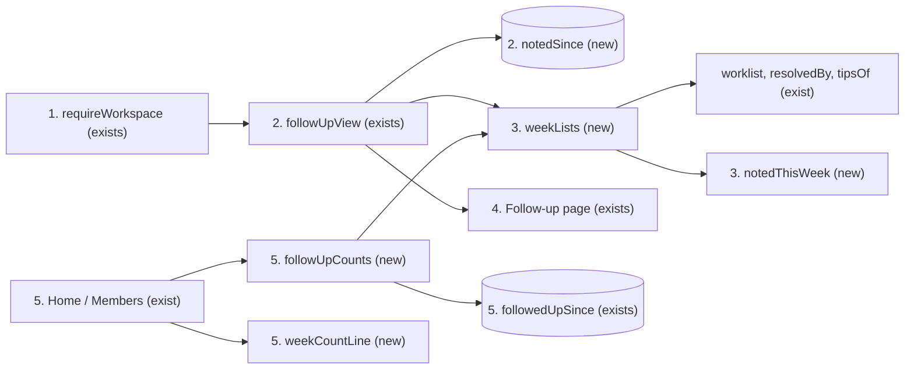
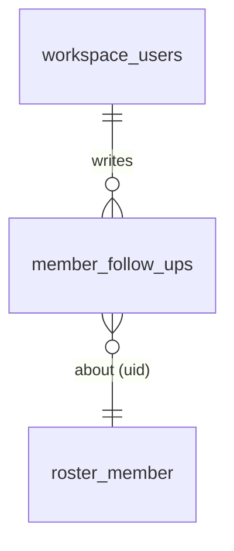
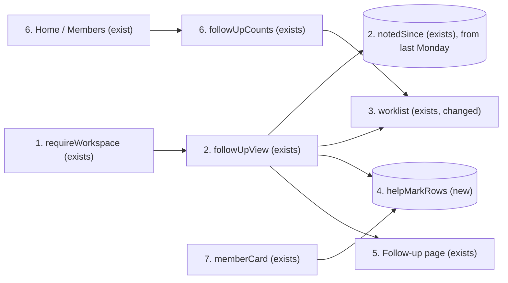
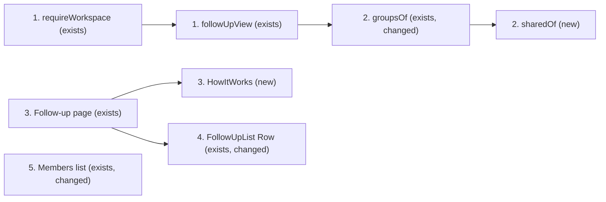
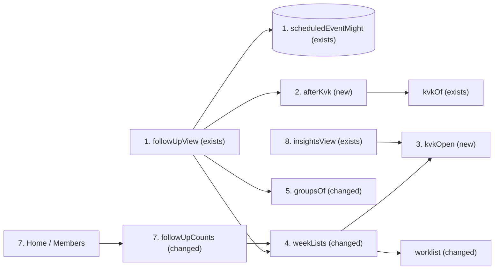

# One worklist: Follow-up answers "who needs me this week, and who was already noted" (#585 batch 3)

**Approved**: 2026-11-22 - user: "go with what you and the personas recommend" (owner, 2026-11-21, standing approval in CONTRIBUTING.md § Working rules); product-strategy verdict: [Plan review](#c-product-strategy-approve-with-changes); adversarial verdict: [Plan review](#d-adversarial-d75-privacy-d71d142-approve-with-changes)

**Approved (S2)**: 2026-11-22 - user: "go with what you and the personas recommend" (owner, 2026-11-21, standing approval in CONTRIBUTING.md § Working rules); product-strategy verdict: [Validation (f)](#f-s2-product-strategy-approve-with-changes); adversarial verdict: [Validation (g)](#g-s2-adversarial-d75-privacy-d71d142-correctness-approve-with-changes)

**Approved (S3)**: 2026-11-22 - user: "go with what you and the personas recommend" (owner, 2026-11-21, standing approval in CONTRIBUTING.md § Working rules); product-strategy verdict: [Validation (i)](#i-s3-product-strategy-approve-with-changes); adversarial verdict: [Validation (k)](#k-s3-adversarial-approve-with-changes)

Size: L (more than one PR across Home, Members, Follow-up, Insights and the member card). This plan covers all slices; slice 1 (S1) was built in PR 640, slice 2 (S2) in PR 646, **slice 3 (S3) is built in `feat/585-follow-up-rows`** (its own size: M, a flow across Follow-up and Members). Part of #585 (findings F3, F14, F15, F21, F29).

## Problem

Officers have four "who needs me" lists with four rules, and none of them says what the other officers already did this week. Measured on a local production build of `dev` (e46cf153, v5.48.0) with the invented 585 seed (about 100 members, 6 officers), the server clock at Sat 21 Nov 16:30 ST (`585-worklist/before/`):

- **Home** (margin note "Members this week") and **Members** (under the alliance's week line) say "3 people to check in with or help", linked to the Members list. The count is Members' status rule (`needsAWord(whoOf(m))`): it ignores what officers recorded this week, leaves out new members and the coins tip, and counts a member an officer marked "Needs help" with no reason left.
- **Follow-up** says "12 to look at · everyone else is fine" and "Check in · 1": the other two members Home counts were talked to this week, and the "Needs help" member is not on it.
- **Insights** lists 8 names under "Took a heavy hit — maybe offer help", with its own rule and no link to Follow-up.
- **What was done is invisible.** A member an officer talked to this week leaves Follow-up without a trace. The only place that says it is that member's card ("This week: Talked Thu, Nov 19 · Ana", #633). D104's own "Why" was "who to look at, why, and what the officers already did"; the last part was never built on the page. Two officers can message the same member, or each assume the other did.
- **Follow-up's first phone screen** (360 × 780) is five lines of explanation, the week, the count and "3 thefts to follow ↓"; the first row starts at about y 600. The group title "Check in · 1" sits right under "12 to look at" and was read as the answer by 3 of 6 officers (Validation (a)). Each row has three controls (Talked to them, Add a note, Members ›), names do not look tappable, the same "Still to ask: Main squad might, Troops, AD Tech, Time zone, Languages" repeats on six rows, and "Members ›" opens the Members list searched by name instead of the card (F29, F14).
- **The card** says "Needs help" with no reason, author or date (F14). **A "This is me" claim** on Home cannot be checked: the player is not a link, there is no date, and "Reject" reads coldly (F15). **Home's Recent activity** opens with 15 "finished the roll call" lines, the screenshot upload sits inside "To review", and a finished event takes a third of the screen (F21).

Usage: no PostHog access in this build; the queries are listed under Validation (b).

What is different for an officer when S1 ships: Follow-up's first phone screen leads with the week's two numbers ("12 to look at · everyone else is fine", "4 others already noted this week ↓"), and "Noted this week" lists each member an officer noted, with who, when, what and the note, linked to their card; Home and Members show the same two numbers, by Follow-up's rule, linked to Follow-up.

## Shape

Reuses Follow-up's own rule (`worklist`, `resolvedBy`, `liveRecords`, `tipsOf` in `lib/private/follow-up-rules.ts` and `follow-up.ts`), its week (`weekStart`) and the card's address (`/w/[slug]/members?m=<uid>`, D122); no new route, table or field. The rules that change what an officer sees (who was noted, the two counts, which line Home and Members show) run in `lib/private` functions the Vitest PGlite suite reaches.

1. officer opens `/w/[slug]/follow-up` -> `openRollCall` / `requireWorkspace` (exists) - officers only, as today
2. `followUpView` (exists) - reads `membersView`, the week's records and the thefts as today; the week's records come from `notedSince` (new, `lib/repo/member-follow-ups.ts`), which adds the note, the last day away and the officer's desk name
3. `weekLists` (new, `follow-up.ts`) - the week's list (`worklist` minus the week's records, with `tipsOf`) and `notedThisWeek` (new, pure, `follow-up-rules.ts`): per current member, the newest record still counting since Monday 00:00 ST, newest first
4. Follow-up page (exists) - the head leads with the week and its two numbers ("{n} to look at · everyone else is fine" kept, then "{m} others already noted this week ↓"), then D140's "what to do" line and D104's help line; the group "Check in · n" is renamed "Worth a hello · n"; the Monday rule moves into the new "Noted this week · m" card, after the to-do groups and before the thefts; each row: the name as a link to the card, the rank, "{officer} · {day}: {what}", the note on its own line
5. Home and Members (exist) -> `followUpCounts` (new, `follow-up.ts`) - while the Follow-up tab is on, `weekLists` over the `MembersView` the page already holds and the week's uid, action and time only (`followedUpSince`, exists): `{ toLook, done }`; `weekCountLine` (new, pure) writes "Follow-up: 12 to look at · 4 noted this week", linked to Follow-up. While the tab is off (D126) nothing is read and the old line stays

**Changes underneath**

| Front       | What changes                                                                                                                                                                                                                                               |
| ----------- | ---------------------------------------------------------------------------------------------------------------------------------------------------------------------------------------------------------------------------------------------------------- |
| domain      | Home's and Members' "check in" count meant Members' status rule (`needsAWord`), now Follow-up's list (`worklist` minus this week's records) while the Follow-up tab is on; Members' list groups keep their own rule (comment at `members-list.ts` updated) |
| stored data | nothing to migrate                                                                                                                                                                                                                                         |
| readers     | Follow-up (head, group title, Noted card), Home and Members (the count line). D104 and D140 get dated amendments: the head order, the Monday rule's place, the group's title, the Noted card and its read                                                  |
| cost        | Home and Members read the week's follow-up records (uid, action, time) through the existing index `member_follow_ups_workspace_written_idx`; one extra query per load, not measured in transactions here (handoff)                                         |

New: nothing - read only.

## Surface

None - nothing consumed outside. No route changes; `POST /api/w/[slug]/follow-up` is untouched.

## Landing

None - no schema, no contract, no dependency; the count rule is code and can be reverted.

- Nothing else in this change is hard to reverse

## S2 plan: Needs help on the list (built in `feat/585-needs-help`)

**S2 problem.** Measured on the S1 build and its walk (invented 585 seed, `585-worklist/after2/`), and in the code at `a170e38d`:

- An officer who marks a member "Needs help" (Follow-up's "They need help", or Edit info › Status) takes them off the week's list for the rest of the week. On Monday they come back only while a reason still holds (`worklist`: a reason and `needsAWord`), and then under "Worth a hello" with a "Needs help" tag and no reason for the mark. A member marked Needs help whose activity is back to normal is on no list, although an officer said they need help (F14).
- Home's and Members' "Follow-up: 12 to look at" (S1) leaves that member out; Members' own group "To check in with or help" (`needsAWord`) counts them, so the two numbers on Members disagree by one per such member.
- The member card says "Needs help" with no reason, author or date (F14). The note an officer typed with "They need help" is only in History, as "Needs help, Thu, Nov 19: … · Tomas".
- A member back on the list on Monday shows nothing of last week: an officer cannot tell that Tomas already talked to them, or what they said.

What is different for an officer when S2 ships: Follow-up opens with "Needs help · n", each row saying who marked it, when and why; the member stays there every week until someone clears the mark or a break starts; Home and Members count them; the card says the same; a returning member shows last week's note.

**S2 shape.** Reuses `worklist`, `weekLists`, `followUpCounts` (one rule for the page and the counts), `notedSince` (the records with note and officer), `notedLine` (the "{officer} · {day}: {what}" shape) and `checkInLink` (Home and Members' line, unchanged). No new route, table, field or migration.

1. officer opens `/w/[slug]/follow-up` -> `requireWorkspace` (exists)
2. `followUpView` (exists) reads `notedSince` (exists) from Monday 00:00 ST of **last** week (was this week): one query; only this week's rows go to `weekLists` (the list and "Noted this week", as in S1 and as Home's `followedUpSince`), and the whole window goes to `lastWeekOf` (new, pure, `follow-up-rules.ts`: per member, `liveRecords` over the window, then the newest one before this Monday)
3. `worklist` (exists, changed): a member with `officerStatus === "help"`, not on a break, joins the list with `help: true`, whatever their reasons; `checkIn` stays "has a reason"
4. `helpMarkRows` (new, `lib/repo/member-follow-ups.ts`): for the members on the list with Needs help, their `status` versions (value, time, writer) and their Follow-up records (action, note, `fact_version`, time, writer), two indexed selects in parallel, each filtered by `workspace_id`; `helpMark` (new, pure, `follow-up-rules.ts`) takes the trailing run of `help` versions and the newest live `help` record in it, else the run's first version. Run beside `gameLanguages`
5. Follow-up page (exists): "Needs help · n" first with its "how it ends" line, then "Worth a hello", "New", "A tip to share"; a row's lines: the mark line and its quoted note, the reasons, the facts still to ask, the tip, last week's context and its quoted note; the panel (exists) gains "No longer needs help" for a Needs help row, which posts to the facts route (exists)
6. Home and Members (exist) -> `followUpCounts` (exists) -> `weekLists` (exists): they count the new group with no change of their own, and read nothing new
7. member card (`memberCard`, exists) -> `helpMarkRows` + `helpMark` (new) for the one member while their status is Needs help: the header's "Since … · added by …" line and its note

**Changes underneath (S2)**

| Front       | What changes                                                                                                                                                                                                                                                                                                                                         |
| ----------- | ---------------------------------------------------------------------------------------------------------------------------------------------------------------------------------------------------------------------------------------------------------------------------------------------------------------------------------------------------- |
| domain      | Who is on Follow-up's list: a standing Needs help mark puts the member on it by itself (was: only while a reason holds). D104 and D80 get dated amendments. Members' list groups keep `needsAWord` (unchanged, already counts Needs help)                                                                                                            |
| stored data | nothing to migrate; nothing new written                                                                                                                                                                                                                                                                                                              |
| readers     | Follow-up (groups, rows), Home and Members (the numbers, through `followUpCounts`), the member card (header), the card's "on the list" flag (`cardFollowUp` calls `worklist`)                                                                                                                                                                        |
| cost        | Follow-up: `notedSince` covers two weeks instead of one (same index `member_follow_ups_workspace_written_idx`), plus `helpMarkRows` (two selects on `member_facts` and `member_follow_ups_workspace_uid_idx`, Needs help members only) beside `gameLanguages`; the card: the same while the status is Needs help. Home and Members: nothing new read |

New: nothing - read only.

**S2 assumptions**

| Assumption                      | Chosen default                                                                                                                                              | Rationale                                                                                                                                 | Confirmed? |
| ------------------------------- | ----------------------------------------------------------------------------------------------------------------------------------------------------------- | ----------------------------------------------------------------------------------------------------------------------------------------- | ---------- |
| When the mark ends              | When the `status` fact is cleared ("No longer needs help" in the panel, or Edit info › Status: Automatic) or set to On a break; an away note only pauses it | "while the mark stands" (S1 handoff); 6 of 6 officers and the product persona: a visible way out; "All fine" stays a weekly answer (D104) | n          |
| A noted Needs help member       | Under "Noted this week" for the rest of the week, back under "Needs help" on Monday                                                                         | S1's rule holds: a member is either to look at, noted, or neither; a talk is about that week (D104)                                       | n          |
| Who and when                    | The writer and time of the standing `status` version; the note of the `help` record that wrote it                                                           | One rule for a mark from Follow-up and from Edit info; the record and the fact are written by the same officer at the same moment         | n          |
| How far back "Last noted" reads | Last game week only                                                                                                                                         | "last week's note" (S1 handoff); a bounded window on a table that grows (D149)                                                            | n          |
| The group's place               | First                                                                                                                                                       | An officer said this person needs help; no ranking inside the group (by name, D75)                                                        | n          |

**S2 validation:** the plan review is under [Validation (e) to (g)](#e-s2-officer-panel-first-glance-test-and-review).

## S3 plan: Follow-up's rows (built in `feat/585-follow-up-rows`)

**S3 problem.** Measured on `dev` at `f5d3658a` with the invented e2e seed (production build, Sun 22 Nov), shots in the orchestrator's scratchpad `s3-shots/before/`:

- Each row has three controls: "Talked to them", "Add a note" and "Members ›". The name does not look tappable, although a tap on it opens the same panel as "Add a note" (F29). Nobody in the officer panel saw that the name opens the panel.
- "Members ›" opens the Members list searched by name (`?q=`), not the member's card (`?m=`, D122).
- Moss Hollow's six rows each say "Quiet for 3 days. Worth a hello."; a group of new members says the same "Still to ask: Main squad might, Troops, AD Tech, Time zone, Languages" on every row.
- The head's two help sentences push the first row down; at 360 × 780 Lantern Keep's second group ("New · 1") is below the fold, and one officer concluded "one person, Galen" (wrong).
- At 1280 the page keeps the old 960 px width while Home and Members use the wide frame.
- Members shows "Follow-up: 6 to look at" (Follow-up's rule) above a list group "To check in with or help" (Members' status rule, no week), two numbers for one question; after S2 they differ by every Needs help member noted this week.

What is different for an officer when S3 ships: each row is the person's name (a link to their panel) and the reasons, with one button, "Talked to them", and "Card ›"; a line every row shares is said once; the head is the week, the numbers and "How this list works"; Members' group says its own status words and points at Follow-up for the week.

**S3 shape.** No new route, table, field or query. Reuses `groupsOf` (`follow-up-groups.ts`), the panel (`FollowUpSheet.tsx`, unchanged but for the row type), `MasterDetail` and `SignedInFrame`'s `wide` (D122), Members' `
` style ("What the labels mean") and the first-use cookie's pattern (`lap_ws_intro`, D73).

1. officer opens `/w/[slug]/follow-up` -> `openRollCall` / `requireWorkspace` (exists), `followUpView` (exists, unchanged)
2. `groupsOf` (exists, changed): per group, `sharedOf` (new, pure) takes the plain lines (reasons, "Still to ask", the tip) every row of a group of two or more holds; the group gets `shared` ("Same for all {n}:" and the lines) and each row `own` (its lines without the shared ones); `lines` stays whole for the panel
3. page (exists): `SignedInFrame wide`; the head (`FollowUpHead`) shows the title, week, count, jumps, then `HowItWorks` (new, client): a `
` open when the cookie `lap_ws_fu_help` is absent (read on the server), which writes it once shown
4. `FollowUpList` `Row` (exists, changed): one button (name in link style, rank, `own` lines) opening the panel; "Talked to them"; "Card ›" to `?m=<uid>`. `Group` shows the shared lines after the hint, inside `ph-no-capture`, and each row's description (`aria-describedby`) names them
5. Members (exists): `MembersList` `Sections` titles the first group "Check in or Needs help" and, while the head shows Follow-up's numbers (`followUpCounts` not null: the tab on, D126, and the first daily update in), adds "This week’s list: Follow-up ›"

**Changes underneath (S3)**

| Front       | What changes                                                                                                                                       |
| ----------- | -------------------------------------------------------------------------------------------------------------------------------------------------- |
| domain      | none: who is on the list, the counts and the panel's saves are unchanged                                                                           |
| stored data | nothing in the database; one browser cookie, `lap_ws_fu_help=1` (one year, `path=/`, `SameSite=Lax`), only "the help was shown here" (D73 amended) |
| readers     | Follow-up (rows, groups, head, frame), Members (the list's first group title and its line), the e2e flows                                          |
| cost        | none: no new read; `sharedOf` compares a few short strings per group                                                                               |

New: nothing - no entity.

**S3 assumptions**

| Assumption                      | Chosen default                                                                                                    | Rationale                                                                                                                                                           | Confirmed? |
| ------------------------------- | ----------------------------------------------------------------------------------------------------------------- | ------------------------------------------------------------------------------------------------------------------------------------------------------------------- | ---------- |
| The Needs help row's action     | "Talked to them", as every row; "No longer needs help" stays in the panel                                         | 4 of 6 officers, product and designer: clearing a mark is a deliberate step beside its context, and a stray tap on the row would clear it                           | n          |
| Which lines a group says once   | Any plain line (reason, "Still to ask", tip) every row holds; never a mark, last week or a note                   | 5 of 6 officers and product: six "Quiet for 3 days" is noise; designer MUST: a mark or history line stays with its note                                             | n          |
| "How this list works" open when | On the officer's first visit on that browser, decided on the server from a cookie                                 | The task's wording, 5 of 6 officers and product; designer MUST: never open after the page has drawn (the content would jump under a thumb)                          | n          |
| The card link's words           | "Card ›" ("Cartão ›", "Fiche ›")                                                                                  | Product and designer: the app's own word (the member card); "Profile" (3 of 6 officers) reads as something the member sees. PT keeps "cartão" as the card's tabs do | n          |
| Members' group                  | "Check in or Needs help" and, while the head shows Follow-up's numbers, "This week’s list: Follow-up ›"; no count | 4 of 6 officers, product and designer; a count would be a third number                                                                                              | n          |
| "Add a note"                    | Removed; the help's summary says, in sight, "Tap a name to write down what they said."                            | 4 of 6 officers, product, designer; 2 of 6 worried the name tap is missed: the help's new line and the answer-mix measure (Validation (b)) watch it                 | n          |

**S3 validation:** the plan review is under [Validation (h) to (k)](#h-s3-officer-panel-first-glance-test-and-review).

## S5 plan: After KvK, offer help (built in `feat/585-after-kvk-help`)

**S5 problem.** Measured in the code at `b8bb5f56` and on invented data (Lantern Keep, KvK Sat, Nov 21, Sun, Nov 22 10:00 ST):

- Insights' KvK card lists "Took a heavy hit — maybe offer help" (`kvkOf` `help`: lost more than 25% of their Start might, still under 80% of it now, not on a break; D139). The 585 seed has 8 names in it. The card is about four phone screens down Insights, has its own rule, and does not link to Follow-up.
- Follow-up, the week's worklist, does not know about the KvK: "2 to look at · everyone else is fine" while three members took a heavy hit and nobody has talked to them. Home's and Members' "Follow-up: n to look at" (S1) leave them out too.
- Officer panel, first-glance test on Follow-up (Validation (l)): 4 of 6 wrong, 2 of 6 "can't tell" on "Who should I offer help to after this KvK?".

What is different for an officer when S5 ships: in the week after a KvK, Follow-up has "After KvK, offer help · n" under Needs help, with a jump to it in the head; a member leaves it once an officer writes something down, or at the next KvK; Home and Members count it; Insights' help list keeps its names and links to the group while the group has someone in it.

**S5 shape.** Reuses `kvkOf` and its `help` (`insights-kvk.ts`, unchanged rule), `scheduledEventMight` (`lib/repo/workspace-rosters.ts`, its date-bounded statement, D149), `MembersView.reads` (15 end-of-day reads, already read), `worklist`, `resolvedBy`, `weekLists`, `followUpCounts`, `groupsOf` and the ready message's existing `kvk` line ("How did KvK go for you? Anything we can help with?"). No new route, table, field or migration.

1. officer opens `/w/[slug]/follow-up` -> `requireWorkspace` (exists); `followUpView` (exists) reads `scheduledEventMight` from 00:00 ST six server days back, beside `membersView`, `notedSince` (from last Monday, exists) and the thefts
2. `afterKvk` (new, pure, `insights-kvk.ts`): `kvkOf`'s newest event shown, while today is less than `KVK_HELP_DAYS` (7) server days after its day: its day, its End read's start (`afterAt`) and its `help` uids; else null
3. `kvkOpen` (new, pure, `follow-up-rules.ts`): those uids minus the members with a record still counting since Monday 00:00 ST or since `afterAt`
4. `weekLists` (exists, changed) takes the rows of the whole window and splits them itself: this week's for the list and Noted, from `afterAt` for `kvkOpen`; `worklist` (exists, changed) gains `kvk` (in the open set, not on a break) and lists such a member
5. `groupsOf` (exists, changed): "After KvK, offer help · n" second, after Needs help, before Worth a hello; its hint holds the rule and the KvK's date, so its rows show name and rank only; the reason line "Still rebuilding after the KvK of {date}." stays in `lines` (the panel) and on a Needs help row
6. `FollowUpHead` (exists): "{n} to offer help after the KvK ↓" to `#follow-up-kvk`
7. Home and Members (exist) -> `followUpCounts` (exists, changed): the same events read beside `followedUpSince` from the earlier of this Monday and the window's first day, then `weekLists`
8. Insights (exists) -> `insightsView`: while the Follow-up tab is on and `afterKvk` holds, `followedUpSince` from the same start and `kvkOpen` minus members marked Needs help; the KvK card shows "Offer help: Follow-up ›" under the names while that set is not empty

**Changes underneath (S5)**

| Front       | What changes                                                                                                                                                                                                                                                                                                                          |
| ----------- | ------------------------------------------------------------------------------------------------------------------------------------------------------------------------------------------------------------------------------------------------------------------------------------------------------------------------------------- |
| domain      | Who is on Follow-up's list: the newest KvK's help list, for the 7 server days from its day, until an officer writes something after its End. D104, D139 and D140 get dated amendments                                                                                                                                                 |
| stored data | nothing to migrate; nothing new written                                                                                                                                                                                                                                                                                               |
| readers     | Follow-up (group, head jump, panel, ready message), Home and Members (the numbers, through `followUpCounts`), Insights (the link). The member card's "on the list" flag and its message do not see the group (follow-up)                                                                                                              |
| cost        | Follow-up, Home and Members: one `scheduledEventMight` over 6 days (one statement, events by `events_event_at_utc_unique`); Home and Members read `followedUpSince` from up to 6 days before Monday (uid, action, time). Insights: one `followedUpSince` only while the tab is on and a KvK is in the window. Measured in the handoff |

New: nothing - read only.

**S5 assumptions**

| Assumption                  | Chosen default                                                                                                           | Rationale                                                                                                                                                          | Confirmed? |
| --------------------------- | ------------------------------------------------------------------------------------------------------------------------ | ------------------------------------------------------------------------------------------------------------------------------------------------------------------ | ---------- |
| How long the group stays    | From the KvK's night read through the Friday after (7 server days from its day); gone on the next KvK day until its read | 5 of 6 officers (A (b)); product MUST: the same week as Insights' recovery; a skipped KvK never leaves an old list                                                 | n          |
| A member noted after it     | Any record still counting since the KvK's End read takes them out of the group until it ends (not back on Monday)        | 4 of 6 officers and product: one offer of help, not a weekly reminder (D75); their other reasons still follow the weekly rule                                      | n          |
| One group per member, order | Needs help > After KvK > Worth a hello > New > A tip, shown in that order; other reasons stay as lines on the row        | Round 2 first glance: KvK first made 2 of 6 think an officer marked the three, 0 of 6 right on "who needs help"; Needs help first plus a head jump: 5 of 6 on both | n          |
| Home's and Members' number  | Counted, one number with Follow-up's ("Follow-up: 5 to look at")                                                         | 4 of 6 officers; the task: equal to Follow-up's, through `followUpCounts`                                                                                          | n          |
| Insights                    | Names kept; "Offer help: Follow-up ›" under them while the group has someone in it                                       | 4 of 6 officers and the designer; the names must stay with the tab off anyway (product MUST). Product picked links only (see Validation (n))                       | n          |
| Copy                        | "After KvK, offer help · n"; row line "Still rebuilding after the KvK of {date}."; hint as criterion 41                  | 4 of 6 officers each; "note"/"noter" reads as grading in French, so the hint says "writes down what they said"                                                     | n          |

**S5 validation:** the plan review is under [Validation (l) to (o)](#l-s5-officer-panel-first-glance-test-and-review).

## Criteria

### S1: Follow-up says who is left and who was noted; Home and Members say the same (P1) - built in this PR

**Acceptance Criteria**

1. WHEN an officer opens Follow-up THEN the head SHALL show the title, the week, "{n} to look at · everyone else is fine" (unchanged words, semibold) and, when at least one member was noted, "{m} others already noted this week ↓" as a 44 px jump link to the Noted card, before D140's "what to do" line and D104's help line
2. The to-do group that held "Check in · n" SHALL be titled "Worth a hello · n" ("Vale um oi · n", "Un petit mot · n")
3. The page SHALL always show the card (before the first daily update too; review of PR 640) "Noted this week · {m}" after the to-do groups and before the thefts, with the Monday rule ("People you note leave the list until Sunday. If the reason is still there, they’re back on Monday.") under its title, listing one row per current member with a record still counting since Monday 00:00 ST, newest record first; with nobody noted it SHALL say "Nobody noted yet this week."
   - a Talked on Mon 00:05 ST → listed; one on Sun 23:59 ST the week before → not listed; a Talked then Undo → not listed; two records this week → one row, the newest
4. Each Noted row SHALL show the member's name as a link to their card (`/w/[slug]/members?m=<uid>`), the rank, "{officer} · {day}: {what}" where what is the answer as the officer chose it ("Talked to them", "On a break until {last day away}", "They need help", "All fine"), and the note on its own line when there is one, inside `ph-no-capture`; with no officer known, "{day}: {what}"
5. IF a record's member is not in the newest roster (left, or a former member) THEN the Noted card SHALL leave them out, and no count SHALL include them
6. WHILE the Follow-up tab is on, Home's "Members this week" and the Members head SHALL show Follow-up's two numbers as one link to `/w/[slug]/follow-up`, from the same week start (Monday 00:00 ST of today, not the newest read's week), members view and tips as Follow-up
   - 12 on the list, 4 noted → "Follow-up: 12 to look at · 4 noted this week"; 12 and 0 → "Follow-up: 12 to look at"; 0 and 4 → "Follow-up: nobody to look at · 4 noted this week"; 0 and 0 → "Everyone looks fine this week." (unchanged, not a link)
7. WHILE the Follow-up tab is off (D126), Home and Members SHALL read no follow-up record and show today's line ("{n} people to check in with or help", Members' rule, linked to the Members group)
8. WHILE the alliance has no end-of-day read yet (`early`), Home and Members SHALL say nothing about check-ins, as today
9. The desk dictionary SHALL hold every new string in EN, PT-BR and FR
10. The Follow-up e2e flow SHALL assert, after "Talked to them", that the member is listed under "Noted this week" with the officer's name, also after a reload; and the Home e2e SHALL assert the line Follow-up's rule gives for the seed

### S2: "Needs help" on the list, with why, who and when (P1) - built in PR `feat/585-needs-help` (F14; M: a rule change, D104/D80 amendment)

Shape, problem and plan review: [S2 plan](#s2-plan-needs-help-on-the-list-built-in-feat585-needs-help).

11. WHILE a current member's status is Needs help (the `status` fact's newest value is `help`), they are not on a break (no away note running, which pauses the mark) and no record of theirs still counts since Monday 00:00 ST, Follow-up SHALL list them under "Needs help · n", the first group, by name, whatever their reasons, and not under "Worth a hello"; their reasons, the facts still to ask and the coins tip stay as lines on the row, and no "Needs help" tag
    - marked Needs help two weeks ago with no reason left → listed; the same member with an away note running → not listed, and back after it; the mark cleared → not listed; a Talked this week → under "Noted this week", not under "Needs help"
12. Each "Needs help" row SHALL say since when and who added the mark, "Since {day} · added by {officer}" ("Since {day}" with no officer known), and the officer's note in quotes on its own line, clamped to two lines (the panel shows it whole), all inside `ph-no-capture`. The mark is the trailing run of `help` versions of the `status` fact: who, when and the note come from the newest Follow-up `help` record still counting whose `fact_version` is in that run, else from the run's first version (its writer and time, no note)
    - "They need help" with a note → that officer, day and note; set in Edit info → its writer and day, no note; Ana marks, Tomas marks again, Tomas undoes → Ana, her day, her note; cleared then set again → the new run's writer
13. The "Needs help" group SHALL say under its title how a member leaves it: "They stay here each week until someone taps “No longer needs help”."; WHEN an officer taps "No longer needs help" in that member's panel THEN the app SHALL save the `status` fact as cleared through the facts route (`POST /api/w/[slug]/members/[uid]/facts`, the version the page saw), close the panel, read the list again and say "Saved. {name} no longer needs help."; IF the save is refused (409, another officer changed it) THEN the panel SHALL say "Could not save. Try again." and the list SHALL be read again. "All fine" stays a weekly answer and clears nothing (product strategy)

S2 continues at 24 (14 to 23 belong to S3 to S6; prettier renumbers one list, so the two parts are separate lists):

24. Home's and Members' Follow-up numbers SHALL count the "Needs help" group through `followUpCounts` / `weekLists` (no count of their own), so they equal Follow-up's for the same data and time
    - two Needs help members and nobody else → "Follow-up: 2 to look at"; one of them noted this week → "Follow-up: 1 to look at · 1 noted this week"
25. WHILE a member's status is Needs help, the member card's header SHALL say under "Needs help" since when and who added it ("Since Thu, Nov 19 · added by Tomas") and the note in quotes on its own line, on every tab, inside `ph-no-capture`, from the same rule as criterion 12
26. The card's History tab SHALL keep listing each Follow-up record still counting, a Needs help one included ("Needs help, Thu, Nov 19: {note} · Tomas") (no change; F14 checked: History lists records and earlier values only, so a mark set in Edit info, the newest version with no record, leaves it empty by design; criterion 25 is the fix)
27. IF a member on this week's list has a record still counting from last game week (Monday 00:00 ST of last week up to this Monday 00:00 ST; a `withdrawn` this week cancels it) THEN their row SHALL show its newest one as context, "Last week: {officer} · {day}: {what}" ("Last week: {day}: {what}" with no officer), its note in quotes on its own line, clamped to two lines; never "again", and not when that record is the one the row's Needs help line already names
    - talked on Thu, Nov 12 with "on holiday", still quiet this week → "Last week: Tomas · Thu, Nov 12: Talked to them" and "“on holiday”"; a record two weeks back only → no line; talked Sun 23:50 ST, undone Mon 00:05 ST → no line
28. Follow-up SHALL take this week's list, its Noted card and Home's and Members' numbers from this week's records only (Monday 00:00 ST on); last week's records, read in the same query, SHALL only give the context line
29. The desk dictionary SHALL hold every new string in EN, PT-BR and FR
30. D104 and D80 SHALL each get an amendment dated 2026-11-22 for the Needs help group, how it ends (cleared; paused by a break), the card's line, and that "stays until cleared" is a deliberate choice to revisit after S3 with the mark-age measure
31. The Home e2e SHALL assert Follow-up's number with the seed's Needs help member counted, and Follow-up's "Needs help · 1" row with the officer, day, note and last week's context, all from the seed's exports; the seed SHALL write the `status` fact and its Follow-up record as `recordFollowUp` does (same officer and time, `fact_version` 1), the week before last, and a Talked last week; and a Follow-up e2e SHALL tap "No longer needs help" on a second seeded Needs help member (written the same way, in a workspace of its own per repeat so Home's count stays put): first refused after another officer saved the status, with "Could not save. Try again.", then cleared, the member gone from "Needs help" on screen and after a reload (review of PR 646)

### S3: Follow-up's rows: one action, tappable names, the card one tap away (P1) - built in `feat/585-follow-up-rows` (F29, F14 link)

Shape, problem and plan review: [S3 plan](#s3-plan-follow-ups-rows-built-in-feat585-follow-up-rows).

14. Each Follow-up row SHALL have one visible action, "Talked to them", in every group (Needs help too; "No longer needs help" stays in the panel); the name, rank and the row's lines SHALL stay one button that opens the member's panel, with only the name styled as a link (plum, semibold, underlined); "Add a note" SHALL go; "Members ›" SHALL become "Card ›" ("Cartão ›", "Fiche ›"), a 44 px link to `/w/[slug]/members?m=<uid>` named "{name}’s card" ("Cartão de {name}", "Fiche de {name}"); the Needs help group's line SHALL say "They stay here each week until someone taps their name, then “No longer needs help”."
15. WHEN every row of a group of two or more holds the same plain line (a reason, "Still to ask: …" or the coins tip) THEN the group SHALL say it once under its title (after the hint), headed "Same for all {n}:" ("Vale para os {n}:", "Pour les {n} :"), and the rows SHALL leave it out; a Needs help mark line, last week's line and an officer's note SHALL never be said for the group; the panel's "Why they’re on the list" SHALL keep every line; the shared lines SHALL sit inside `ph-no-capture` as the rows' do (issue 549), and each row's button SHALL name them in its description (`aria-describedby`), since a row may show only the name (adversarial SHOULD)
    - six rows each "Quiet for 3 days. Worth a hello." → said once, each row shows its name and rank; five rows with all five facts to ask and one with Troops only → each row keeps its own; a group of one → on the row; two Needs help rows marked the same day by the same officer → each keeps its mark line
16. Follow-up SHALL use the wide frame (D122, `wide`) like Home and Members: from 1024 the list and the member's panel side by side
17. D140's "what to do" line and D104's help line SHALL move, word for word, into one disclosure under the head's numbers and jumps, "How this list works" ("Como esta lista funciona", "Comment fonctionne cette liste"), 44 px, its summary saying, always in sight, "Tap a name to write down what they said." ("Toque em um nome para anotar o que a pessoa disse.", "Touchez un nom pour noter ce qu’on vous a dit.") before the label (officer panel after the build: 5 of 6 did not find the panel without it); it SHALL be open on an officer's first visit on that browser and closed after, decided on the server from the cookie `lap_ws_fu_help`, which the page writes once the help was shown open (not while the first-use cards cover the page, adversarial SHOULD), so nothing moves after the page is drawn; the open state SHALL be taken once, when the page is first drawn, so a save's refresh (which reads the new cookie) never closes it under the officer's thumb
18. Members' list group "To check in with or help" SHALL be titled "Check in or Needs help" ("Ver como está ou Precisa de ajuda", "À contacter ou Besoin d’aide"), the Who column's words, with no count; WHILE the Members head shows Follow-up's numbers (the tab on, D126, and the first daily update in: the case where the two numbers met), a line under its title SHALL say "This week’s list:" ("Lista desta semana:", "Liste de la semaine :") and link "Follow-up ›" to `/w/[slug]/follow-up` (44 px)

S3 continues at 32 (19 to 31 are taken):

32. The desk dictionary SHALL hold every new or changed string in EN, PT-BR and FR, and drop the keys nothing reads any more ("Add a note", "Members ›")
33. D104, D140, D98 and D73 SHALL each get an amendment dated 2026-11-22 for what they quote or rule that changes (the row, the help, the Needs help line, the Members group, the cookie)
34. The Follow-up e2e flow SHALL assert that the quiet member's row has one button besides the name ("Talked to them"), no "Add a note", and "Card ›" linking to `/w/[slug]/members?m=<their uid>`, which opens that member's card (adversarial SHOULD); the quiet reason on the group, whether said once or on the row (adversarial MUST: other runs change the group's size); that "How this list works" is open on a first visit and closed after a reload; the Home e2e SHALL assert the Needs help group's new line; and a Members e2e SHALL assert the "Check in or Needs help" title and its "Follow-up ›" link

### S4: Home leads with the week's follow-up, and its activity reads in one screen (P2) - later PR (F3 on Home, F21)

19. Home SHALL show Follow-up's two numbers in its main column near the top (product persona: the only fix for Home's first glance)
20. Recent activity SHALL fold the same action on the same roll call by several officers into one line ("Cheese Trap roll call finished · Wren, Tomas and 3 others · yesterday")
21. The screenshot upload SHALL leave "To review" for a card of its own; a finished event on "Today and tomorrow" SHALL take one line

### S5: "After KvK, offer help" in Follow-up (P2) - later PR (F3; M: a rule change)

22. Follow-up SHALL hold an "After KvK, offer help · n" group from Insights' heavy-hit rule (`insights-kvk.ts` `help`), not on a break, for the week after the KvK; Insights' list SHALL link to it instead of being a list of its own (superseded by criteria 40 to 47: Insights keeps its names, see the S5 assumptions)

S5 is built in `feat/585-after-kvk-help`; its criteria start at 40 (35 to 39 are S4's, in PR 652). Shape, problem and plan review: [S5 plan](#s5-plan-after-kvk-offer-help-built-in-feat585-after-kvk-help).

40. WHILE the newest KvK Insights shows (`kvkOf`'s first event: Start and End read, a daily read after its End) is less than 7 server days old, Follow-up SHALL list under "After KvK, offer help · n" ("Depois da KvK, ofereça ajuda · n", "Après la KvK, proposer de l’aide · n"), the second group, by name, every current member in that KvK's help list who is not on a break, not marked Needs help, and has no record still counting written this week or since the KvK's End read began
    - KvK Sat, Nov 21: Sun 22 and Fri 27 → listed; Sat 28 before that day's KvK read → not listed; "Talked to them" Sun 22 → under "Noted this week", and not back on Mon 23; talked then undone → listed; on a break → not listed; marked Needs help → under "Needs help", with the KvK line
41. The group SHALL say under its title "Lost over a quarter of their might in the KvK of {date}, and still below 80% of what they had. Here for the week after it, or until someone writes down what they said."; its rows SHALL leave out the KvK line (the hint says it), and keep every other line; the reason "Still rebuilding after the KvK of {date}." SHALL be in the panel's "Why they’re on the list", and on the row of a Needs help member in the help list; no number SHALL be shown beside a name, on the row, in the panel or in the ready message (D139), whose first reason line SHALL be the KvK one ("How did KvK go for you? Anything we can help with?"); names inside `ph-no-capture`
42. WHEN the group has members THEN Follow-up's head SHALL show "{n} to offer help after the KvK ↓" ("{n} para oferecer ajuda depois da KvK ↓", "{n} à qui proposer de l’aide après la KvK ↓") as a 44 px jump to the group, first among the head's jumps
43. Home's and Members' Follow-up numbers SHALL count the group through `followUpCounts` / `weekLists` (no count of their own), so they equal Follow-up's for the same data and time, a member noted on the Sunday after the KvK included on the Monday
44. Insights' "Took a heavy hit — maybe offer help" SHALL keep its names and, WHILE the Follow-up tab is on (D126) and Follow-up's group has at least one member, show under them "Offer help: Follow-up ›" ("Oferecer ajuda: Acompanhar ›", "Proposer de l’aide : À suivre ›"), a 44 px link to `/w/[slug]/follow-up#follow-up-kvk`; otherwise the card SHALL be as today
45. The desk dictionary SHALL hold every new string in EN, PT-BR and FR
46. D104, D139 and D140 SHALL each get an amendment dated 2026-11-22 for the group, its window and noted rule, the head jump, Home's and Members' numbers, Insights' link and the ready message's line
47. The e2e seed SHALL give one Lantern Keep member a heavy hit at the last KvK (the other members' figures unchanged); the Home e2e SHALL assert Follow-up's number with that member counted, the head jump, the group with its hint, the member's row and Insights' link to it; the Members e2e SHALL assert the Members head's number equal to Home's; on a Saturday (server day) the group is gone and the numbers leave the member out

### S6: a claim you can check (P3) - built in feat/585-claim-check (F15)

23. A "This is me" claim on Home SHALL link the player to their card (`/w/[slug]/members?m=<uid>`), say the day it was asked in server time ("Asked on Thu, Nov 19 to see their own page."), and offer "Not them" (was "Reject", also on the card's pending line) with the same action and server checks

## Out of scope

| Excluded                                                                                                  | Why                                                                                                                                                                                                          |
| --------------------------------------------------------------------------------------------------------- | ------------------------------------------------------------------------------------------------------------------------------------------------------------------------------------------------------------ |
| S2 to S6 in this PR                                                                                       | L work: one PR per slice; S1 has the highest first-glance gain                                                                                                                                               |
| Undo on a Noted row                                                                                       | The saved line and the card keep Undo for the officer who just saved; a list-wide Undo of another officer's note is a new action (append-only log, D104)                                                     |
| Any count per officer ("Tomas noted 3")                                                                   | D75 and the product persona: it turns into a leaderboard of officers. Never, in any slice                                                                                                                    |
| Changing the owner's own words ("{n} to look at · everyone else is fine", the help line, the empty state) | Kept as the owner wrote them (D104); S3 proposes moving, not rewording                                                                                                                                       |
| `matchOnRead` on Follow-up                                                                                | Pre-existing: Home and Members match new members to the newest roster first, Follow-up does not, so on a direct visit right after a read a just-matched member can differ for one page load. Follow-up issue |
| A new analytics event                                                                                     | See the analytics plan                                                                                                                                                                                       |

## Assumptions

| Assumption                              | Chosen default                                                                                                     | Rationale                                                                                                                    | Confirmed? |
| --------------------------------------- | ------------------------------------------------------------------------------------------------------------------ | ---------------------------------------------------------------------------------------------------------------------------- | ---------- |
| What "noted" means                      | A current member with a follow-up record still counting since Monday 00:00 ST: what takes them off the list (D104) | One rule with the list: a member is either to look at, noted, or neither                                                     | n          |
| The word                                | "Noted", not "Done"                                                                                                | Panel MUST and adversarial MUST: "done" read as "closed" or "quit", and "Needs help" listed as done reads as dismissed (D75) | n          |
| Order of the Noted card                 | Newest record first                                                                                                | It reads as "what happened lately"; ordering by an officer's time is not a ranking of members (D75)                          | n          |
| Where the Noted card sits               | After the to-do groups, with the head's jump link                                                                  | 5 of 6 officers: the work comes first, the count in the head answers how many                                                | n          |
| The renamed group                       | "Worth a hello · n"                                                                                                | Panel MUST 2: "Check in · 1" under "12 to look at" was read as the answer; the rows already say "Worth a hello"              | n          |
| Home and Members while Follow-up is off | Today's line and link, nothing read                                                                                | D126: no link to a turned-off page; a turned-off tab reads nothing of its own                                                | n          |
| Which slice is first                    | S1 (counts and Noted)                                                                                              | The orchestrator: "the highest first-glance gain"; the question has two halves and the second has no answer today            | y          |

**Open questions:** none - all resolved or logged above.

## Validation

### (a) Officer panel: first-glance test, before

Six officer personas saw only the 360 × 780 first viewport (`585-worklist/before/followup--360-light-en-fold.png`, `-dark-`, `home--360-light-en-fold.png`) for about 5 seconds. Question: "Who do I need to check in with this week, and who has someone already talked to?" Truth in the seed: 12 on the list, 4 noted this week (invisible on both screens).

| Persona                                  | Screen    | What they concluded                                                                                           | Right?                  |
| ---------------------------------------- | --------- | ------------------------------------------------------------------------------------------------------------- | ----------------------- |
| R5, 40s, native English                  | Follow-up | "12 to look at, Keleth first. Nobody has been talked to yet, since nothing says so."                          | Wrong (MUST)            |
| War lead, 30s                            | Follow-up | "'Check in · 1': just Keleth."                                                                                | Wrong (MUST)            |
| Diplomat, early 20s, French              | Follow-up | "12 to 'look at'? 'Check in' is 1. I can't see who was talked to."                                            | Can't tell              |
| Discord-upkeep officer, 50s, US          | Follow-up | Missed the small count line: "Only Keleth this week."                                                         | Wrong (MUST)            |
| Officer, early 20s, Ukraine (English L2) | Follow-up | "12 people. Some are gone already, but how many?"                                                             | Half right / can't tell |
| Architect, 30s, Switzerland              | Follow-up | "12 open. Noted people are hidden, so the number done is unknown."                                            | Half right / can't tell |
| All six                                  | Home      | Five "can't tell" (no members line in the first screen); the war lead read the Home badge "1" as one check-in | 1 wrong, 5 can't tell   |

Before: 3 wrong on Follow-up, 1 wrong on Home, nobody could answer the "already talked to" half anywhere.

### (b) Usage in PostHog, read only

No access in this build. What we would query (HogQL, read-only):

- Reach: `$pageview` where `pathname` matches `/w/%/follow-up`, weekly unique users and sessions, by `$viewport_width < 640`; the same for `/w/%` (Home) and `/w/%/members`, to size how many officers see each count line.
- Path: sessions with a Home or Members pageview followed by a Follow-up pageview within 10 minutes, before and after (does the new link carry officers to Follow-up?); `$autocapture` clicks on the Home and Members line (`$el_text` starts with "Follow-up:" / "Acompanhar:" / "À suivre"), if autocapture is on for `/w`.
- Coordination (the main metric): members with two or more `ws_action` `follow_up` `record` events from different officers in the same game week. The event carries no uid (D71), so take the baseline from `member_follow_ups` read-only on the database (count of `(workspace_id, uid, week)` with 2+ distinct `written_by`), before and after.
- Work done: `ws_action` `follow_up` `record` per workspace per week, and the share of Monday's list noted by Sunday (database, read-only).
- Needs help (S2, database, read-only, per workspace and game week, no names): members whose newest `status` is `help`, the median age of those marks, and the share of them noted that week; then the two-officers-on-one-member count again.
- Scroll: `$pageleave` `$prev_pageview_max_scroll_percentage` on Follow-up at < 640 px (does anyone reach the Noted card?), and clicks on the jump link (`$autocapture`, `href="#follow-up-noted"`). Corrected 2026-11-22 (S3 product review): click autocapture is off on `/w` (`NO_AUTOCAPTURE` in `lib/analytics/posthog.ts`) and `before_send` drops query strings, so the jump-link clicks and the Path bullet's line clicks have no data; the scroll depth and the pageview paths stay.
- Rows (S3, database, read-only, per workspace and week, no names): the share of records that are not "Talked" (On a break, They need help, All fine: in the panel only once "Add a note" is gone) and the share with a note, before and after; and `ws_message_copied` `where=follow_up` per `ws_action` `follow_up` `record` (a floor on panel opens).

### (c) Product strategy: approve with changes

Taken into S1: the "noted" wording; the "Check in · 1" rename; the counts semibold and before the explanation; the card shown on Monday with its empty line and the rule; a test that Home's numbers equal Follow-up's for the same data and time; no count per officer; `ph-no-capture` on names and notes. Reordered: "Needs help" on the list is now S2 (S1 makes that gap visible), and Home's follow-up line in the main column is S4. New uses proposed and kept for later: last week's note as context on a returning row (S2 criterion 27); a weekly team line "This week: 12 to look at, 9 noted" on Home; a coverage share per week for the R5, team-level only. What to measure: see (b).

### (d) Adversarial (D75, privacy D71/D142): approve with changes

- MUST, taken: the Monday rule never leaves the page (the Noted card is always shown, with its empty line; before the first daily update too since PR 640's review); D104's "Under the week" gets a dated amendment.
- MUST, taken: Home's and Members' counts use Follow-up's own week start (Monday 00:00 ST of today, `sinceMonday`), not `MembersView.week` (the newest read's week, still last week on a Monday before the read), and the same `tipsOf`; one shared `weekLists` for both.
- MUST, taken: "Noted", not "Done" (a "Needs help" row must not read as closed, D75).
- SHOULD, taken: no follow-up read at all while the tab is off (`followUpCounts` returns null first); the counts read uid, action and time only (`followedUpSince` unchanged), the note and officer only for Follow-up's card (`notedSince`); the `members-list.ts` comment and D104 amendment name the split between Members' group and the head's numbers; one PGlite case per example of criterion 3, plus a member who left.
- SHOULD, reported, not built: `matchOnRead` differs between Home/Members and Follow-up (pre-existing, Out of scope); in `early`, Follow-up can list New members while Home stays silent (criterion 8 keeps today's behaviour).
- Checked and fine: member sessions cannot reach Home, Members or Follow-up (`requireWorkspace` refuses a non-officer, `access.ts:168`); the wider select stays filtered by `workspace_id`; nothing new goes to logs, analytics, Discord or a shared cache; the index exists.
- No one-way door: the standing approval applies.

### (e) S2: officer panel, first-glance test and review

Six officer personas (R5 40s UK, war lead 30s US, diplomat early 20s FR, Discord-upkeep officer 50s PH, officer early 20s UA, architect 30s CH; AI personas on invented data) saw the 360 × 780 first viewport of a text wireframe for about 5 seconds, before (today's Follow-up) and after (S2). Question: "Who needs help this week, why, and has an officer already said so?" Truth: two members are marked Needs help; today one of them is on no list.

| Screen     | Right | Partial | Wrong | Can't tell |
| ---------- | ----- | ------- | ----- | ---------- |
| Before     | 0     | 3       | 1     | 2          |
| After (S2) | 6     | 0       | 0     | 0          |

After S2 all six named the first member, who added the mark, when and why; the second member is below the fold, and the count "Needs help · 2" says there is one. Findings and what was done:

- MUST, taken: a visible way out (6 of 6; 4 expected "All fine" to clear the mark, none found Edit info › Status: Automatic). Built as "No longer needs help" in the member's panel, and a line under the group title; "All fine" does not clear it (product strategy: it is a weekly answer).
- MUST, taken: the officer's note in quotes, so a note, a computed reason and last week's context are told apart (4 of 6).
- MUST, later (S3 criterion 17): one help line instead of the head's two sentences, to bring the second row above the fold (5 of 6).
- SHOULD, taken: "Since {day} · added by {officer}" instead of "Marked by …" (3 of 6 heard "marked" or "signalé" as flagged; 4 of 6 read a bare "· Tomas" as unclear); "Last week:" before last week's line (5 of 6); notes clamped to two lines on the row, whole in the panel (5 of 6).
- SHOULD, not taken: "Lucien talked to them" as a sentence (1 of 6) — last week's line keeps the Noted card's shape ("{officer} · {day}: {what}") so the page reads one way; "14 to look at · 2 need help" in the head (3 of 6) — the group title gives the number; a "still needs help?" prompt after 4 weeks (3 of 6) and a group collapse (2 of 6) — follow-ups after the mark-age measure.
- Translation: FR "indiqué par", never "signalé par"; PT "marcado por".

### (f) S2: product strategy: approve with changes

- MUST, taken: a direct way to end a mark ("No longer needs help", the same `status` write as Edit info, from the panel; S3 folds it into the one-action row). Not "All fine".
- MUST, taken: Home's case with only Needs help members (criterion 24's examples).
- SHOULD, taken: the D104 amendment says "stays until cleared" is deliberate and is revisited after S3 with the mark-age measure; last week only for the context line; no "not yet noted" line, ever.
- SHOULD, taken into (b): measure from the database, read-only, per workspace and week, no names: members with a standing Needs help mark, the median age of the marks, and the share noted each week; re-run S1's two-officers-on-one-member count after S2.
- COULD, not taken: a `ws_action` count of "No longer needs help" (the facts route's `member_facts` `save` already counts it).

### (g) S2: adversarial (D75, privacy D71/D142, correctness): approve with changes

No one-way door: no migration, nothing deleted, nothing new written, no privacy widening.

- MUST, taken: only this week's rows reach `weekLists` (else last week's records take members off this week's list and Follow-up stops matching Home); `liveRecords` runs over the whole window before the split, so a Sunday Talked undone on Monday gives no context line; who, when and why come from the trailing run of `help` versions and the newest live `help` record in it, so an Undo of a repeated mark (restored as a new version by the officer who undid it) still credits the first officer and keeps the note; every select filtered by `workspace_id`; the wireframe's first row dated last week; a line on how a mark ends.
- SHOULD, taken: a break pauses the mark (it writes `away`, not `status`); `helpMarkRows` beside `gameLanguages`; two records on one `fact_version` take the newest live one; no tag and `checkIn && !help` for "Worth a hello"; row keys by place, not text.
- SHOULD, stated not tested: before the first daily update, Follow-up lists Needs help members (officerStatus shows then, D80) while Home and Members say nothing (criterion 8 kept).
- NOTE, follow-ups: Undo of a "They need help" saved over another officer's standing mark puts the status back to empty (pre-existing); the card shows "Needs help" during a break while Follow-up leaves the member out (`statusOf` reads the officer's status first, stated in the amendment); a rejoining former member (D107) or a matched pending member (D106) comes back under Needs help with the old date; Members' group still counts noted Needs help members (S3 criterion 18); the ready message says nothing about the mark (kept).
- Patch notes: past marks whose reasons cleared appear under "Needs help" on release (handoff, for the release's patch notes).

### (h) S3: officer panel, first-glance test and review

Six officer personas (R5 40s UK, war lead 30s US, diplomat early 20s FR, Discord-upkeep officer 50s PH, officer early 20s UA, architect 30s CH; AI personas on invented data) saw the 360 × 780 first viewport for about 5 seconds: before, `dev`'s screenshots of Lantern Keep (2 to look at: one Needs help, one new) and Moss Hollow (6 quiet); after, text wireframes of the proposal. Question: "Who do I need to check in with this week, and what do I do for each?"

| Screen               | Right | Partial | Wrong | Can't tell |
| -------------------- | ----- | ------- | ----- | ---------- |
| Lantern Keep, before | 0     | 4       | 1     | 1          |
| Moss Hollow, before  | 4     | 2       | 0     | 0          |
| Lantern Keep, after  | 4     | 2       | 0     | 0          |
| Moss Hollow, after   | 6     | 0       | 0     | 0          |

Before, nobody saw that the name opens the panel; the wrong answer missed "New · 1" below the fold ("one person, Galen"). Votes: A (a) 4, (b) 1, (c) 1; B (a) 5, (b) 1; C (a) 5, (b) 1; D "Card" 2, "Their card" 1, "Profile" 3; E (a) 4, (b) 1, (d) 1; F drop "Add a note" 4, keep a second way in 2. Findings and what was done:

- MUST, not taken here (follow-up): "Last week: Officer LNK · Fri, Nov 13: Talked to them" was read as "already done, skip him" by 2 of 6 (the two partial answers after), because the line repeats the button's words. It is S2's line, chosen by S2's panel (5 of 6) in the Noted card's shape; a sentence form ("Last week, Officer LNK talked to them (Fri, Nov 13)") needs its own copy test and changes S2's checks C17 and C19.
- SHOULD, taken: the shared line's head on its own line, so "Same for all 6:" and "Still to ask: …" do not run as two colons in one sentence (3 of 6); the Members line shortened to "This week’s list: Follow-up ›" (3 of 6).
- SHOULD, taken in part: a second way into the panel (2 of 6): a line on tapping a name, not a second button (first in the help, then, after the test below, in its summary).
- SHOULD, not taken: "Profile ›" (3 of 6; product and designer: "card" is the app's word, and "profile" reads as something the member sees); PT "Ficha ›" (2 of 6 and the designer: "cartão" reads as a bank card; kept, because the card's own PT words say "cartão", `card.tabs`); "Nothing is sent on your behalf" (3 of 6 read "for you" as "to you"; D140's words, kept as the owner wrote them, reported); a line after "Talked to them" on a Needs help row saying the mark stays (3 of 6; follow-up); the reassurance kept visible outside the disclosure (2 of 6; product: one tap away is enough, never removed).
- COULD, not taken: drop "Worth a hello." from a shared quiet line under "Worth a hello · 6" (2 of 6; the reason's words are Follow-up's own, D104).

**After the build** (the same six, real 360 × 780 shots of the build on the invented e2e seed, `s3-shots/after/` and `after2/`):

| Screen and question                                                 | Right | Partial | Wrong | Can't tell |
| ------------------------------------------------------------------- | ----- | ------- | ----- | ---------- |
| Lantern Keep, return visit, the question above (round 1)            | 3     | 2       | 1     | 0          |
| Moss Hollow, return visit (round 1)                                 | 6     | 0       | 0     | 0          |
| Lantern Keep, first visit, the help open (round 1)                  | 3     | 2       | 1     | 0          |
| "How would you write down what Galen said?" (round 1)               | 1     | 1       | 4     | 0          |
| Lantern Keep and Moss Hollow, the question above (round 2, tap cue) | 3     | 3       | 0     | 0          |
| "How would you write down what Galen said?" (round 2, tap cue)      | 4     | 0       | 2     | 0          |

- MUST, taken (round 1, 5 of 6): with one button per row, nothing on a return visit said that the name opens the panel; 4 of 6 tapped "Talked to them" or "Card ›" to write a note. The help's summary now says, always in sight, "Tap a name to write down what they said." before "How this list works" (round 2: 4 right, 2 wrong). The two still wrong (the war lead taps "Talked to them" expecting a note box; the Ukrainian officer opens "Card ›") are an open question for the owner, not built: the remaining fix the designer named is "Add a note" back on the row, which criterion 14 (one visible action, from the S1 handoff) rules out.
- MUST, reported, not built: in round 1 one officer (UA) counted "1 other already noted this week ↓" as one of "2 to look at", on both Lantern Keep screens. It is S1's jump line (6 of 6 right in S1's round 2); with one or more noted it showed here only because the e2e card flow notes a member in parallel. Round 2 had nobody noted and no wrong answer. A follow-up for S1's words ("{m} more already noted"; the S1 handoff already lists it).
- SHOULD, reported: "Talked to them" right under "Last week: … Talked to them" reads as a status (2 to 3 of 6, both rounds; S2's line, see above); on a phone Nyla's "Still to ask" is under the bottom bar, so the New row reads as "say hi" (3 of 6); "Nothing is sent for you" read as odd, and "Nothing is sent" twice when the help is open (3 of 6; the owner's and D140's words); on Members, the "Missing info 8" chip reads as a second to-do list (3 of 6) and "Check in" differs from Follow-up's "Worth a hello" (2 of 6).
- Members: "Does the Members page give one answer to who to check in with this week?" mostly yes; "This week’s list: Follow-up ›" understood by 5 of 6.

### (i) S3: product strategy: approve with changes

- Picks: A (a), B (a), C (a), D "Card ›", E (a), F drop "Add a note".
- SHOULD, taken: the Needs help line no longer points at a button that is not on the row: "…until someone taps their name, then “No longer needs help”."
- MUST, taken: Validation (b)'s "clicks on the jump link (`$autocapture`)" has no data: click autocapture is off on `/w` (`NO_AUTOCAPTURE`, `lib/analytics/posthog.ts`), and `before_send` drops query strings, so `?m=` and `?q=` never reach PostHog. Corrected in (b).
- MUST, taken: a dated "Changed" line in the tracking plan ("Add a note" gone, the name opens the panel, "Members ›" is "Card ›" to `?m=`; Members page views after Follow-up may move). No event changes.
- What to measure (database, read-only, per workspace and week, no names): the share of records that are not "Talked" (On a break, They need help, All fine: only in the panel now, so a drop means the name tap is not found); the share of records with a note; `ws_message_copied` `where=follow_up` per `ws_action` `follow_up` `record` (a floor on panel opens); the mark age after release (A (a) adds a step to clearing).
- D75: the shared line stays visible above its rows, never folded; "nobody is removed" stays one tap away, never removed; no count per officer or "not yet noted" line, in any slice.
- COULD, not taken: a `card: true` flag on `$pageview` when `m` is in the URL.

### (j) S3: designer: approve with changes

- MUST, taken: one button over the name and the lines (a large target), only the name in the link style (plum, semibold, underlined), "· R2" ink/75, the lines in ink; `tint-button` and `OPEN_ROW` as today.
- MUST, taken: only the plain lines (reason, "Still to ask", tip) are said once; never "Since … added by", "Last week: …" or a note.
- MUST, taken: the disclosure never opens after the page is drawn: open or closed is decided on the server from a cookie. (The designer's own pick was closed always; the panel and product chose the first visit, so the cookie.)
- MUST, taken: `wide` with `MasterDetail` 7/5, "Card ›" at every width.
- SHOULD, taken: under the button, "Talked to them" left and "Card ›" right; the shared line in ink with its head semibold, after the hint; each row's description also names the shared lines (`aria-describedby`), so a screen reader hears why; a line on tapping a name (now the help's summary, see (h) after the build).
- COULD, follow-up: on "Noted this week" a plum name opens the card, on the list it opens the panel (same look, two places); from 768, the chip row beside the name.

### (k) S3: adversarial: approve with changes

No one-way door: no migration, nothing deleted, no route or contract change, no privacy widening; the cookie holds no personal data and needs no consent (a preference like `lap_ws_intro`; D77's "no cookie" is about PostHog); the page is already dynamic (`cookies()` in `Frame`), so no shared-cache or hydration risk.

- MUST, taken: the Follow-up e2e asserted "Quiet for 3 days. Worth a hello." on the row; every quiet seed member has the same days and other runs change the group's size, so the line is now checked on the group (criterion 34).
- MUST, taken: the shared lines inside `ph-no-capture` (criterion 15).
- SHOULD, taken: the help's cookie is not written while the first-use cards cover the page; the open state is taken once, so a save's refresh never closes it (criterion 17); each row's description names the shared lines (criterion 15); the e2e taps "Card ›" and sees the member's card (criterion 34).
- NOTE, taken: D104's amendment says the owner's help line moved behind the disclosure (its words unchanged); the deviation "only the name styled as the link" (the S1 handoff said "the name and reasons") is in the handoff; `sharedOf` compares exact strings, so "Quiet for 3 days" and "for 4 days" stay on their rows; a save that shrinks a group to one row brings that row's line back (a small jump, accepted); privacy improves (`?q=<name>` becomes `?m=<uid>`); a screenshot at 1024 with the rail.
- Changed after it, while building: the Members line shows while the head shows Follow-up's numbers (`followUpCounts` not null: the tab on and the first daily update in), not on the tab switch alone. That is the case where the two numbers met; before the first daily update the head says nothing about check-ins (criterion 8).

### (l) S5: officer panel, first-glance test and review

Six officer personas (R5 40s UK, war lead 30s US, diplomat early 20s FR, Discord-upkeep officer 50s PH, officer early 20s UA, architect 30s CH; AI personas on invented data) saw the 360 × 780 first viewport of text wireframes for about 5 seconds. Truth: KvK Sat, Nov 21; Esk, Ivo and Mabry took a heavy hit and nobody has talked to them; Galen took one too and is marked Needs help; Juno took one and was talked to this morning. Q1: "Who should I offer help to after this KvK?" Q2 (round 2): "Who needs help this week, and has an officer already said so?"

| Screen and question                                                | Right | Partial | Wrong | Can't tell |
| ------------------------------------------------------------------ | ----- | ------- | ----- | ---------- |
| Before (today's Follow-up), Q1                                     | 0     | 0       | 4     | 2          |
| Round 1, A: Needs help first, KvK group title at the fold, Q1      | 0     | 4       | 2     | 0          |
| Round 1, B: KvK group first, Q1                                    | 6     | 0       | 0     | 0          |
| Round 2, A': Needs help first, a head jump, the hint said once, Q1 | 5     | 1       | 0     | 0          |
| Round 2, A', Q2                                                    | 5     | 1       | 0     | 0          |
| Round 2, B': KvK group first, the hint said once, Q1               | 6     | 0       | 0     | 0          |
| Round 2, B', Q2                                                    | 0     | 3       | 2     | 1          |

Votes (round 1): A (window) (b) 5, (c) 1, (a) 0; B (noted rule) until the next KvK 4, weekly 2; C (order) KvK first 4, Needs help first 2 (round 2: A' 4, B' 2); D (Home's number) one number 4, a separate "· 3 after KvK" 2; E title "After KvK, offer help" 4, "Rebuilding after KvK" 2; row line "Still rebuilding…" 4, "Took a heavy hit…" 2; F (Insights) keep the names and link 4, link only 2.

- MUST, taken: the group on Follow-up (before: 4 wrong, 2 can't tell; "everyone else is fine" read as false).
- MUST, taken as A': with the KvK group first, 2 of 6 thought an officer had marked the three and nobody answered Q2 right; with Needs help first and the head's jump, 5 of 6 on both questions. Round 1's A put the names below the fold with no count in sight (2 wrong).
- MUST, taken: no "note" in the new copy: "noter" reads as "to grade" in French. The hint says "until someone writes down what they said" (round 2: "records how it went" was unclear to 2 of 6). S1's "noted" words stay (follow-up).
- SHOULD, taken: the hint rewritten ("still under 80% of before" read as clumsy by 6 of 6); title (1) and row line (i).
- SHOULD, not taken: "Same for all 3:" as "All 3:" (2 of 6; S3's words, follow-up); the KvK group no longer uses a shared line, the hint says it.
- COULD, not taken: "· 3 after KvK" on Home on Sundays (2 of 6): a second number on Home, and the head's jump on Follow-up says it.

### (m) S5: designer: approve with changes

- MUST, taken: say the reason once: the hint holds the date and the rule, the rows show name and rank, the panel keeps the reason line, a Needs help row keeps it.
- MUST, taken: the hint names the KvK (not "in it") and matches the rule (until the next KvK, or a note after the KvK).
- MUST, taken: Insights' link only while Follow-up's group has someone in it (else the jump lands nowhere); the names stay in every case.
- SHOULD, taken: "Offer help: Follow-up ›" (the "label: Destination ›" shape of "This week’s list: Follow-up ›"), after the names, no border, the link style, no count (Insights' list and the group differ by the noted and Needs help members); `scroll-mt-4` on the group heading (no sticky top bar, so the jump would cut the card's top edge).
- Picked A (Needs help first): an officer's own mark is the stronger signal; the round 2 test agreed with the head jump added.

### (n) S5: product strategy: approve with changes

- MUST, taken: read the records from the earlier of Monday and the window's first day (a 7 × 24 h window would miss a record near its end); no number on the row, the panel or the ready message (D139, a copied message leaves the app); with the Follow-up tab off Insights keeps its names (D126); the window is Insights' recovery week (`addDays(day, 7)`).
- SHOULD, not taken: "Took a heavy hit…" as the row's line (a fact, not a judgement): 4 of 6 officers picked "Still rebuilding…" as kinder and the diplomat read "heavy hit" as blame in translation. Kept on Insights, where it is today.
- SHOULD, not taken: "3 already noted since Sat, Nov 21" under the group (members noted last week are on no card); a new line on a phone screen the designer asked to shorten. Follow-up.
- SHOULD, measured instead: skip the KvK read on Home and Members when no KvK is in the window; the read is one date-bounded statement, measured in the handoff.
- Picked Insights (b), links only (F3: two lists for one question). Not taken: 4 of 6 officers and the designer kept the names, which must stay with the tab off anyway; the link has no count, so no second number.
- Measure (database, read-only, per workspace and KvK, no names): the share of the group with a record inside the window, by answer; the median time from the night read to the first record; members with records from 2 or more officers in the window; the group's size and the share also marked Needs help; the share back to 80% by the window's end. PostHog: Insights → Follow-up pageviews within 10 minutes; `ws_message_copied` `where=follow_up` in the window against outside it.
- Later uses: a "Back on their feet" thanks line; a pre-KvK tip for members still under 80% while the shield check is on; an alliance-level "how concentrated was the hit" note, no names.

## Analytics plan

No new event, no change to an event. The count line on Home and Members becomes a link to Follow-up (was the Members group); pageviews already show it. A dated line in the tracking plan's "Changed" section says that from this release Home and Members link to Follow-up, so Follow-up pageviews from Home may rise. Remove: nothing. PostHog side: no insight or Endpoint reads these; nothing to change.

S2: no new event, no change to an event. "No longer needs help" saves through the facts route, which already counts `ws_action` `member_facts` `save`. A dated line in the tracking plan's "Changed" section says that from this release Home's and Members' "Follow-up: n to look at" also counts members marked Needs help, so the number can rise on release day. Remove: nothing. PostHog side: nothing reads these.

S3: no new event, no change to an event. Changed (a dated line in the tracking plan): "Add a note" is gone (the name opens the panel), "Members ›" (`?q=<name>`) is "Card ›" (`?m=<uid>`), and Members' group heading is "Check in or Needs help" with a "Follow-up ›" link; read Members page views after Follow-up as card opens, and watch the share of non-Talked records and of records with a note (database, read-only). Click autocapture is off on `/w`, so no link click is counted. Remove: nothing. PostHog side: no insight or Endpoint reads these.

## Differences from the source

None - no binding design source; the findings and the screenshots are the evidence.

## Sources

- Orchestrator brief, 2026-11-22 (#585 batch 3, "One worklist") - binding - scope, slices, process
- `585-review/findings.md` F3, F14, F15, F21, F29 - binding - the problems
- DESIGN.md (Layout system D122, Workspace components, Validation, first-glance test) - binding
- D75, D104, D126, D136, D140, D146 - binding
