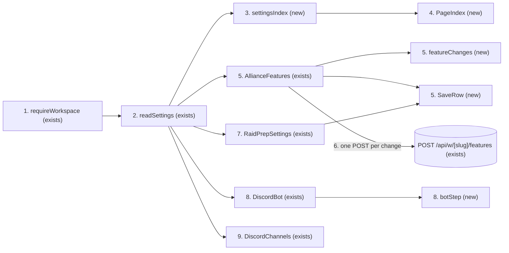

# Alliance settings and /admin: clear, explicit, with help in place (#585 batch 2b)

**Approved**: 2026-11-22 - user: "go with what you and the personas recommend" (owner, 2026-11-21, standing approval in CONTRIBUTING.md § Working rules); product-strategy verdict: [Plan review](#plan-review); adversarial verdict: [Plan review](#plan-review)

Size: L (more than one PR; slice 3 adds routes). This plan covers all slices; **only slice 1 (S1) is built in this PR**. Part of #585 (findings F28, F38, F11, F12, F13, F33, F34) and #392.

## Problem

The owner, about these screens: "the admin panel's permissions, workspaces and granularity page, and the Alliance settings panel… are not friendly at all". The people who use them are experienced game officers, aged 20s to 50s, in six countries, some reading English as a second language, and the site's owner on /admin.

Measured on a local production build of `dev` (0921a586) with the invented 585 seed (`585-2b/shots/before/`):

- **Alliance settings** (`/w/[slug]/settings`) is 4,916 px tall at 360 (3,849 at 768, 3,825 at 1280), 5,213 in French. It has no index: the first 360 × 780 viewport shows the header, the read status bar and the Tracker key card, nothing else. Six cards follow in one 672 px column, also at 1280.
- **Two save models on one page.** Features saves each tick at once, for every officer, with no "saved" line (D134); the Raid Shield check card right under it has a Save button; Notifications saves at once for this device; Discord channels save with "Check and save".
- **The Discord step contradicts itself** when the site's bot is off: "LAPTracker is in your server. Commands on: translate, me." and, under it, "The bot is not set up on this site yet. Ask the site's owner."; step 1 says "Discord is not set up on this site yet."; the lead still says "come back here and tap Check" with no Check button (`DiscordBot.tsx` shows the stored "seen" state and the "off" line independently).
- **The Raid Shield channel's privacy warning is the faintest text in its card**: 14 px at ink/75 under a bold title, while it is the one sentence that stops an officer from posting names into a members' channel (D147).
- **Labels touch their selects** (4 px) in the Raid Shield check card.
- **No view of who can open the desk** (F38).
- **/admin** is 9,184 px tall at 360 (6,578 at 1280). Its first screen is Status: "3869 of 1,000 · Not read today", "Running now: Nothing". With an access request waiting, one workspace with no member role and one with no read, the owner concludes "nothing to do" (F11). `attentionOf` ignores a closed board, no read and no Discord (F12). `WorkspaceForm`'s select shows the wrong alliance for a workspace with no read yet (F13). Quota above the cap shows "OK"; "of 1,000" is typed out in 9 strings; there is no late-tick check; `/admin/errors` drops `workspace_slug` (F34). Workspaces, permissions and feature switches are one long section of the overview (F33).

Usage (PostHog, read-only, last 30 days, consented pageviews; numbers from the orchestrator): `/admin` 42 views in 34 sessions (14 under 640 px); `/w/[slug]/settings` 14 views in 14 sessions (7 under 640 px); `/admin/runs` 7/4/5; `/admin/members` 5/4/5; `/admin/errors` 4/3/3; `/admin/changes` 3/2/3. Settings writes (`ws_action`): `features` 8, `discord` save 2, `discord` check 1, `tracker_key` save 1. Few officers have used Alliance settings at all, half of them on a phone: first-time clarity matters more than speed for repeat users. On /admin the owner is the main user, also on his phone.

What is different when S1 ships: the first phone screen of Alliance settings lists every card with its state ("Tracker key · Working", "Discord · 3 of 3 channels set"), and a card that needs a look says so in yarn; Features changes nothing until Save, and says "Not saved yet" until then; the Discord card says one thing about the bot; the Raid Shield channel's warning reads at full contrast with a "Leaders only" tag.

## Shape

Reuses the existing routes (`/api/w/[slug]/features`, `/raid-prep`, `/discord`), the layout components (`PageHead`, `Spread`, `MarginNote`) and the desk's leave warning (`useLeaveWarning`, `notice-editor-state.ts`); no new route, table or field. The rules that change what an officer sees (each card's state in the index, which switches a Save sends, which bot lines show) run in plain functions the Vitest suite reaches.

1. officer opens `/w/[slug]/settings` -> `requireWorkspace` (exists) - officers only; a member's session is refused (`refuse.ts`, unchanged)
2. `readSettings` (exists) - the key view, features view, shield settings, webhooks, bot view, push view, as today
3. `settingsIndex` (new, `app/(private)/_ui/settings-index.ts`) - turns those views into one row per card shown: its anchor, its name and its state, with `attention` when it needs a look
4. `PageIndex` (new, `lib/brand/components/layout/PageIndex.tsx`) - draws the rows as 44 px jump links with the state beside each; in a `MarginNote` "On this page", above the cards below 1024 and in the sticky margin column from 1024 (`Spread marginFirst stickyMargin`)
5. `AllianceFeatures` (exists) - ticks change a draft only; `featureChanges` (new) lists the switches that differ from what is stored; `SaveRow` (new, `app/(private)/_ui/SaveRow.tsx`) shows Save, "Not saved yet: n changes", "Saved." or the refusal, and warns before the page is left while dirty
6. Save -> `POST /api/w/[slug]/features` (exists) once per changed switch, one after another; stops at the first refusal; then `router.refresh()`, so the page shows what the server stored
7. `RaidPrepSettings` (exists) - same `SaveRow`; Save is off while nothing differs
8. `DiscordBot` (exists) - `botStep` (new) picks one of `off` (no Discord app on the site), `noCheck` (app id but no bot token), `ready`; `off` shows one block in place of steps 1 and 2 and never the stored "in your server" line
9. `DiscordChannels` (exists) - the Raid Shield channel's title carries a `Tag` "Leaders only" (attention) and its help line is body size at full ink; the webhook how-to and the private-channel note are in-place help (`
`), open while a channel is not set

**Changes underneath**

| Front       | What changes                                                                                                                                                                         |
| ----------- | ------------------------------------------------------------------------------------------------------------------------------------------------------------------------------------ |
| domain      | Features' officer switch meant "one tap, saved at once" (D134), now "ticks, then Save"; D134 gets a dated amendment. The route and its limit (60 per 15 min) are unchanged           |
| stored data | nothing to migrate                                                                                                                                                                   |
| readers     | Alliance settings only. `ws_action` `features` still counts one per switch that went through; fewer turn_off → turn_on pairs are expected from this release (a dated "Changed" line) |
| design      | DESIGN.md gains `PageIndex` (layout components) and "Save row" and "In-place help" (workspace components)                                                                            |

Data: none - read only; no entity, relation or field is added or written beyond the existing switch, shield-settings and webhook writes.

## Surface

None - no route is added or changed. The page calls the existing `POST /api/w/[slug]/features`, `/raid-prep` and `/discord` exactly as today.

## Landing

None - no one-way door: no data is deleted, no schema change, no change to who sees which field (the index shows the officers states they already see further down the same page), no quota change, no new dependency. Every part comes out in one commit.

## Criteria

### S1: Alliance settings says what is set, what saves, and what needs a look (P1) - built in this PR

**Acceptance Criteria**

1. WHEN an officer opens Alliance settings THEN the page SHALL show, before the first card, an "On this page" index with one row per card shown, in page order: Tracker key, Features, Raid Shield check (while the check is on), Notifications (while the site has push keys), Discord, Your alliance's data; each row SHALL be a link of at least 44 px to its card
2. The index SHALL give each row its card's state in words:
   - Tracker key: the key's state word (`Working`, `Refused`, `No quota left today`, `Enter it again`, `Not set`, `Site's key`, `Off on this site`)
   - Features: `{on} of {allowed} on`
   - Raid Shield check: `Summary to Discord: on` or `off`
   - Discord: `{set} of {n} channels set`, and `commands off on this site` when the site has no Discord app (was `bot off on this site`; changed 2026-11-22 after the after-build first-glance test, where "bot off" beside the channels read as "nothing posts", while the webhooks post without the bot)
   - Your alliance's data: `Deletion asked: {date}` while a deletion is asked, else no state
3. IF a card needs a look THEN its index row SHALL show its state in yarn with a dot, and SHALL NOT otherwise:
   - key refused, out of quota, or to enter again → attention; key `Working` → none; no key → none (the key is optional, D134)
   - a channel to paste again → attention; the Raid Shield summary on with no usable Raid Shield channel → attention on Raid Shield check; every channel set → none
   - a deletion asked → attention
4. At 360 × 780 the whole index SHALL be inside the first viewport for the seeded `ogs` workspace (EN, FR, PT); from 1024 it SHALL sit in the margin column and stay in view while the cards scroll
5. WHEN an officer ticks or unticks a feature THEN nothing SHALL be sent, and the Features card SHALL show "Not saved yet" with the number of changes, in yarn, beside an enabled Save
6. WHEN the officer taps Save THEN the page SHALL send one `POST /api/w/[slug]/features` per switch that differs from what is stored, and none for a switch ticked and unticked back; after every one went through it SHALL show "Saved." and the stored values
   - tick Thefts off, Insights off, Insights on again → one POST (Thefts off), "1 change"
7. IF a Save's POST is refused or gets no answer THEN the page SHALL stop sending, show the refusal (rate limited, failed, signed out), refresh to the stored values, and keep the switches not yet sent as the draft with "Not saved yet"
8. WHILE Features or the Raid Shield check card has changes not saved, WHEN the officer reloads or closes the tab THEN the browser SHALL ask before leaving (`useLeaveWarning`)
9. The Raid Shield check card SHALL use the same Save row: Save off while nothing differs from what is saved, "Not saved yet" while something does, "Saved." after a save
10. The page head SHALL say how the page saves, in one line: each card saves with its own button, and Notifications are for this device only
11. WHERE the site has no Discord app (no `DISCORD_CLIENT_ID`) the Discord card SHALL show one block in place of steps 1 and 2, saying the site's bot is off and that the channels below still work, and SHALL NOT show "LAPTracker is in your server", "Commands on", "Not checked yet" or "tap Check"; the channels' heading SHALL then have no step number
12. WHERE the site has the app id but no bot token THEN step 2 SHALL show only that Check is off on this site, never the stored "in your server" line
13. The Raid Shield channel SHALL carry a "Leaders only" tag beside its title, and its help line (the D147 text, unchanged) SHALL be at body size and full ink, never lighter than the card's other text
14. The Raid Shield check card SHALL keep 8 px or more between each select's label and the select
15. The webhook how-to ("In Discord: open the channel's settings → …") and the private-channel permissions note SHALL be in-place help a 44 px summary opens; the how-to SHALL be open while any channel is not set
16. The desk dictionary SHALL hold every new or changed string in EN, PT-BR and FR

### S2: /admin answers "what do I need to do?" first (P1) - next PR

**Acceptance Criteria**

17. WHEN the owner opens /admin THEN the first section SHALL be "Needs you", listing with a count each thing that waits on him: access requests, workspaces with a setup gap, page errors in the last 24 h, the quota above the cap or low, a late tick (none for 20 minutes or more); with none, one line says so
18. The workspaces' attention (`attentionOf`) SHALL count a closed board, no read yet, no Discord and no member role as setup gaps (F12)
19. The /admin nav SHALL carry counts for App errors and for the workspaces needing a look
20. `WorkspaceForm`'s alliance select SHALL show the workspace's own alliance when it has no read yet (F13)
21. IF the quota left is above the cap THEN the quota fact SHALL NOT say OK (F34); "of 1,000" SHALL come from one constant; `/admin/errors` SHALL show `workspace_slug`

### S3: /admin structure: Overview, Runs, Workspaces, one page per workspace (P2) - later PR, M triggers (new routes)

**Acceptance Criteria**

22. `/admin/workspaces` SHALL list the workspaces with their setup state; `/admin/workspaces/[slug]` SHALL hold that workspace's setup checklist, its features with plain words for each layer (allowed by the owner, on for the alliance, paused), its roles (leadership and member role ids, with help on where to find them), and a danger zone at the end (pause, sign out users) whose every action asks first, safe answer first
23. The admin area SHALL move its destructive actions without changing what they do or what they confirm

### S4: who can open the desk (P3) - needs the owner's OK (`decision`)

**Acceptance Criteria**

24. WHERE the owner approves it, Alliance settings SHALL show which Discord roles open the desk as leadership and as members (F38). Not built until the owner decides it: it reads Discord role names, which the desk does not show today

## Out of scope

| Excluded                                                         | Why                                                                                                                                      |
| ---------------------------------------------------------------- | ---------------------------------------------------------------------------------------------------------------------------------------- |
| S2, S3, S4 in this PR                                            | L work: one PR per slice; S1 has the highest first-glance gain for officers                                                              |
| A batch features route (`{switches: …}`)                         | One POST per changed switch fits the 60-per-15-minutes limit (at most 20 switches) and keeps `ws_action` one per switch                  |
| A warning on in-app navigation (Next links) with unsaved changes | The desk's leave warning (notices, Start here) covers reload and close only; the yarn "Not saved yet" stays visible. Follow-up if needed |
| Recomputing the tracker-call estimate from the draft             | The estimate counts served features (owner pauses included); after Save the refreshed page shows it                                      |
| Notifications switches                                           | Per device, saved at once (D148); the page head says so                                                                                  |
| A two-column card layout from 1024                               | Cards hold forms (`--form-max` 560 px); the margin column takes the index instead                                                        |
| A new analytics event                                            | See the analytics plan below: no product question needs one                                                                              |

## Assumptions

| Assumption                                                  | Chosen default                                                                                                                                                          | Rationale                                                                                                    | Confirmed? |
| ----------------------------------------------------------- | ----------------------------------------------------------------------------------------------------------------------------------------------------------------------- | ------------------------------------------------------------------------------------------------------------ | ---------- |
| "Explicit save model"                                       | Every card that changes something for the whole alliance saves with its own button and says "Not saved yet" until then; per-device Notifications save on tap, said once | The finding is two models with nothing saying which; the instant one changes every officer's tabs on one tap | n          |
| Where the index lives                                       | A reusable `PageIndex` layout component, so S2 can use it on /admin                                                                                                     | DESIGN.md: no component that exists only once                                                                | n          |
| Which states count as "needs a look"                        | Only states that stop something working (key refused, out of quota, to enter again; a webhook to paste again; the summary on without its channel; a deletion asked)     | D75 tone: yarn means "needs a look", not "optional thing not set"; a missing key is optional (D134)          | n          |
| Which slice is first                                        | Alliance settings                                                                                                                                                       | The orchestrator's brief; officers are many and first-time, /admin has one user                              | y          |
| The site's bot "off" covers both no app id and no bot token | Two states (`off`, `noCheck`), because with an app id the install link works                                                                                            | `botView`: `installUrl` needs only `DISCORD_CLIENT_ID`; Check needs the token and both credentials           | n          |

**Open questions:** none - all resolved or logged above (S4 waits on the owner's decision before it is planned in detail; it is not built here).

## Validation

### (a) Officer panel and the owner: first-glance test, before

Each persona saw only the first viewport at 360 × 780 (`585-2b/shots/before/settings--360-light-en-fold.png`, `-fr-fold`, `-pt-BR-fold`; /admin `admin--360-light-en-fold.png`) for about 5 seconds.

| Persona                                  | Question                                                     | What they concluded                                                            | Right?                                    |
| ---------------------------------------- | ------------------------------------------------------------ | ------------------------------------------------------------------------------ | ----------------------------------------- |
| R5, 40s, native English                  | "Is our Discord set up so the Raid Shield summary posts?"    | "This page is the tracker key. Discord must be somewhere else."                | Wrong (MUST)                              |
| War lead, 30s                            | "Is the Raid Shield check on, and when is the morning read?" | "Can't see it. The key works, so I guess it's on."                             | Wrong guess (MUST)                        |
| Diplomat, early 20s, French              | "Où je règle le salon pour les annonces ?"                   | « Ici c'est la clé du tracker, pas Discord. »                                  | Wrong (MUST)                              |
| Discord upkeep officer, 50s, US          | "Is the bot in our server, and are all channels set?"        | "No idea from this. I'd scroll." (scrolling, she finds the contradiction, F28) | No answer                                 |
| Officer, early 20s, Ukraine (English L2) | "If I untick a feature, is it saved at once?"                | "There are no features here."                                                  | Wrong (MUST)                              |
| Architect, 30s, Switzerland              | "What can I change on this page?"                            | "Only the tracker key."                                                        | Wrong (MUST)                              |
| Owner on /admin                          | "What do I need to do today?"                                | "Quota not read today, nothing running, next run Saturday: nothing to do."     | Wrong (MUST): a request and 2 setups wait |

### (b) Usage in PostHog, read only

The numbers are in Problem. What we would query next (HogQL, read-only):

- Settings reach and depth: `$pageview` where `pathname` matches `/w/%/settings`, by `$viewport_width < 640`, and `$pageleave` `$prev_pageview_max_scroll_percentage` for those views (does anyone reach Discord or the data card on a phone?).
- Mis-taps under instant save: `ws_action` `feature = 'features'`, pairs of `turn_off` then `turn_on` of the same workspace within 5 minutes (the server event has no switch name, so per workspace and time); the same after this release, expected lower.
- Discord setup friction: `ws_action` `discord` by `action` (`check`, `save`, `test`, `remove`) per workspace, and the Check refusals' codes if logged; `ws_webhook_set` by `channel` (is the Raid Shield channel set where the summary is on?).
- Key setup: `ws_key_saved` by `state`.
- /admin: `$pageview` paths under `/admin` per session, time from `$pageview /admin` to the first `admin_*` event; `admin_workspace_approved` delay after `ws_access_requested`.

What the tracking plan says exists in Alliance settings: `ws_action` `features` (`turn_on`, `turn_off`), `tracker_key` (`save`, `remove`), `discord` (`check`, `save`, `test`, `remove`), `raid_prep` settings save, `data_export`, workspace deletion ask/cancel; browser `ws_key_saved`, `ws_webhook_set`, `ws_bot_installed`, the push events. On /admin: `admin_feature_changed`, `admin_workspace_approved` and the run actions.

### (c) Product strategy: approve with changes

Settings first is right: half its views are on a phone and few officers have used it, so the first screen has to teach the page. Changes taken: (1) the index doubles as a setup checklist for a new alliance, so its states are the setup states (criterion 2), and S2 reuses it on /admin as "Needs you"; (2) "needs a look" only for what stops something working, so a new alliance is not met with a page of yellow (criterion 3); (3) the analytics plan gets a dated "Changed" line so a drop in turn_off → turn_on pairs is read as the save model, not as less use. Proposed and kept for later: S4 (who can open the desk) as an owner decision; a "Settings needs you" line on Home from the same `settingsIndex` attention (follow-up, Home already has the key card). Declined: an event for index taps (it answers no decision; scroll depth from `$pageleave` already says whether people reach the lower cards).

### (d) Adversarial (privacy D71/D142, destructive actions): approve with changes

- Privacy: the index reads only the views the page already reads after `requireWorkspace`, and shows states the same page shows below; no roster field, no webhook URL, no key; a member's session is still refused before any read. No change to D71 or D142.
- Must fix, taken: a Save that is refused halfway must not leave the page showing switches as saved that are not; criterion 7 refreshes to the stored values and keeps the unsent ones as the draft.
- Must fix, taken: a double tap on Save must not send twice; Save is disabled while sending (criterion 6's one POST per change).
- Taken: turning off a tab is now a two-step act (tick, Save) with "Not saved yet" in yarn; the lead keeps "Nothing is deleted".
- Danger zone: "Delete this workspace" keeps its typed-address sheet with the safe answer first, unchanged; the index row only jumps to the card and shows "Deletion asked: {date}" in yarn while one is asked. S3 moves /admin's destructive actions only with their confirmations unchanged (criterion 23).
- Accepted limit: the leave warning does not catch in-app navigation (Out of scope).
- No one-way door: the standing approval applies.

## Analytics plan

No new event. Change: a dated line in the tracking plan's "Changed" section: from this release Features saves on Save, so `ws_action` `features` still counts one per switch that went through, and turn_off → turn_on pairs within minutes should drop. Remove: nothing. PostHog side: no insight or Endpoint reads `ws_action` `features` by action; nothing to change.

## Differences from the source

None - no binding design source; the findings and the screenshots are the evidence.

## Sources

- Orchestrator brief, 2026-11-22 (#585 batch 2b) - binding - scope, slices, process
- `585-review/findings.md` F11, F12, F13, F28, F33, F34, F38 - binding - the problems
- PostHog numbers from the orchestrator, 2026-11-22 - binding - usage
- DESIGN.md (Layout system D122, Workspace components, Validation) - binding - the look and the tests
- D71, D124, D129, D134, D137, D142, D147, D148 - binding
