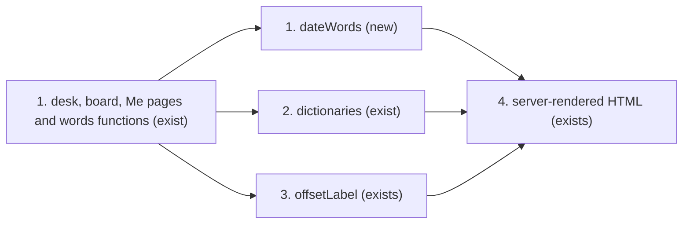

# Words pass in EN, PT and FR: one rule per concept for dates, times, zones and averages, then the words (#585 batch 4)

**Approved**: 2026-11-22 - user: "go with what you and the personas recommend" (owner, 2026-11-21, standing approval in CONTRIBUTING.md § Working rules); product-strategy verdict: [Validation (c)](#c-product-strategy-approve-with-changes); adversarial verdict: [Validation (d)](#d-adversarial-approve-with-changes). Covers S1 only. S1b (F19) reverses a rule D136 states and both verdicts ask for the owner's own yes, so it waits for the owner's reply (see S1b).

Size: L (more than one PR: seven slices across the desk, the members' board, Me and /admin). This plan covers every slice; **slice 1 (S1) is built in `feat/585-words-1`, slice 2 (S2) in `feat/585-words-2`**. Part of #585 (findings F19, F25, F30, F31, F35, F43, F44, F45, F46, F47) and the "first-visit fold" item of #656.

## Problem

The same fact is written several ways, and one number is computed two ways.

- **Dates (F35).** The desk writes a date at least five ways: "Fri, Nov 20" (cards, calendar), "Nov 20" (trends, breaks), "20/11" (Portuguese breaks only), "Sun 15 Nov 13:46" (thefts, notices, the card's times, no comma), "Mon 18:54 server time" (Home, no date). Each page builds its own `Intl.DateTimeFormat`, about 20 of them, and one (`NoticePictureKept.tsx`, a client component) has no zone, so it writes the process's or the viewer's day, not the server day. In Portuguese and French a short date ends in "." ("sex., 20 de nov."), so a sentence that ends with one prints "nov..". /admin writes three more forms.
- **Zones (F35, F31).** Times end in "ST" on most desk lines and in "server time" on others ("{time} server time" on Home, notices, thefts and the Members source line; "Back on (server time)"; "Times are server time."), sometimes on one screen. Portuguese spells the full term two ways ("hora do servidor", "horário do servidor"). The offset is "UTC−2" on the calendar and in the time-zone picker, but the board writes the viewer's zone with the browser's short name ("BRT", "GMT", "GMT-3"), and /admin's schedule shows the IANA id "Etc/GMT+2", which reads as the opposite sign.
- **Board vs Me (F31).** The board's "This week" is today and the six days after it (Saturday to Friday on a Saturday); Me's "This week", one tap away, is Monday to Sunday. The board puts the viewer's own time first and server time under it; Me's squads line puts server time first and the viewer's time after it, with "(the next day)" pointing at a date the line never says.
- **Averages (F19).** A member's daily quest points, Alliance Help coins and donations are averaged in three places. The member card's "Last 7 days" (`rowOf`, `lib/private/member-days.ts`) and Me (`averageOf`, `lib/private/me-parts.ts`) leave a "none" day (the daily update listed the member, nothing sent) out of the average, as D136 states. Insights (`effortsOf`, `lib/private/insights-rules.ts`) counts it as 0, as D139 states, with its reason: under the card's rule one big day among six "none" days reads as a high average. D127 says a "none" day is a fact, not missing data.
- **Words (F25, F30, F43 to F47).** "read" is used as a noun where the glossary's UI word is "daily update", and French uses three words for it. Notices use two sets of status words, leave titles untranslated, never say a notice changed after it was posted, and "Update English" does not say from which language. Thefts' "Open" status looks like a button, a group line repeats, and Portuguese shows "Quest rewards" in English. French uses "Annuler" for both undo and cancel, KvK's gender varies, Portuguese mixes "você" and "vocês" and "Agenda" and "Calendário", and the coins unit stays in English. The Members head has four meta lines and three counts, and the name field says "Name (no emoji needed)". Start here's disabled buttons give no reason and its back link always goes to the board. Former members' facts line is dense and never says where a member went. Follow-up's open "How this list works" pushes the "After KvK, offer help" group below the first phone screen on a first visit (#656).

Who pays: officers on phones, several reading English as a second language, compare two dates or two numbers that should agree and lose trust in both; a member reads a different week on two pages one tap apart.

Usage: no PostHog access in this build; the read-only queries for the touched screens are listed under Validation.

What is different when S1 ships: every desk, board and Me date reads one way per purpose ("Fri, Nov 20"; with a time "Fri, Nov 20, 18:54 ST", PT "sex., 20 de nov. às 18:54 ST", FR "ven. 20 nov. à 18:54 ST"), no sentence ends in "nov..", every time ends in "ST", every offset reads "UTC−2", "This week" always means Monday to Sunday, and the board and Me both put the viewer's own time first.

## Shape

S1 adds one date module (`lib/date-words.ts`, new, pure `Intl`, no private data, importable from `lib/private` and `app`) and points every desk, board and Me caller at it; the one offset form already exists (`offsetLabel`, `lib/calendar-time.ts`). No route, table or field changes. The rules run in pure functions the Vitest suite reaches (`date-words.test.ts`, `BoardParts`/`MemberSquads` tests), and the pages only call them.

1. a desk, board or Me page or `lib/private` words function that writes a date or time -> `dateWords(language, zone)` (new, `lib/date-words.ts`) - the forms below, made once per language and zone; a `YYYY-MM-DD` string is a server day, a `Date` is shown on `zone`'s clock
2. the page's dictionary (exists, `lib/private/dictionary*.ts`) - adds " ST" through `time.server` ("{time} ST") or the line's own key
3. `offsetLabel` (exists, `lib/calendar-time.ts`) - the one offset form "UTC−2" for the instant shown; `lib/private/time-zones.ts`' `offsetLabel(minutes)` formats through the same code (`offsetText`, exists after this change in `lib/calendar-time.ts`); the board's time column and /admin's zone row use it
4. out: server-rendered HTML; a client component gets its server-zone strings as props, so server and browser HTML never differ

**The date forms** (EN shown; PT-BR and FR from `Intl` in the officer's language, 24-hour clock):

| Form       | EN                  | PT-BR                       | FR                   | For                                                                                           |
| ---------- | ------------------- | --------------------------- | -------------------- | --------------------------------------------------------------------------------------------- |
| `day`      | Fri, Nov 20         | sex., 20 de nov.            | ven. 20 nov.         | every date in a row, chip, line or card                                                       |
| `dayMonth` | Nov 20              | 20 de nov.                  | 20 nov.              | where the weekday is said already (trends) or an article comes before it (a break's last day) |
| `long`     | Friday, November 20 | sexta-feira, 20 de novembro | vendredi 20 novembre | a day's heading (calendar, board)                                                             |
| `sentence` | November 20         | 20 de novembro              | 20 novembre          | a date that ends a sentence or follows an article ("after the {date}.")                       |
| `withYear` | November 20, 2026   | 20 de novembro de 2026      | 20 novembre 2026     | a date that may be months away (deletion)                                                     |
| `time`     | 18:54               | 18:54                       | 18:54                | a time alone; the line adds " ST"                                                             |
| `at`       | Fri, Nov 20, 18:54  | sex., 20 de nov. às 18:54   | ven. 20 nov. à 18:54 | a date with its time; the line adds " ST"                                                     |
| `range`    | Nov 16 – 22         | 16 – 22 de nov.             | 16–22 nov.           | a week (`Intl` `formatRange`, so a week across months names both)                             |

Machine formats stay as they are: the thefts page's `en-CA` server day (a key) and `en-GB` "HH:MM" (a form field value), and every `YYYY-MM-DD` key.

**Changes underneath**

| Front       | What changes                                                                                                                                                                                                                                                                                                                                                                                                                  |
| ----------- | ----------------------------------------------------------------------------------------------------------------------------------------------------------------------------------------------------------------------------------------------------------------------------------------------------------------------------------------------------------------------------------------------------------------------------- |
| domain      | "This week" on the board meant the next 7 days; the board's section is now "Next 7 days", and "This week" always means Monday to Sunday                                                                                                                                                                                                                                                                                       |
| stored data | nothing to migrate: formats are computed per request                                                                                                                                                                                                                                                                                                                                                                          |
| readers     | every desk, board and Me date and time line; the board's title, section and time column; Me's squads "seen" line; /admin's schedule zone row. Decisions that quote a changed string get a dated amendment: D105 and D116 (the board's week, title and zone name), D109 (the trend date in PT), D108 or the decision that quotes the Portuguese "24/11" break date, and every decision that quotes a "{time} server time" line |

Data: none - nothing stored is read differently or written.

## Surface

None - nothing consumed outside. Routes and their responses are unchanged.

## Landing

| One-way door                                                                                                                                                                       | Literal shape | Alternative rejected |
| ---------------------------------------------------------------------------------------------------------------------------------------------------------------------------------- | ------------- | -------------------- |
| None - every change is a computed string or a pure function; no stored format, public URL, cookie, analytics property, schema, dependency, quota use or private-field flow changes | -             | -                    |

- Nothing else in this change is hard to reverse

## Criteria

### S1: one rule for dates, times and zones on the desk, the board and Me (P1)

Every desk, board and Me date, time and zone is written one way per purpose, in the officer's or member's language, on the server's clock.

**Acceptance Criteria**

1. The system SHALL write a server day on every desk, board and Me row, chip, line and card as `day`: EN "Fri, Nov 20", PT-BR "sex., 20 de nov.", FR "ven. 20 nov."
   - the break line in Recent activity, where French puts an article before the date ("jusqu’au {date}"), writes `dayMonth` in every language: "until Nov 24", PT "até 24 de nov." (it wrote "24/11"), FR "jusqu’au 24 nov." (amended while building: `day` would have printed "jusqu’au mar. 24 nov.")
2. The system SHALL write an instant with its time as `at` and " ST": EN "Fri, Nov 20, 18:54 ST", PT-BR "sex., 20 de nov. às 18:54 ST", FR "ven. 20 nov. à 18:54 ST"; the thefts list, notices' "written by" and "last change" lines, Home's To review, the garrison's "posted" line and the member card's times use it
3. WHILE the server's zone is UTC−2 and the machine's zone is neither UTC nor UTC−2, WHEN an instant is 2026-11-21T01:31Z THEN the system SHALL write it as EN "Fri, Nov 20, 23:31" (the server day, not the UTC or the machine's day)
4. IF a notice picture's "kept" date is shown THEN the system SHALL write the server day, built on the server (`NoticePictureKept`)
5. IF a dictionary line ends a sentence with a date THEN the system SHALL fill it with `sentence` or `withYear`, so no PT or FR line prints "nov.." (the other lines with an article before a short date, about 50 keys, are S4's sweep)
   - EN "This workspace will be deleted after November 20, 2026."; PT "… depois de 20 de novembro de 2026."; FR "… après le 20 novembre 2026."
6. The system SHALL end every time on the desk, board and Me in "ST"; the full term is written only in a legend or help line, as EN "server time (ST)", PT-BR "horário do servidor (ST)", FR "heure du serveur (ST)"
   - "{time} server time" → "{time} ST"; "Back on (server time)" → "Back on (ST)"; "Times are server time." → "Times are in server time (ST)."
7. The system SHALL write a zone's offset as `UTC±h[:mm]` with a true minus sign, for the instant shown ("UTC−3"; Europe/Kyiv "UTC+2" in November and "UTC+3" in July), on the board's time column, the calendar legend, the time-zone picker and the member card's zone; never a browser short name ("BRT", "GMT")
8. WHEN the owner opens /admin THEN the schedule's zone row SHALL read "UTC−2 (server time)", never the IANA id
9. The members' board SHALL title the page "Next 7 days in the alliance" (PT-BR "Os próximos 7 dias da aliança", FR "Les 7 prochains jours de l’alliance") and its section "Next 7 days" (PT-BR "Próximos 7 dias", FR "Les 7 prochains jours"); "This week" SHALL mean Monday to Sunday wherever it appears
10. The board's time column SHALL read "your time (UTC−3)" (PT-BR "seu horário (UTC−3)", FR "votre heure (UTC−3)"); the calendar's "{time} your time" reads PT-BR "{time} seu horário"
11. WHILE the viewer's zone is known, Me's squads "seen" line SHALL put the viewer's time first with its own date, then the ST time: "seen Fri, Nov 20, 00:32 your time · Thu, Nov 19, 22:32 ST"; on the same day the date is written once: "seen Thu, Nov 19, 20:32 your time · 22:32 ST"; the desk card's line keeps server time first
12. WHILE the browser does not know its zone, the board, Me and the desk SHALL show the ST time alone, so server and browser HTML never differ (as today)
13. Me SHALL say once, where its times appear, that they are in server time (ST)

### S1b: one rule for a member's average (F19) - waits for the owner (P1)

The card, Me and Insights agree on a member's average. Not built until the owner answers; recommended by the officer panel (6 of 7 with changes) and the product-strategy persona, with the adversarial reviewer's conditions.

The question for the owner: "D136 says the card's and Me's averages leave a 'none' day out; D139 says Insights counts it as 0. Should 'none' count as 0 everywhere (Insights' rule, recommended), with the average line naming the none days ('Average 400 · 6 days, 2 none'; all none: 'None on all 7 days', never 'Average 0')?"

Criteria, when approved:

1. The system SHALL average a member's daily quest points, Alliance Help coins and donations over the days whose daily update lists the member, counting a "none" day as 0 and leaving out a day with no daily update and a day still to come (`dayAverage`, one function, used by the card, Me and Insights)
   - 600, none, none, 600, no update, 600, 600 → "Average 400 · 6 days, 2 none"; seven "none" → "None on all 7 days"; no day with a daily update → no average
2. WHEN the card's Last 7 days, Me's last week and Insights' effort for one member are built from the same seven end-of-day reads THEN the system SHALL show the same average in all three
3. The card and Me SHALL keep writing a "none" day as "none" and a day with no daily update as the no-data mark (D127)
4. Insights keeps its last-7-reads window and its "few reads" rule (adversarial finding 3); the agreement in criterion 2 is for the same days
5. A new decision supersedes D136's average sentence and D139's "This differs" paragraph (adversarial finding 2); the PT and FR "none" counts get their own `.one`/`.other` keys from the copy experts

### S2: one word for the daily update, and Follow-up's help on one screen (F25, #656) (P2)

"read" as a noun becomes "daily update" in UI copy (the glossary's UI word), with one Portuguese and one French word for it; Follow-up's "How this list works" is closed on every visit, so a first visit's first screen is a return visit's. Built in `feat/585-words-2`.

**Approved (S2)**: 2026-11-22 - user: "go with what you and the personas recommend" (owner, 2026-11-21, standing approval in CONTRIBUTING.md § Working rules); product-strategy verdict: [Validation (g)](#g-s2-product-strategy-approve-with-changes); adversarial verdict: [Validation (h)](#h-s2-adversarial-approve-with-changes).

Scope of the word: the end-of-day read of the alliance (glossary "daily read"). Not this word, kept: the Raid Shield check's "reading", the tracker's "squad reads", a KvK's "Start read" / "End read" and its "KvK read", the tracker's per-member "read" in the export's file list, the status bar's label "Reads from the tracker", and every verb ("could not be read", "Read from a screenshot", Insights' "the alliances we read"). Stored keys keep their names (`night_read`, `insights.pulse.noRead`, `daily_reads`). Out of scope: /admin and the owner's Discord lines (`lib/copy-admin*.ts`, `lib/copy-discord.ts`: English only, D48; /admin's words are S7's) and the public pages (their own reviewed copy, as in S1).

Decisions amended (Copy rule): D104, D140 and D73 (the help and its cookie); D139, D142, D146, D148, D135 and D132 (the word).

**Acceptance Criteria**

14. The system SHALL name the end-of-day read "daily update" in every desk, board and Me line that names it as a noun, PT-BR "atualização diária", FR "mise à jour quotidienne", and never "read", "reading", "leitura" or "relevé"/"lecture" for it
    - Members' week line: "no daily update on Tue, Wed, not in the total"; Me: "No daily update that day: it never counts."; Insights: "Based on 3 daily updates this week: Mon, Tue, Thu."; the status bar: "Today’s daily update failed · the cards keep the last numbers" and "Today’s daily update is late · the cards keep the last numbers" (it said "roster"); Alliance settings: "They are read after the daily update."
15. The Insights week bars SHALL note a week's count as "{n} daily updates" ("1 daily update"), and a week with none as "no daily update"; never "{n} days", which 3 of 7 officers read as days played (S1b's panel)
16. WHEN tonight's daily update and its retry both fail THEN the officer's notification SHALL read "Daily update failed" with "Tonight’s daily update and its retry failed. Nothing to do: the desk keeps the last numbers and tries again tomorrow."; the Notifications setting's label SHALL read "Daily update failed"; the stored use `night_read` is unchanged
17. WHEN an officer opens Follow-up, on a first visit as on any other, THEN "How this list works" SHALL be closed, its summary "Tap a name to write down what they said. How this list works" in sight; one tap SHALL show D140's line, "Say hello, write down what they said, mark how it went." (it no longer repeats "Nothing is sent for you."), and the owner's line word for word: "These are notes for you. Nothing is sent and nobody is removed from the alliance."
18. WHEN an officer opens Follow-up for the first time on a browser, at 360 × 780 in English, with one member under "Needs help" and one under "After KvK, offer help" THEN the "After KvK, offer help" title's box SHALL end above the tab bar's top, as on a return visit; in every language the "{n} to offer help after the KvK ↓" jump SHALL be in the first screen (in PT and FR the title is below the fold on every visit with this seed: the header and the jump wrap; a follow-up)
19. The cookie `lap_ws_fu_help` SHALL no longer be read or written (a cookie already in a browser is left to expire; it holds no identifier)

### S3: Notices and Thefts words (F30, F43) (P2)

One set of notice status words; titles translated with the text; a "changed after posting" line; "Update English from {language}". Thefts' "Open" status as a status, not a button; the repeated group line said once; Portuguese "Quest rewards" translated. If translating titles adds AI requests per notice, that is an M trigger and is sized then.

### S4: French and Portuguese terms (F44) (P2)

FR: "Annuler" only for cancel and another word for undo; one gender for KvK; no abbreviated date after an article anywhere (the S1 sweep covers the lines that end a sentence). PT: one form of address ("você"), one word for the calendar, the coins unit translated; lowercase "média"/"moyenne" after a colon on Me. Glossary entries for each chosen term.

### S5: Members head and Former members (F45, F47) (P3)

The Members head down to the lines an officer acts on, one count; the name field's hint; Former members' facts line split, and "went to {alliance}" where a public daily roster shows it.

### S6: Start here (F46) (P3)

A disabled button says why; the back link returns to where the officer came from.

### S7: /admin dates (F35, /admin part) (P3)

/admin's three date forms ("Oct 31, 16:01 server time", "Sat, 11/07/2026, 14:01 server time", "5 Nov") become one; with the /admin batch (#392) if it runs first.

## Out of scope

| Excluded                                                                              | Why                                                                                                                          |
| ------------------------------------------------------------------------------------- | ---------------------------------------------------------------------------------------------------------------------------- |
| Public pages' dates and their "server time" word (`app/_ui/format.ts`, `lib/copy.ts`) | the public pages have the viewer's own date-order and zone choice and their own reviewed copy; F35 names the desk and /admin |
| Discord messages, ready messages and theft warnings to players                        | sentences sent outside the app in the recipient's language; a separate review with the players' persona                      |
| /admin's date forms                                                                   | S7 (product strategy: /admin is the /admin batch's, #392); S1 fixes only its zone row, which is the zone rule                |
| "Yesterday"/"today" before a date                                                     | a new behaviour the officer panel suggested (SHOULD); follow-up                                                              |
| The desk card's squads line following the Server/My time switch                       | the line ignores the switch today (adversarial finding 6); changing it is new behaviour; follow-up                           |
| Weekday-only labels and day-of-month digits (the board strip, day columns)            | labels, not dates; they already come from one `Intl` call each                                                               |

## Assumptions

| Assumption                          | Chosen default                     | Rationale                                                                                                             | Confirmed?                                |
| ----------------------------------- | ---------------------------------- | --------------------------------------------------------------------------------------------------------------------- | ----------------------------------------- |
| The board's 7 days vs the game week | keep the next 7 days, retitle them | a Monday-to-Sunday board on a Saturday would hide next week's events (product strategy, officer panel 6 of 8 approve) | y - personas, under the standing approval |
| "ST" in PT and FR                   | keep "ST"                          | the community writes it in every language (PT and FR experts)                                                         | y - personas                              |
| The Portuguese "20/11" break date   | the one `day` form                 | one form per purpose (PT expert approves)                                                                             | y - personas                              |
| EN board title                      | "Next 7 days in the alliance"      | the officer panel's wording; PT and FR from the native experts                                                        | y - personas                              |
| F19's direction                     | Insights' rule                     | D127; officer panel and product strategy                                                                              | n - owner (S1b)                           |

**Open questions:** S1b's question to the owner (`blocks` S1b only).

## Differences from the source

None - no capture binds this plan.

## Sources

- Issue #585 Phase 1 findings (kept locally, persona notes not copied) - binding - the findings F19, F25, F30, F31, F35, F43 to F47
- Issue #656 - binding - the first-visit fold item
- D75, D105, D109, D116, D127, D136, D139, D142 - binding - the rules the criteria keep or amend
- docs/GLOSSARY.md - binding - "daily read" / "daily update", "ST"

## Validation

Plan review, 2026-11-22, on invented data only (no private field reached any persona). Each persona saw the plan and the before/after strings at 360 px.

### (a) Officer panel, member and player: approve with changes

Six officers (20s to 50s; UK, Philippines, France, US, Ukraine, Switzerland), a member and a player from another alliance.

| Change       | Approve / with changes / reject | MUST                                                                                                                                                | SHOULD                                                                                              |
| ------------ | ------------------------------- | --------------------------------------------------------------------------------------------------------------------------------------------------- | --------------------------------------------------------------------------------------------------- |
| F19 averages | 2 / 6 / 0                       | the line says how many days were "none" (3 of 7 read "6 days" as "played 6 days")                                                                   | a help line on what counts                                                                          |
| Dates        | 5 / 3 / 0                       | where the desk's My time switch shows the viewer's time, its label says "your time" (already so in `TimePair`; Home's To review has no viewer time) | "yesterday"/"today" before a date (follow-up); a week across months names both (`formatRange` does) |
| Zones        | 6 / 2 / 0                       | none                                                                                                                                                | the offset for the date shown (criterion 7); check the "−" glyph at 360 px                          |
| Board vs Me  | 6 / 2 / 0                       | Me's seen line: the viewer's time with its own date, no "(the next day)" (2 misread it) (criterion 11)                                              | the title "Next 7 days in the alliance" (criterion 9)                                               |

First-glance question "When was this sent, and is it today?" on "Screenshot from Officer Lark · Fri, Nov 20, 23:31 ST" (today Sat, Nov 21 ST): 7 of 8 said "yesterday"; the officer at UTC+8 said "today" from their own clock. Before ("Fri 23:31 server time"), the same officer said the same; the new line adds the date. The player from another alliance confirms nothing public changes.

### (b) PT-BR and FR copy experts: approve with changes

Adopted: the per-language join "às"/"à" (criterion 2); dates that end a sentence or follow an article use `sentence` or `withYear` (criterion 5); one full term per language, "horário do servidor (ST)" and "heure du serveur (ST)" (criterion 6); keep "ST"; drop "20/11"; PT "seu horário" (criterion 10); PT and FR titles (criterion 9); keep "· 6 dias"/"· 6 jours" (S1b). Not adopted in S1: lowercase after a colon on Me (S4).

### (c) Product strategy: approve with changes

Adopted: split F19 out to S1b for the owner's yes; /admin's date forms to S7; "ST" in the glossary for every language (S1); the ST legend on Me (criterion 13; the board has "Your own time comes first, with server time (ST) under it."); the first-glance test on Home, the board and Me (above). Measure: no new events, because no event or property changes meaning (the board's `board_section` value `week` keeps its days); watch `$exception` on the board and Me (criterion 12's zone rule) and Me page views for two weeks after release. Proposed follow-ups: `dateWords` for Discord ready messages; "UTC−2" on the public pages.

### (d) Adversarial: approve with changes

Adopted: F19 waits for the owner (finding 1); S1b's criteria take findings 2 to 5; Me's squads line gets an `order` and its viewer-day dates from the server, so no ST form is formatted in the browser (6); the picture date is built on the server (7, criterion 4); machine formats excluded (8); criterion 8 limited to the zone row (9); a test that no PT or FR date-ending line prints ".." (10); the board e2e heading and D105 change in the same PR (11); date tests compare with `Intl` output, not typed literals, where ICU spacing may vary (13).

### S2 validation

Plan review, 2026-11-22, on invented data only (the e2e seed; no private field reached any persona). Screens: 360 × 780 screenshots of Follow-up from a production build, in EN, PT and FR, on a first and a return visit, and option B mocked in the page.

### (e) S2 officer panel and member: approve with changes

Six officers (20s to 50s; UK, Philippines, France, US, Ukraine, Switzerland; four read the desk in English, two in French) and a member (Brazil, Portuguese).

First-glance test, "Who should I offer help to after this KvK?" (truth: the member in "After KvK, offer help"; the Needs help member above it has an officer's note about rebuilding a squad):

| Screen                                     | Right | Partial | Wrong |
| ------------------------------------------ | ----- | ------- | ----- |
| Before: first visit, help open             | 4     | 1       | 1     |
| Option B: open, the owner's line only      | 4     | 1       | 1     |
| After (option A): first visit, help closed | 6     | 0       | 0     |

- Help: A 4, C 2 (the owner's line also at the page's foot), B 0. 6 of 6: D140's line should drop "Nothing is sent for you." (the owner's line says it; "for you" reads as "on your behalf?" to a second-language reader).
- The word: 3 approve, 4 approve with changes, 0 reject. Adopted: the week bar note "{n} daily updates", not "{n} days" (2 officers read "5 days" as the week's length or days left). Reported, not changed: "Daily update failed" can read as an app update at a glance (the line's second half clears it); Me's "nothing sent" in the "none" legend (unchanged wording, a follow-up).
- SHOULD, follow-up: in FR the jump's "↓" wraps onto its own line.

### (f) S2 PT-BR and FR copy experts: approve with changes

Adopted: one term each, PT "atualização diária" (already in about eight lines) and FR "mise à jour quotidienne" (already in about seven; "relevé" is left to the KvK's Start and End and the squads, "mise à jour du jour" read like a typo); every PT and FR string of criterion 14; FR feminine agreement ("la dernière", "la première", "la plus récente"); "fora da conta" / "hors du compte" where "fica de fora" / "laissé de côté" did not agree with several days; « rien » in FR; the setting's label and the notification title the same string; EN "A member listed in the daily update …"; the late line aligned with the failed one; the trimmed D140 line ("… e marquem como foi.", "… et indiquez comment ça s’est passé."). Not adopted: "{n} dias" / "{n} jours" for the week bar note (officers and product strategy, criterion 15); "a day without one" in EN (kept "a day with no daily update", clearer to a second-language reader). Follow-ups: KvK's gender between Me and Insights, straight apostrophes in three EN KvK lines, FR "might" vs "puissance", "na última atualização" (ambiguous bare "update").

### (g) S2 product strategy: approve with changes

Option A: fixes the measured failure in EN, keeps the tap cue in sight and the owner's line word for word one tap away; B keeps the cookie and still fails; C prints the line twice where few officers scroll. Retiring the cookie is right; a first-time officer may tap "Talked to them" before reading "Nothing is sent", which Undo covers. No one-way door. MUSTs adopted: "{n} daily updates" (criterion 15); `night_read` keeps its key (criterion 16); the scope line above; D73 and D104 amended; the analytics plan says "change" with a dated line. Measure (read-only): the share of non-Talked records and of records with a note, the KvK group's share with a record in its week, and masked replays of first Follow-up views. Proposed follow-ups: the owner's line as a Follow-up card in the first-use steps; a shorter PT and FR head (a no-break space before "↓"), then the KvK first-glance test again in PT and FR.

### (h) S2 adversarial: approve with changes

Adopted: the amendments listed under the criteria (finding 1); the scratch screenshot spec and dump script are not committed (2); Alliance settings' "after the daily roster" takes the word, D132 amended (3); the late line in criterion 14 (4); criterion 18 defined by the title's box against the tab bar, proven by a screenshot, not a committed test (5); FR Insights' week bars checked at 360 px: the value and note wrap under the label, nothing overflows (6); "the alliances we read" kept as a verb (7); /admin and Discord lines listed as out of scope. No one-way door: `night_read`, the dictionary keys and the `use` property are unchanged; the retired cookie held no identifier.
