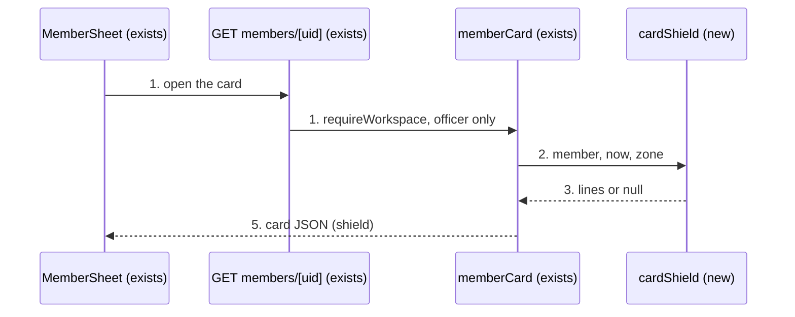
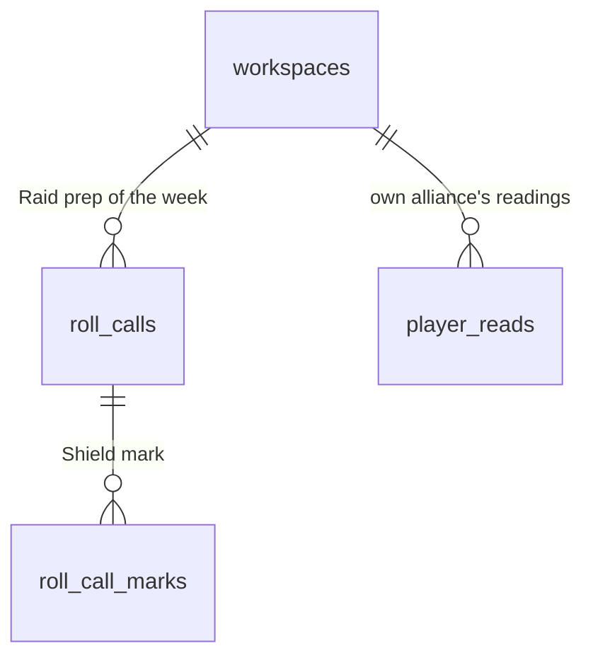

# Member card: the Raid Shield reading from Friday's night check until KvK starts (#634)

**Approved**: 2026-11-22 - user: "634 pode seguir com a sua recomendação" (owner, on issue #634: option A); product-strategy verdict: [Validation (b)](#b-persona-check-approve-with-changes); adversarial verdict: [Validation (c)](#c-adversarial-privacy-d71d137-d75-approve-with-changes).

Size: M (a second reader of the Raid Shield reading changes D137's Privacy paragraph: a one-way door the owner settled above). Built from #516's slice 2 (`.specs/features/516-card-followup-shield/plan.md`, S2) with option A.

## Problem

On raid night an officer who opens a member's card from Members cannot tell whether that member has a shield up. The card shows no shield data (D136, "Shields are not on the card"). To answer, the officer leaves the card for Raid prep, finds the member's tile and comes back. In #516's first-glance test (5 personas, 360 × 780), Q2 "Does this member have a shield up?" had no supported answer; 2 of 5 answered from an empty card or from the No-data circle by accident.

What is different when this ships: from Friday's night check (23:30 ST) until KvK starts (Saturday 12:00 ST), the card's header says the member's Raid Shield state in Raid prep's own words; at every other time it says nothing about shields.

## Shape

Reuses Raid prep's rules and reads: the raid's instants from `raidOf`, the readings from `shieldReadings` over `passWindows` (the alliance-wide windows Raid prep reads, no per-member query, D149), the checkpoints from `hintOf`, the week's Raid prep from `weekRaidPrep`, its marks from `newestMarks`, and the away rule `awayOn` on the raid's Saturday (as the Discord summary and the push count, D137 2026-11-22). The window and the state are decided in `lib/private/card-shield.ts`, which PGlite tests reach.

1. officer opens a card -> `GET /api/w/[slug]/members/[uid]` (exists) -> `requireWorkspace` (exists): officers of this workspace, own alliance; a member's session 401
2. `memberCard` (exists) - as today, plus `cardShield` (new)
3. `cardShield` (new) - WHERE `shield_check` is on, WHILE `raidOf(today).night <= now < raidOf(today).kvk`: away on the raid's Saturday -> "Away on raid day"; else the readings of both windows and the week's Raid prep mark; returns the lines, else null. Outside the window or with the check off it reads nothing
4. `raidOf` (exists, `lib/shield-check.ts`) - gains `night`: Friday at `NIGHT_MINUTE` (23:30 ST), so the window has one rule
5. out: the card JSON gains `shield` (null outside the window); `MemberSheet` (exists) shows it in the card's header under the status, inside `ph-no-capture`

**Changes underneath**

| Front       | What changes                                                                                                                |
| ----------- | --------------------------------------------------------------------------------------------------------------------------- |
| domain      | `raidOf` gains `night` (Friday 23:30 ST); its two callers ignore it. D137's Privacy paragraph and D136 get dated amendments |
| stored data | nothing to migrate; read only                                                                                               |
| readers     | the member card (Members; Follow-up's panel reads the same JSON and does not render `shield`)                               |

New: nothing - read only.

## Surface

| Route                             | In        | Out                   | Status                                  | Who                                                                      |
| --------------------------------- | --------- | --------------------- | --------------------------------------- | ------------------------------------------------------------------------ |
| `GET /api/w/[slug]/members/[uid]` | unchanged | `card` gains `shield` | 200; 401 `signed_out`; 404 `not_member` | officers of the workspace; a member's session 401, another workspace 404 |

## Landing

| One-way door                                              | Literal shape                                                                                                                                                    | Alternative rejected                                                                                                                                                                           |
| --------------------------------------------------------- | ---------------------------------------------------------------------------------------------------------------------------------------------------------------- | ---------------------------------------------------------------------------------------------------------------------------------------------------------------------------------------------- |
| A second reader of the Raid Shield reading (D137 Privacy) | `lib/private/card-shield.ts`, after `requireWorkspace`, `access.unionId` only, in the card route's no-store answer, from Friday 23:30 ST until Saturday 12:00 ST | B, always the latest reading: a past raid's "no shield seen" stays on the card all week and reads as a mark against the member (D75); C, no line: officers keep leaving the card on raid night |

- Nothing else in this change is hard to reverse

## Criteria

### S1: The Raid Shield state on the card during the raid (P1)

**Acceptance Criteria**

1. WHERE the `shield_check` feature is on, WHILE now is from Friday 23:30 ST (the night check, `raidOf(today).night`) until before Saturday 12:00 ST (KvK, `raidOf(today).kvk`) the card SHALL show a "Raid Shield" block in its header, under the status, on every tab
   - Friday 23:29 ST → no block; Friday 23:30 ST → the block; Saturday 00:05 ST → the same raid's block (across midnight); Saturday 11:59 ST → the block; Saturday 12:00 ST → no block
2. WHILE now is outside that window, or WHERE `shield_check` is off, the card SHALL show nothing about shields (`shield` null) and read no shield reading or Raid prep mark
3. WHEN an officer marked the member's Shield on the week's Raid prep (a mark not written by the tracker, and not cleared since) THEN the block SHALL lead with "Raid prep: Shield up", "Raid prep: No shield" or "Raid prep: No problem seen", only the newest checkpoint under it, muted; "No shield" in the attention colour, never bold
   - an officer's ✓ then its clear (newest version not set) → no mark leads, the checkpoints show; the tracker's own ✓ → no mark leads
4. WHEN no officer mark leads and the tracker read the member THEN the block SHALL show one line per checkpoint, newest first, in Raid prep's words with the map scan's server time: "Morning check: no shield seen (map from 07:15 ST)", then "Night check: shield seen (map from 22:33 ST)" muted; "no shield seen" in the attention colour, never bold, never a ✗
5. WHEN the tracker has not read the member yet in either window and no officer mark leads THEN the block SHALL say "Tracker: not read yet"
6. WHEN the member is away on the raid's Saturday (`awayOn`: an away note running that day, or On a break) THEN the block SHALL say only "Away on raid day", with no reading and no mark (D75, D103)
7. The block SHALL come only from the workspace's own alliance's readings (`access.unionId`) and its own Raid prep: another workspace's reading of the same player SHALL never show (issue 471 suite)
8. The block SHALL be inside `ph-no-capture`, carry no `shield_type`, x, y, `online`, `last_online_at` or `avatar_url`, and send no analytics event
9. The words SHALL be in the desk dictionary in EN, PT-BR and FR: "Raid Shield" / "Escudo de raid" / "Bouclier de raid"; "Raid prep: {mark}" / "Preparação do raid: {mark}" / "Préparation du raid : {mark}"; "Tracker: not read yet" / "Tracker: ainda sem leitura" / "Tracker : pas encore lu"; "Away on raid day" / "Ausente no dia do raid" / "Absent le jour du raid"; the checkpoint, map-time and mark words reused from Raid prep and the roll call

## Out of scope

| Excluded                                                                     | Why                                                                                                                              |
| ---------------------------------------------------------------------------- | -------------------------------------------------------------------------------------------------------------------------------- |
| The viewer's own clock beside the map time (D136's owner rule of 2026-11-20) | Option A: server time only, as Raid prep's tiles (D137, 2026-11-21); D136 gets an amendment                                      |
| A link from the block to Raid prep, or marking the Shield from the card      | Not asked; one more control on the header. Follow-up if officers ask                                                             |
| The squads-off-the-wall mark                                                 | Optional on Raid prep and never counts (D137, issue 585)                                                                         |
| An e2e assertion of the block                                                | The card is made on the server, which runs on the real clock (`next start`), and the seed has no shield reading; see the handoff |

## Assumptions

| Assumption                                                                         | Chosen default                                                                                             | Rationale                                                                                                              | Confirmed? |
| ---------------------------------------------------------------------------------- | ---------------------------------------------------------------------------------------------------------- | ---------------------------------------------------------------------------------------------------------------------- | ---------- |
| "Away shows as away" (task) and "away members get no line" (issue #634, settled)   | "Away on raid day" and nothing else: no reading, no mark                                                   | Both hold: no shield line for an away member, and the card says why, in the roll call's words                          | n          |
| Which away day                                                                     | The raid's Saturday                                                                                        | The Discord summary and the push count from it (D137, 2026-11-22)                                                      | n          |
| The tracker's own marks (`by_tracker`), "Mark ✓ the n seen with a shield" included | Not a lead: the checkpoints say the same, with the map time; Raid prep shows those as ✓ "from the tracker" | "Officer marks win" (owner, 2026-11-21); the tracker's ✗ is the morning checkpoint (adversarial SHOULD: recorded here) | n          |
| With `shield_check` off                                                            | No block, even with officer marks                                                                          | It is the Raid Shield reading; turned-off features are hidden (D126)                                                   | n          |

**Open questions:** none - all resolved or logged above.

## Validation

### (a) Mock at 360 px

A static mock of the card header at 360 × 780 (kept out of the repo; invented member "Fennick Lowe"), five states: both checks with no mark, an officer's ✓, not read yet, away, and after KvK (no block).

### (b) Persona check: approve with changes

Four of four approve with changes (R4 war lead, officer with English as a second language, product strategy, adversarial).

- R4 war lead: Q1 right in A and B; Q2 (no block after KvK) understood. MUST, applied: under an officer's mark every line is muted, the red line included (it made them doubt the ✓). SHOULD, applied: "Away that day" → "Away on raid day" ("which day is that day?").
- ESL officer: read "Not read yet" as "has not read the message". MUST, applied: "Tracker: not read yet". MUST not applied: "(map from 07:15 ST)" → "(map scan 07:15 ST)"; #585's first-glance panel tried "map scan 21:00 ST" and it was read as another check, while "map from" was read right by 4 of 4 (D137, 2026-11-21). The bracket is kept whole (`whitespace-nowrap`), as on Raid prep's tiles.
- Product strategy: saves the trip to Raid prep on the one night it matters. SHOULD, applied: under an officer's mark, only the newest checkpoint. Measure: card opens against Raid prep opens between Fri 23:30 and Sat 12:00 ST, before and after the next KvK, from existing `$pageview` and card events; no new event.

### (c) Adversarial (privacy D71/D137, D75): approve with changes

Privacy holds: officers only, after `requireWorkspace`, own alliance; the member's own page (D142) never calls `cardShield`; D137's Privacy paragraph gets its amendment. MUSTs, applied: the officer's "No shield" follows the reading's rule (attention colour, never bold); `raidOf` tested across midnight (Sat 00:05 ST resolves to the same raid); a cleared officer mark does not lead (criterion 3); no copy hard-codes the morning check's time. SHOULDs: tracker marks not leading recorded in Assumptions; network payloads in PostHog and a card opened at 11:59 keeping its block after 12:00 noted in the handoff.

## Analytics plan

- **Add**: nothing. **Change**: nothing. **Remove**: nothing. The block is read-only text with no control; the card's opening is already counted. No event or property may carry a shield value or a name (D137 Privacy).

## Differences from the source

None - no binding design source; the issue, D136 and D137 are the evidence.

## Sources

- Issue #634 and the owner's reply of 2026-11-22 (option A) - binding - the window and the settled items
- `.specs/features/516-card-followup-shield/plan.md` S2 - binding - the shape the owner approved
- D137 (Privacy, the 2026-11-21 and 2026-11-22 amendments), D136, D103, D75, D149 - binding
