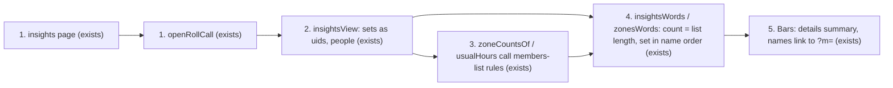
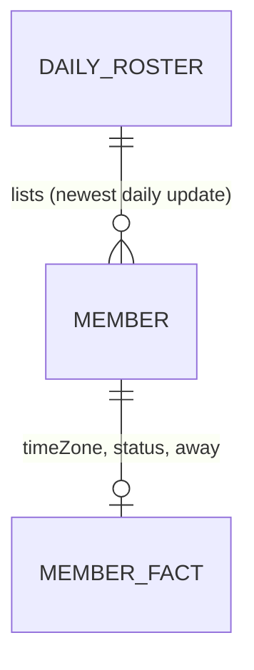

# Insights: tap a count to see exactly those members (#678)

**Approved**: 2026-11-22 - user: "Insights is getting very good, but it could do more drilldown, e.g. one part says there are 22 members in might range X. Who are those members? Why can't I tap and see those members filtered?" (owner, issue #678; built under the owner's standing approval for validated work, CONTRIBUTING.md § Working rules); panel verdicts: [Validation](#validation).

Size: M (one PR, `feat/678-insights-drilldown`).

## Problem

Insights says how many members sit in a might range, a tenure band, a week's joiners and leavers or a time zone, but never who they are. An officer who reads "22 members, 80M–120M" has to leave the page, open Members and rebuild the set by hand. For most sets that is impossible: Members has no filter for a quarter of might among the members compared, for "joined in the week of Nov 9" or for "with us under 14 days". The owner asked (2026-11-22): "one part says 22 members are in might range X. Who are those members? Why can't I tap it and see those members filtered?" No other evidence.

What is different when this ships: on Insights, every count that stands for a set of members, and that no owner decision keeps as a count only, opens that set with one tap, in name order, and each name opens that member's card.

## Inventory

Every count on Insights, the function that makes it, and what this change does with it.

| #     | Card        | Count                                                                                                      | Function (today)                 | Form                                                                                                |
| ----- | ----------- | ---------------------------------------------------------------------------------------------------------- | -------------------------------- | --------------------------------------------------------------------------------------------------- |
| E1    | Effort      | members in each of the 4 might ranges (the "22 members" note on each range row, in each of the 3 measures) | `bandsOf` (`insights-rules.ts`)  | in place, once: "Who is in each range"                                                              |
| E2    | Effort      | left out of the comparison: new, on a break, no might ("Left out: 2 new, 1 on a break")                    | `effortPart` (`insights.ts`)     | in place, only with the groups (3 daily updates or more)                                            |
| E3    | Effort      | Quiet contributors                                                                                         | `quietOf`                        | already names: unchanged                                                                            |
| F1    | Flow        | joined and left in each of the 5 weeks                                                                     | `movesOf` + `flowPart`           | in place, one fold per week                                                                         |
| F2    | Flow        | came from / went to each alliance, "Not known"                                                             | `cameFrom`, `wentTo`, `tally`    | not opened: D139 "counts per alliance, never names" (owner question)                                |
| F3    | Flow        | tenure bands (under 14, 30, 90 days, more, since our first daily update)                                   | `tenureOf`                       | in place                                                                                            |
| F4    | Flow        | newcomers ("4 newcomers")                                                                                  | `newcomersOf`                    | not opened: D139 "Aggregate only (owner, 2026-11-20)" (owner question); the list is computed for it |
| K1    | KvK         | "Took a heavy hit — maybe offer help"                                                                      | `eventOf` `help`                 | already names linking to the card: unchanged                                                        |
| K2    | KvK         | "All n members counted" fold                                                                               | `eventOf` `people`               | already names: unchanged                                                                            |
| K3    | KvK         | members not counted, members who left since (based lines)                                                  | `eventOf` `others`, `left`       | not opened (out of scope)                                                                           |
| S1–S3 | Squads      | squads seen, freshness, strongest squad's might ranges                                                     | `squadsCoverageOf`               | not opened: owner's "counts only: no names" (2026-11-20) (owner question)                           |
| Z1    | Time zones  | members in each offset group                                                                               | `zoneCountsOf` + `zoneGroups`    | in place                                                                                            |
| Z2    | Time zones  | "Not recorded yet"                                                                                         | `zoneCountsOf` (members − known) | Members `?ask=timeZone` (exists, D153); the count calls Members' rule                               |
| Z3    | Time zones  | usual hours ("27 of the 29 … 11:00–12:59 ST")                                                              | `usualHours`                     | Members `?day=H` (exists, D153); the count calls Members' rule                                      |
| P     | Pulse       | shares of member-days (quests, coins, donations)                                                           | `pulseOf`                        | not opened (out of scope)                                                                           |
| SH    | Raid Shield | seen with a shield per check                                                                               | `shieldPassCounts` (SQL counts)  | not opened (out of scope)                                                                           |

**Why in place.** Members lists the same newest daily update, but it cannot rebuild E1, E2, F1, F3 or Z1 without the reads only Insights makes (36 daily updates, first-seen days, break notes): a Members filter would need a second copy of each rule or new reads on Members (D149). In place, each set comes out of the function that counts it, and the count is that list's length. Z2 and Z3 keep their D153 links, because Members already has those exact filters and is where an officer adds a time zone.

## Shape

It reuses the reads `insightsView` already makes, the cards' `Bars` rows and the `
` fold, Members' card address (`?m=`, D122) and Members' own predicates for Z2 and Z3; it adds no query and no route. The rules that decide who is in a set run in the pure modules Vitest reaches (`insights-rules.ts`, `insights-zones.ts`, `members-list.ts`), and the PGlite tests reach them through `insightsView` and the words.

1. `/w/[slug]/insights` (exists) -> `openRollCall` (exists) - `requireWorkspace`, the Insights switch (D126), then the read
2. `insightsView` (exists) - each set's function returns the uids of its members instead of a number (`bandsOf`, `effortPart`, `flowPart`, `tenureOf`, `newcomersOf`, `zoneCountsOf`); the view adds `people`: uid → name for the newest daily update's members and the flow's joiners and leavers, with whether each is still a member
3. `zoneCountsOf`, `usualHours` (exists) - "not recorded" calls Members' `factsToAsk`, and usual hours call Members' `daytimeAt`, which Members' `day=`/`night=` filter also calls (`members-list.ts`)
4. `insightsWords` (exists), `zonesWords` (exists) - each row's number is its list's length; each row carries `set`: its kind, key and names in name order (`setOf`)
5. `Bars` (exists, `InsightsSections.tsx`) - a row with a set is a `
`: the row (label, plum count ▾, bar) is the summary; the names open under it, each a 44 px link to `/w/[slug]/members?m=<uid>` (a former member: `?view=former&m=<uid>`); a small client listener keeps the open set in the address fragment and sends `ws_insights_set_opened`; out: server-rendered HTML, `ph-no-capture`

**Changes underneath**

| Front       | What changes                                                                                                                                                                                                                                               |
| ----------- | ---------------------------------------------------------------------------------------------------------------------------------------------------------------------------------------------------------------------------------------------------------- |
| domain      | nothing: every set keeps its rule; a count becomes the length of the list the same function returns                                                                                                                                                        |
| stored data | nothing to migrate - read only                                                                                                                                                                                                                             |
| readers     | `InsightsView` (only the Insights page and its tests read it): `Band.members`, `leftOut`, `flow.weeks`, `tenure`, `newcomers.n` and `ZoneCounts` carry uid lists; Members' `keepsFacts` calls the shared `daytimeAt`; Follow-up does not read these fields |

New: nothing - read only.

## Surface

None - nothing consumed outside. No route changes; the links go to Members' existing addresses (`?m=`, `?view=former&m=`, `?ask=timeZone`, `?day=H`).

## Landing

None - no stored shape, route, dependency or contract changes. Names in place reuse the `
` fold the page already has; the analytics event follows the plan's existing rules.

- Nothing else in this change is hard to reverse

## Criteria

### S1: every set count opens its members (P1)

An officer taps a count on Insights and sees exactly the members it counts.

**Acceptance Criteria**

1. The system SHALL compute each set of the inventory's "in place" rows (E1, E2, F1, F3, Z1) in the same function that counts it, and SHALL show as that row's number the length of that list.
   - a range of 22 members → "22 members" and 22 names; 0 members → no ▾, no fold
   - F1 lists moves: a member who left and came back in one week counts twice and is named twice
2. WHEN an officer taps a set row (its label, number or bar) THEN the system SHALL open, under that row and at full width, the names of exactly the members it counts; the row SHALL be a native `
` summary at least 44 px tall whose count is plum with a ▾ that turns when open.
3. The system SHALL list the names in name order (the page language's collation, numbers in order, punctuation ignored), in two columns at 360 px, with no number, rank or measure beside a name (D75, D114).
4. WHEN an officer taps a name THEN the system SHALL open `/w/[slug]/members?m=<uid>` with that member's card open; IF the member is not in the newest daily update (a leaver in F1) THEN the link SHALL be `/w/[slug]/members?view=former&m=<uid>`.
5. Each name link SHALL be at least 44 px tall, a long name SHALL end in "…" on one line, and no part of a set SHALL work only on hover.
6. The effort ranges (E1) SHALL open in one place: a "Who is in each range" list of the four ranges before the three measures, whose "22 members" notes stay plain text.
7. WHILE the effort card has its groups (3 daily updates or more) and someone is left out (E2), the system SHALL offer one "See who" fold under the left-out line listing each kind (new, on a break, no might) with its names.
8. Each flow week (F1) SHALL be one fold whose summary is the week and its two bars, opening "Joined" and "Left" with their names at full width; a week with nobody joining or leaving does not open.
9. The time zone rows (Z1) SHALL open their members' names; "Not recorded yet" and usual hours SHALL keep their links to Members.
10. Each card with sets (Effort, Membership flow, Time zones) SHALL say once "Tap a count to see who." above its first set.
11. WHEN an officer opens a set, taps a name and goes Back THEN the system SHALL show Insights with that set open (the open set's key in the address fragment, `#who-<key>`).

### S2: one rule for the counts Members also filters (P1)

12. The system SHALL count "Not recorded yet" (Z2) with Members' own Missing-info rule (`factsToAsk`), so that the number on Insights equals the members Members lists at `members?ask=timeZone` on the same data.
13. The system SHALL count members in their usual hours (Z3) with Members' own daytime predicate (`daytimeAt`), so that the number on Insights for hour H equals the members Members lists at `members?day=H` on the same data.
14. The links of Z2 and Z3 SHALL be written by Members' `queryString` from the query the count used, and `pickQuery` of that address SHALL give that query back (round trip).
15. The Z2 note SHALL drop "Members lists today's roster, so its count there can differ.": both pages count the same newest daily update.

### S3: privacy, people first, switches, analytics (P1)

16. The sets SHALL carry only uid and name; no figure SHALL appear beside a name, and no x, y, online, last_online_at, joined_at or avatar_url SHALL be read (CLAUDE.md, D71, D76, D142).
17. Every names list SHALL be inside `ph-no-capture`; no name, uid or count SHALL reach analytics, logs or a shared cache (the page stays per request, D143).
18. WHEN an officer opens a set THEN the system SHALL send `ws_insights_set_opened` with `set` from the closed list `effort_range`, `effort_left_out`, `flow_week`, `tenure`, `zone`, at most once per set kind per page view.
19. WHERE Insights is off the page SHALL go to Home as today (D126); the squads card keeps its counts only.
20. The system SHALL add no query to the page (D149).

### S4: tests (P1)

21. One PGlite test per set kind (E1, E2, F1, F3, Z1, Z2, Z3) SHALL assert, on one data set, that the names equal the members the rule selects and that the shown number equals the list's length; for Z2 and Z3 the list is Members' `keepMembers` on `membersView` rows of the same data.
22. An e2e flow on the seed SHALL tap the top might range, see exactly the names computed from the seed (no literals), tap one name, see that member's card on Members, go Back and see the range still open.

## Out of scope

| Excluded                                                              | Why                                                                                                                                                      |
| --------------------------------------------------------------------- | -------------------------------------------------------------------------------------------------------------------------------------------------------- |
| Squads (S1–S3), came from / went to names (F2), newcomers' names (F4) | owner decisions say counts only (2026-11-20; D139 "never names", "Aggregate only"); the owner's #678 quote names only might ranges; asked in the handoff |
| Pulse (P)                                                             | Pooled member-days, not a set of members; a per-day list would be a daily_* list of who did or did not do quests, a blame list (D75)                     |
| Raid Shield check (SH)                                                | D137 and D139: alliance-level counts only, never "who was not seen"; per-member readings are not in the page's read (a new query, D149)                  |
| KvK "not counted" and "left since" (K3)                               | small print in the based lines; who left shows in Flow's weeks; the counted members already have their fold                                              |
| A Members filter per set (`?band=` …)                                 | would need a second copy of each rule or new reads on Members; in place is one rule                                                                      |
| Might or any figure beside a name                                     | not shown on Insights today per member; the card has it one tap away                                                                                     |
| A "Copy names" action                                                 | a new feature; follow-up (product, officers NICE)                                                                                                        |

## Assumptions

| Assumption                                     | Chosen default                                                                              | Rationale                                                                                             | Confirmed?      |
| ---------------------------------------------- | ------------------------------------------------------------------------------------------- | ----------------------------------------------------------------------------------------------------- | --------------- |
| Order of names                                 | by name                                                                                     | neutral and findable (officers 5/6)                                                                   | y - panel       |
| Effort ranges in 3 measures                    | one "Who is in each range" list, notes stay plain                                           | names beside a low median read as a low-effort list (officers 4/6, designer, product)                 | y - panel       |
| Squads, F2, F4                                 | not opened                                                                                  | owner's counts-only decisions; the issue's "squads bands" is the orchestrator's example (adversarial) | y - panel       |
| A leaver back in a newer stale or event roster | the former link opens the former list with no card (Members' former view reads `anyRoster`) | checking would read `lastSeen`, unbounded (D149); rare; reported                                      | y - adversarial |
| A member row that fails to parse               | shows as left and joined by name, as it already counted                                     | pre-existing in the counts; reported as a follow-up                                                   | n               |

**Open questions:** for the owner, in the handoff: may squads (counts, ranges), "came from / went to" and newcomers open their names?

## Analytics

Add `ws_insights_set_opened`, `set`: `effort_range`, `effort_left_out`, `flow_week`, `tenure`, `zone` (plus the super properties `workspace`, `alliance`), sent on a set's `
` opening, at most once per kind per page view; never a name, uid, count or which range. Question: "Which Insights sets do officers open, so we know which to keep, cut or give Copy names first?" (product strategy). A name tap stays a Members page view after Insights (query strings stripped, `lib/analytics/sanitise.ts`).

## Differences from the source

None - no capture binds; the issue gives rules, not a layout.

## Sources

- Issue #678 (owner's request, 2026-11-22) - binding - the rules: one rule per set, D75 order, officers only, no per-member query, 360 px, switches
- D139, D153, D98, D122, D126, D75, D76, D142, D149 - binding - the page, the zones card, Members' filters and card, switches, privacy, DB cost

## Validation

Plan review, 2026-11-22, on invented data (88 members, 80 compared), mocks at 360×780.

### (a) Officers (six: UK, PH, FR, US, UA, CH; first-glance test)

"Who are the 22 members in this band?": 6 of 6 got there, 3 without hesitating. In place 6/6, name order 5/6, one place for effort ranges 4/6, names with clear gaps that never break 6/6, a "See who" cue or one tap hint per card 4/6, Back keeps the list open 5/6. "On a break" is not blame 6/6. Adopted: every MUST. NICE adopted: punctuation ignored in name order. Left: a kind line in "None seen yet" (squads are out), "Copy names" (follow-up), one open list per card.

### (b) Designer: approve with changes

Adopted every MUST: effort names once in "Who is in each range"; a flow week is one fold opening full width; the plum count with ▾ is the cue; no `
` in `
`, `min-h-11`, hidden marker, `focus-visible:outline-plum`, `tint-button`; names as `min-h-11` `text-link` cells in two columns with `bdi` and `.name-fit`, `ph-no-capture`; no ▾ on 0. NICE adopted: an `aria-label` on each list. The tap hint is once per card (the officers' wording) instead of once in the page lead.

### (c) Product strategy: approve with changes

Adopted: one effort fold; leave F2 and squads out rather than reverse owner decisions; Back keeps the list open as a criterion and in e2e; one event, `ws_insights_set_opened`. S2/S3 cut with squads. Follow-ups: Copy names (not on effort sets), a set address on Members if group messaging comes, read the event after two weeks.

### (d) Adversarial: one blocker, adopted

Blocker: squads names contradict the owner's counts-only rule and the owner's quote names only might ranges: squads out. SHOULD adopted: F2 and F4 out (D139); F1 lists moves (a name can appear twice); E2 names only with the groups (3 daily updates or more); amend D139 and D153 and the code comments; the former-link edge stated. Verified: Z2/Z3 use the same newest daily update and facts on both pages, dropping D153's "can differ" line is safe, no new query, query strings stripped. NICE left: no names for a range of one member (reported).
