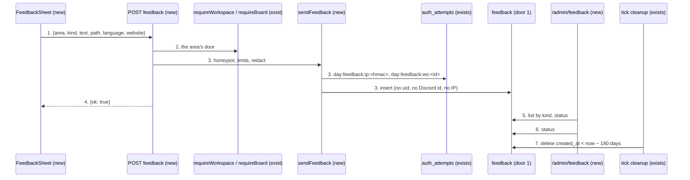
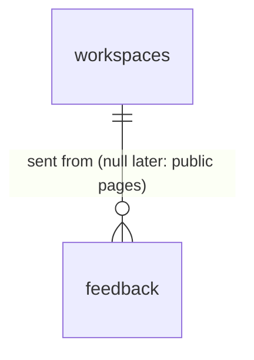

# Feedback form: officers and members send an idea, a problem or something good from the desk and the board; the owner reads it on /admin/feedback (#713, part H)

**Approved**: 2026-11-22 - owner, in the chat, relayed on #713 by the orchestrator: "Feedback: the desk and the board first. Public visitors come later." "Retention: feedback is kept 180 days." "Replies: collect only, with no reply to the sender. A sender sees "Received, thank you", and patch notes credit an idea without a name." The spike's Part 3 ("Recommended: our own form") is the shape that approval covers. Panel verdicts: [Validation](#validation).

Size: M (a migration, a new route, a new /admin page, a new decision). One PR.

## Problem

Officers and members have no way to tell the site's owner an idea, a problem or something that works well, except by finding the owner in Discord. The owner wants that feedback in one place, without names, without answering each sender, and without putting free text into PostHog (the tracking plan's rule: closed lists, no names, no free text).

Evidence: issue #713 Part 3 and the spike's comment (2026-11-22); the owner's answers 6, 7 and 8 on the same day.

What is different when this ships: every desk page and the members' board show "Send feedback" at the end of the page. It opens a sheet: the kind (Idea, Problem, Something good), the text (up to 1,000 characters), Send. After a send the sheet says "Received, thank you." Nothing comes back to the sender. The owner opens /admin/feedback, filters by kind and status, and marks each item New, Read, Became an issue or Dropped. Rows older than 180 days are deleted by the daily job.

## Shape

Reuses the doors (`requireWorkspace`, `requireBoard`), the same-origin JSON rule (`isSameOriginJson`), the Postgres day counters (`auth_attempts`, `day:` keys, as D101, D130 and D154), the private-field redactor (`redactPrivate`, D115), the daily cleanup that purges `app_errors` (D115, `lib/tick.ts`), D125's list of owned tables, the bottom sheet, and the admin PIN pattern.

1. officer or member taps "Send feedback" -> `FeedbackSheet` (new) -> `POST /api/w/[slug]/feedback` (new)
2. route: slug, same origin, strict body, then the door of the area: `desk` -> `requireWorkspace` (officer only); `board` -> `requireBoard` and the `board` feature (officer or member)
3. `sendFeedback` (new, `lib/private/feedback.ts`): honeypot filled -> `{ok: true}`, nothing stored or counted; then 5 a day per IP hash (`day:feedback:ip:<HMAC>`), 20 a day per workspace (`day:feedback:ws:<id>`); then the text through `redactPrivate` and one insert into `feedback` (door 1)
4. out: `{ok: true}`; the sheet says "Received, thank you" and sends `feedback_sent {feedback_area, kind}`
5. owner -> `/admin/feedback?kind=&status=` (new page, PIN session) -> `listFeedback` (new, `lib/queries/admin-feedback.ts`)
6. owner taps a status -> `POST /api/admin/feedback {id, status}` (new, PIN) -> `setFeedbackStatus` (new, `lib/repo/feedback.ts`)
7. daily job, after the day's first read -> `purgeOldFeedback` (new): rows older than 180 days go
8. workspace deleted (D125) -> its rows go through `workspace_id` (cascade, and the list in `lib/repo/workspace-data.ts`, never downloaded); its day counter goes with the others

**Changes underneath**

| Front       | What changes                                                                                                                                                                   |
| ----------- | ------------------------------------------------------------------------------------------------------------------------------------------------------------------------------ |
| domain      | "Feedback" is a new glossary word: what an officer or member sends the site's owner, without their name. No existing concept changes.                                          |
| stored data | New table `feedback`, nothing to migrate.                                                                                                                                      |
| readers     | /admin/feedback only. Not the workspace download (D125): a member's feedback is addressed to the owner, not to the officers who would download it. Deleted with the workspace. |

## Surface

| Route                         | In                                                                                                                                                                                                                           | Out          | Status                                                                                                                                                                                                | Who                                                               |
| ----------------------------- | ---------------------------------------------------------------------------------------------------------------------------------------------------------------------------------------------------------------------------- | ------------ | ----------------------------------------------------------------------------------------------------------------------------------------------------------------------------------------------------- | ----------------------------------------------------------------- |
| `POST /api/w/[slug]/feedback` | `{area: "desk" or "board", kind: "idea" or "problem" or "good", text: 1–1,000 characters after trimming, path: "/w/<slug>…" (no query), language: "en" or "pt-BR" or "fr", website: string}`, strict (an unknown key is 400) | `{ok: true}` | 200; 400 `bad_request`; 401 `signed_out` (no session; a member's session with `area: desk`; another workspace's session); 403 `forbidden` (not same origin), `turned_off` (board off); 429 `too_many` | desk: officers of this workspace; board: its officers and members |
| `POST /api/admin/feedback`    | `{id: int, status: "new" or "read" or "issue" or "dropped"}`, strict, `x-edit-pin`                                                                                                                                           | `{ok: true}` | 200; 400; 401 / 429 (the PIN's own limits); 404 `not_found`                                                                                                                                           | the site's owner                                                  |
| `GET /admin/feedback`         | `?kind=`, `?status=` (anything else: all)                                                                                                                                                                                    | page         | the PIN card until the admin session is valid                                                                                                                                                         | the site's owner                                                  |

## Landing

| One-way door                                    | Literal shape                                                                                                                                                                                                                                                                                                                                                                                                                                                                                                                                  | Alternative rejected                                                                                                                                                                                                                                                                                                                                                 |
| ----------------------------------------------- | ---------------------------------------------------------------------------------------------------------------------------------------------------------------------------------------------------------------------------------------------------------------------------------------------------------------------------------------------------------------------------------------------------------------------------------------------------------------------------------------------------------------------------------------------- | -------------------------------------------------------------------------------------------------------------------------------------------------------------------------------------------------------------------------------------------------------------------------------------------------------------------------------------------------------------------- |
| 1. `feedback` table (migration `0073_feedback`) | `id serial pk`, `area text not null` check in (`desk`, `board`), `kind text not null` check in (`idea`, `problem`, `good`), `text text not null` (after `redactPrivate`), `path text not null`, `language text not null` check in (`en`, `pt-BR`, `fr`), `workspace_id int → workspaces on delete cascade` (nullable, for public pages later), `tier text not null` check in (`officer`, `member`), `created_at timestamptz not null`, `status text not null default 'new'` check in (`new`, `read`, `issue`, `dropped`); index `(created_at)` | (a) PostHog surveys: they need flags and a new proxy path, use PostHog's own UI, a popover would come back on every desk page load, and free text in PostHog breaks the tracking plan's rule; (b) storing who sent it (user id, uid, Discord id, IP): the owner asked for collect-only with no reply, so nothing needs it, and it would make every row personal data |

- Nothing else in this change is hard to reverse.

## Criteria

### S1: an officer or a member sends feedback (P1)

1. WHILE an officer is signed in, every desk page that uses the signed-in frame SHALL end with a "Send feedback" button, 44 px tall, with a visible label.
2. WHILE a member or an officer is on the members' board or their own page, the page SHALL end with the same button.
3. WHEN the button is tapped THEN a sheet SHALL open with a visible legend "What is it about?" and three choices, Idea, Problem and Something good (none chosen), a labelled text field with its limit ("Up to 1,000 characters"), a line that the owner reads it without the sender's name and does not answer, and Send.
4. WHEN the sender has chosen a kind, written text and taps Send THEN the system SHALL store one row and the sheet SHALL show "Received, thank you." with Close; nothing else comes back to the sender.
   - Idea, "Show the shield count on Home", from the desk → one row: area `desk`, kind `idea`, tier `officer`
5. IF no kind is chosen, or the text is empty after trimming THEN Send SHALL be off and nothing is sent; the text field SHALL stop at 1,000 characters and the route SHALL refuse 1,001 (400).
6. The system SHALL store the text after `redactPrivate`: a pasted `x: 512, y: 733` is stored as `x: …, y: …`, and a photo URL as `…`.
7. The system SHALL never store who sent it: no workspace user id, uid, Discord id, name or IP. It stores the area, the kind, the text, the page's path without its query, the desk language, the workspace, the tier and the time.
8. IF the hidden field `website` is filled THEN the route SHALL answer `{ok: true}` and store and count nothing.
9. IF the same IP hash already sent 5 today THEN the route SHALL answer 429 `too_many` and store nothing; the sheet says "You have sent a lot today. Try again tomorrow."
   - 5th from an IP → 200; 6th → 429; another IP, same workspace → 200
10. IF the workspace already sent 20 today THEN the route SHALL answer 429 `too_many` and store nothing.
    - 20th from the workspace → 200; 21st → 429
11. The IP SHALL reach the database only as an HMAC under the server's secret, in an `auth_attempts` key that is deleted after a day.
12. IF the request is not same-origin JSON THEN 403 `forbidden`; IF there is no session, or `area: desk` comes with a member's session, or the session is another workspace's THEN 401 `signed_out`; IF `area: board` and the board is turned off THEN 403 `turned_off`. Nothing is stored in each case. No answer carries a message or a stack.

### S2: the owner reads it (P1)

13. WHILE the admin session is valid, /admin/feedback SHALL list the feedback newest first (up to 200), each with its kind, status, day and time, desk or board, officer or member, the workspace, the language, the path and the text, in English (D48).
14. WHEN the owner picks a kind or a status filter THEN only those rows SHALL show; the filters are links, 44 px tall, and the current one is marked.
15. WHEN the owner taps a status (New, Read, Became an issue, Dropped) THEN the row SHALL keep it after a reload.
16. IF the admin session is missing or invalid (an officer's or a member's workspace session only) THEN /admin/feedback SHALL show the PIN card and read nothing, and `POST /api/admin/feedback` SHALL answer 401.

### S3: retention and deletion (P1)

17. WHEN the daily job runs after the day's first read THEN rows created more than 180 days before SHALL be deleted, and rows at or after that edge SHALL stay.
18. WHEN a workspace is deleted (D125) THEN its feedback rows and its feedback day counter SHALL go; another workspace's stay.

### S4: what leaves (P1)

19. The text SHALL never go to PostHog, a log, `run_logs`, AI, translation or Discord. PostHog gets only `feedback_sent {feedback_area, kind}` from the sheet after a 200.

## Analytics

- Add browser `feedback_sent` `{feedback_area: "desk" | "board", kind: "idea" | "problem" | "good"}`, after a 200. Question: do officers and members use the form, from where, and for what? Insight: weekly count by `kind` and `feedback_area`, breakdown `alliance`.
- The property is `feedback_area`, not `area`: `before_send` sets `area` (public, workspace, admin) on every event and would overwrite it, as `board_section` avoids `section`.
- Change, remove: nothing.
- Go / no-go (product persona): eight weeks after release, at least one item a week across alliances and at least one "Became an issue" a month (database, read-only, counts). Otherwise move the button where it is seen (the desk menu) before adding public pages.

## Out of scope

| Excluded                                       | Why                                                                     |
| ---------------------------------------------- | ----------------------------------------------------------------------- |
| Public visitors                                | owner, 2026-11-22: desk and board first; public pages need 17 languages |
| Replies, an email or Discord ping to the owner | owner, 2026-11-22: collect only                                         |
| A 1–5 score (PostHog `api` survey)             | the spike's "Later"                                                     |
| Screenshots or files                           | private fields on screen (D71); not asked                               |
| A count of new feedback in the admin nav       | not asked; follow-up if the owner misses items                          |

## Assumptions

| Assumption            | Chosen default                                                                                 | Rationale                                                             | Confirmed? |
| --------------------- | ---------------------------------------------------------------------------------------------- | --------------------------------------------------------------------- | ---------- |
| Where the button sits | the end of every desk page in the signed-in frame, and the end of the board and Me             | the desk has no menu; the account row is full at 360 px               | n          |
| Statuses              | New, Read, Became an issue, Dropped (the task's), not the spike's New, Planned, Done, Declined | the orchestrator's task for part H                                    | y          |
| IP hash               | HMAC-SHA-256 of the IP under `CRON_SECRET`, cut to 32 hex characters                           | a plain SHA-256 of an IPv4 address can be reversed by trying all 2^32 | n          |
| The download (D125)   | feedback is deleted with the workspace and never downloaded                                    | a member's feedback is for the owner; officers download the workspace | n          |
| The day               | a rolling day from the first send, as every `day:` counter                                     | the existing limiter                                                  | n          |

## Sources

- Issue #713, the spike's Part 3 and the owner's approval (2026-11-22) - binding - the scope
- D48, D71, D75, D77, D105, D115, D125, D149 - binding - English admin, privacy, analytics, retention, deletion, growth

## Validation

See the PR body: persona check at 360 px and the adversarial review, with what was adopted.
