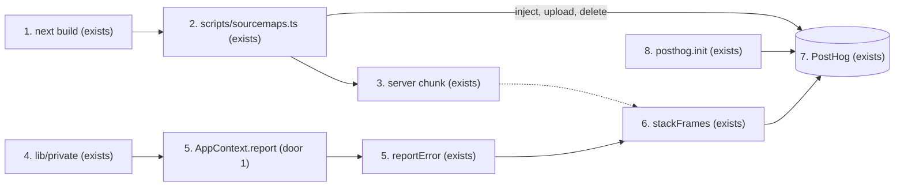

# Errors: server source maps, lib/private reports, browser URL masking

**Approved**: 2026-11-21 - user: "go with what you and the personas recommend" (owner, 2026-11-21, standing approval in CONTRIBUTING.md § Working rules); product-strategy verdict: [Plan review](#plan-review); adversarial verdict: [Plan review](#plan-review)

Size: M (a new external call at build time; a change to how `lib/private` handles errors). Follow-up to PR #598, part of #592.

## Problem

Server errors reach PostHog Error Tracking as `$exception` (D115), but every server frame points at a minified Turbopack chunk (`/var/task/.next/server/chunks/ssr/…js:1:48211`). `scripts/sourcemaps.ts` uploads only `.next/static`. A local `next build` (Next 16.4.5, Turbopack) leaves 1,053 `*.map` files under `.next/server` that nothing uploads and nothing deletes. PostHog resolves a JavaScript frame by the frame's `chunk_id`: `@posthog/core` 1.68.0 reads `globalThis._posthogChunkIds` (written by the snippet `posthog-cli sourcemap inject` puts in each chunk) and sets `frame.chunk_id`. Our server builds `$exception_list` by hand (`stackFrames`, `lib/analytics/server.ts`) and sets no `chunk_id`, so even uploaded maps would not be used.

Six `catch` blocks in `lib/private` swallow a failure of our own code or database and only write a code line (`privateLog`) or nothing: the owner never sees them in Error Tracking.

The browser SDK masks no URL query key itself. `before_send` strips query strings from event properties, but posthog-js also keeps the first page's URL and referrer in its own storage (`getPersonInfo`, `posthog-persistence.js`) before `before_send` runs. A public page with "Allow" keeps that on the device; `/players?q=<typed name>` would be stored whole.

What is different when this ships: a server error in PostHog shows our file, line and function; a swallowed `lib/private` failure shows up in Error Tracking with only where it happened and its code; the SDK masks `m` and `q` in every URL it reads.

## Shape

Reuses the one upload step (`scripts/sourcemaps.ts`, the same CLI, key and env filter), the one error exit (`reportError`, which already runs `redact` → `redactPrivate` → `scrubMessage`) and the one injection point (`AppContext`). The rules that decide an outcome (which directories, which frames get a chunk id, which context fields leave) run in plain modules the Vitest suite reaches.

1. `pnpm build` -> `next build` (exists) - writes `.next/static` and `.next/server`, each with `*.map`
2. `scripts/sourcemaps.ts` (exists) - for each of `.next/static` and `.next/server`, with the key: `posthog-cli sourcemap process --directory <dir> --delete-after …` (injects chunk ids, uploads, deletes), after copying aside each chunk that has a map; a run that fails or times out gets those chunks put back as Next built them; then deletes every `*.map` left in both directories, key or not
3. server chunk (exists) - when it loads, the snippet posthog-cli injected records its chunk id by its file
4. `lib/private` (exists) - one of six catches calls `report(error, { route, kind })` from `getAppContext()` or from the deps a route built from it (door 1)
5. `AppContext.report` (door 1) -> `reportError` (exists) - only `route` and `kind` are read; the error's detail is redacted
6. `stackFrames` (exists) - each frame whose file is an injected chunk gets that chunk's `chunk_id`
7. out: `$exception` to PostHog (exists) `/batch/`; PostHog resolves the frame against the uploaded map
8. browser: `posthog.init` (exists) gets `mask_personal_data_properties: true` and `custom_personal_data_properties: ["m", "q"]`

**Changes underneath**

| Front       | What changes                                                                                                                                                                                                                                                                                                                                                                                         |
| ----------- | ---------------------------------------------------------------------------------------------------------------------------------------------------------------------------------------------------------------------------------------------------------------------------------------------------------------------------------------------------------------------------------------------------- |
| domain      | `$exception` frames may carry `chunk_id` (server). No new event, no new property outside `$exception_list`                                                                                                                                                                                                                                                                                           |
| stored data | nothing stored by us; PostHog stores server symbol sets                                                                                                                                                                                                                                                                                                                                              |
| readers     | PostHog Error Tracking shows resolved server frames; `/admin/errors` keeps the minified stack (its text is unchanged)                                                                                                                                                                                                                                                                                |
| deployment  | after a finished run, every chunk with a map starts with posthog-cli's ~300-byte snippet and ends with `//# chunkId=…`, with no `sourceMappingURL` comment; after a failed or stopped run, that directory's chunks are as Next built them (their `sourceMappingURL` points at a deleted map). No `*.map` is left under `.next/static` or `.next/server` either way. Build time: up to 2 × 120 s more |

Data: none - no table or row changes.

## Surface

None - nothing consumed outside. `AppContext` is internal.

## Landing

| One-way door       | Literal shape                                                                                                                                                                                                                                                                                                                     | Alternative rejected                                                                                                                                                                                       |
| ------------------ | --------------------------------------------------------------------------------------------------------------------------------------------------------------------------------------------------------------------------------------------------------------------------------------------------------------------------------- | ---------------------------------------------------------------------------------------------------------------------------------------------------------------------------------------------------------- |
| 1. The report seam | `report: (error: unknown, context: ReportContext) => void` on `AppContext`, where `ReportContext` is a union of literal `{ route: "lib/private/<module>.ts"; kind: "<code>" }` pairs (`lib/report-error.ts`); production and the tests' context both `reporter(ctx)`, which reads only `route` and `kind` and calls `reportError` | Importing `reportError` in each `lib/private` module: works today, but it bypasses the one injection point, so a test cannot see or stop the send, and a later change of the exit would touch every module |

- Nothing else in this change is hard to reverse: the upload step, the frame field and the init options each come out in one commit. No new dependency (posthog-cli 0.19.0 and posthog-js 1.444.4 are installed).

## Criteria

### S1: server frames readable in PostHog (P1)

**Acceptance Criteria**

1. WHEN `pnpm build` runs with `POSTHOG_PERSONAL_API_KEY` set THEN `scripts/sourcemaps.ts` SHALL run `posthog-cli sourcemap process --directory <dir> --delete-after --release-name laptracker [--release-version <sha>]` once for `.next/static` and once for `.next/server`, each with only PATH, HOME, POSTHOG_CLI_* and the key
2. The build SHALL leave no `*.map` file under `.next/static` or `.next/server`, whether the key is set or not, and whether each upload succeeded, failed or timed out
   - no key → both directories' maps deleted, the CLI never run; upload fails on `.next/server` (exit 1) → its maps still deleted, the build line says so, the build goes on
3. IF a directory's CLI run fails or is stopped THEN the build SHALL ship that directory's chunks byte for byte as Next built them, never one the CLI was rewriting; a finished run's injected chunks SHALL stay injected
   - stopped while the server chunk is half rewritten → the chunk as Next built it; the browser's finished run → its rewritten chunk kept
4. WHEN a server error is reported AND its frame's file is a chunk posthog-cli injected THEN the `$exception` frame SHALL carry that chunk's `chunk_id`; a frame of a file with no injected id SHALL carry none
   - a frame in a chunk loaded with the CLI 0.19.0 snippet → its id; a `node:internal` frame → no `chunk_id`
5. The build SHALL never print the key (unchanged from D115)

### S2: swallowed lib/private failures reach Error Tracking (P1)

**Acceptance Criteria**

6. WHEN one of these catches runs THEN it SHALL call `report(error, { route, kind })` with exactly the two keys `route` (the module path) and `kind` (the code its log line has, or a new code), both from the closed `ReportContext` list, and SHALL go on as today:
   - `frameReadStatus` (`w.read_status.failed`), `matchOnRead` (`w.pending.match_failed`), `runJob`'s failure (`w.import.discord_failed`) and its cleanup's failure (`w.import.settle_failed`), a sealed webhook that does not open (`w.webhook.open_failed`), the invite's command registration (`w.invite.commands_failed`)
7. WHEN a reported error's message carries a query's parameters or a private roster field THEN the `$exception` sent SHALL carry `params: …` and `…` in their place, never the text (the same `reportError` path, D71, D115)
   - a failed insert of a screenshot's read lines (an invented member name in `params:`) → the name is absent from the batch body
8. The catches that turn an expected failure into a result SHALL NOT report (D115's "Not reported, on purpose"): bad input (`new URL`, `JSON.parse`, a time zone, a signature), a third party's network failure already turned into a reply (`fetch(…).catch(() => null)`), a refused picture, closing a dropped OCR worker
9. The `lib/private` code SHALL still import no `lib/notify*` or `lib/discord-*` (the eslint zone stays as it is)

### S3: the browser SDK masks person keys in URLs (P2)

**Acceptance Criteria**

10. WHEN posthog-js starts on any page THEN its init SHALL carry `mask_personal_data_properties: true` and `custom_personal_data_properties` containing `m` (a member's uid, D122) and `q` (a typed name, `/players?q=`, `/w/[slug]/members?q=`)

### S4: IP recommendation, no change (P3)

**Acceptance Criteria**

11. The handoff SHALL state whether PostHog should discard client IPs, from what the app's analytics read (tracking plan, D145 Endpoints, `$geoip` use), and turn a project setting into an owner to-do

## Out of scope

| Excluded                                                                                                                  | Why                                                                                                                                                     |
| ------------------------------------------------------------------------------------------------------------------------- | ------------------------------------------------------------------------------------------------------------------------------------------------------- |
| Release id on server `$exception` (`$exception_release_id`)                                                               | Not needed to resolve a frame: event mode chunk ids are content-addressed; a follow-up if the owner wants errors grouped by release                     |
| `.next/build/chunks/*.map` (6 build-time transform maps)                                                                  | Not part of the deployment's functions (no `.nft.json` lists them)                                                                                      |
| Reporting Discord/Groq network failures from `lib/private`                                                                | D115 keeps them out on purpose                                                                                                                          |
| Changing PostHog project settings                                                                                         | Owner only; the IP point is a to-do                                                                                                                     |
| An env switch to skip the upload (product review, point 2)                                                                | The 120 s cap per directory already bounds it, and unsetting `POSTHOG_PERSONAL_API_KEY` in Vercel skips it; no new variable                             |
| Rate-limiting `report` during a database outage (product review, point 7)                                                 | `withContext` already records every failed request; PostHog groups the events into one issue. A follow-up if the bill shows it                          |
| `lib/private/discord-translate-run.ts` turning a non-`ChatError` into `ChatError("failed")` (adversarial review, point 4) | Its job has no deps that reach `ctx`, and the error passes the officer's text path; a follow-up                                                         |
| `kind` from `failureCode(…)` in `runJob` (adversarial review, point 4)                                                    | `kind` stays a closed literal; PostHog groups issues by exception type and frames, so an OCR timeout and a database failure are already separate issues |

## Assumptions

| Assumption                                                                       | Chosen default                                                                                                                                                                                                                                                               | Rationale                                                               | Confirmed? |
| -------------------------------------------------------------------------------- | ---------------------------------------------------------------------------------------------------------------------------------------------------------------------------------------------------------------------------------------------------------------------------- | ----------------------------------------------------------------------- | ---------- |
| Which `lib/private` catches "swallow an error"                                   | The six in criterion 6: a failure of our own code, database or crypto that ends in a code line or nothing                                                                                                                                                                    | D115 already rules out expected failures; reporting them would be noise | n          |
| How a catch with no deps reaches `report`                                        | `getAppContext().report` inside the catch, as `frameReadStatus` already reads `getAppContext()`; `runJob` gets `report` in the `JobDeps` the route builds from `ctx`                                                                                                         | No signature change in pages and routes for a failure path              | n          |
| Upload time of ~1,050 server maps                                                | Same 120 s cap per directory as the browser (up to 240 s per build); past it the build goes on and those frames stay minified                                                                                                                                                | A slow upload must never fail a deploy (D115)                           | n          |
| 2026-11-22, PR #615 review, replaces the row above: how a catch reaches `report` | From the deps its caller builds from `ctx` wherever the function takes deps: `runJob` (`JobDeps`), `noticeChannels` and `testWebhook` (`{ env, report }`), the invite's `StepDeps`. `getAppContext().report` only in `frameReadStatus` and `matchOnRead`, which take no deps | One injection point: the route's `ctx`                                  | y - review |
| `frameReadStatus` reports twice when the page's own connection fails             | Accepted: `onRequestError` records the page's failure too                                                                                                                                                                                                                    | Two events in one outage, one PostHog issue each                        | n          |
| Personal query keys                                                              | `m` and `q` only; `who`, `f`, `lang`, `day`, `night`, `ask`, `r4` are filters with fixed values                                                                                                                                                                              | Grep of `searchParams`/`params.get` in `app` and `lib`                  | n          |

**Open questions:** none - all resolved or logged above.

## Plan review

Both on 2026-11-21, on this plan before the build.

**Product strategy: approve with changes.** S1 is the main payoff, S2 cheap and actionable, S3 cheap, S4 fine as a to-do. Changes taken: (3) one real build checked: the CLI's snippet put into every mapped chunk of a local `next build` (1,052), every one parses and the 918 under `chunks/` load and record their id; (5) the handoff says `/admin/errors` keeps the minified stack and PostHog is the readable view; (6) an Error Tracking alert for the new kinds is a handoff to-do. Declined, with reasons in Out of scope: (2) a skip switch, (7) rate-limiting. (4) cold start not measured: ~300 bytes per chunk.

**Adversarial (privacy, D71, build security): approve with changes.** (1) must fix, taken: a CLI run stopped mid-write could ship a cut-short chunk; each mapped chunk is now copied aside and put back when the run fails or times out (criterion 3); the deployment row says `sourceMappingURL` is stripped only after a finished run. (2) taken: `ReportContext` is a union of literal module/code pairs. (3) no change: the server maps' sources are only `node_modules`, `lib`, `app`, `config/alliances.ts`, `instrumentation.ts`, `proxy.ts` and Next internals, all public; no env value is inlined; `server-reference-manifest` has no map. (4) the six catches are right; `failureCode` as `kind` and `discord-translate-run.ts` declined or deferred (Out of scope). (5), (6) taken into Assumptions and the deployment row. (7) masking confirmed to reach `getPersonInfo` (`posthog-persistence.js:1625`, `session-props.js:19`). No one-way door: symbol sets can be deleted in PostHog; no schema, data, quota or dependency change.

## Differences from the source

None - no binding design source.

## Sources

- Orchestrator task, 2026-11-21 (owner-approved follow-up to PR #598) - binding - the four items and the tests
- `@posthog/core` 1.68.0 `dist/error-tracking/chunk-ids.js`, `error-properties-builder.js` - binding - frames resolve by `chunk_id` from `globalThis._posthogChunkIds`
- posthog-cli 0.19.0 binary strings - binding - the injected snippet and `--delete-after` stripping `sourceMappingURL`
- `@posthog/types` 1.425.1 `posthog-config.d.ts` (posthog-js 1.444.4) - binding - `mask_personal_data_properties`, `custom_personal_data_properties`; `ip` "HAS NO EFFECT", use the "Discard IP data" project setting
- D71, D77, D115 (and its 2026-11-21 amendments), D122, D145
