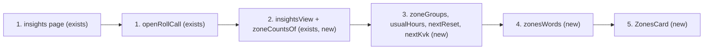
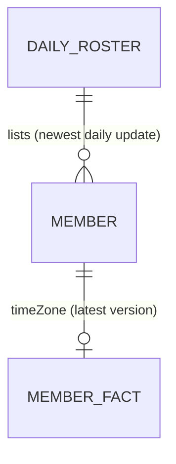

# Insights: Time zones

**Approved**: 2026-11-22 - user: "go with what you and the personas recommend" (owner, 2026-11-21, standing approval in CONTRIBUTING.md § Working rules); product-strategy verdict: [Validation (c)](#c-product-strategy-approve-with-changes); adversarial verdict: [Validation (d)](#d-data-honesty-and-adversarial-approve-with-changes). The request: owner, 2026-11-22: "in the officers' Insights, something grouped by time zones, showing which time zones have more players, and what the server time is for those time zones, etc."

Size: M (one new Insights section, one PR, `feat/insights-time-zones`).

## Problem

Officers plan events for members spread over many time zones, mostly on phones. Each member's time zone is an officer-entered fact (D80) that shows on that member's card and drives Members' "Within their usual hours at HH ST" filter, but nothing shows the alliance as a whole: which zones hold most members, and what a server-time moment (the 00:00 ST reset, KvK) is on their clocks. Today an officer opens cards one by one or converts in their head across UTC−8 to UTC+8. The owner asked for it (2026-11-22): "in the officers' Insights, something grouped by time zones, showing which time zones have more players, and what the server time is for those time zones, etc." No usage evidence beyond the request.

What is different when this ships: on Insights an officer reads, without a tap, where most members with a known time zone live and what the 00:00 ST reset is on their clock; below it every zone group with its count, its time now, at the reset and at KvK, and how many members have no time zone recorded yet, with a way to see who.

## Shape

It reuses the facts `insightsView` already reads (`factsOf`), the newest daily update's members, the one offset form (`offsetText`/`zoneOffset`, `lib/calendar-time.ts`) and the one date rule (`dateWords`, `lib/date-words.ts`), Members' usual hours (`DAY_FROM`/`DAY_TO`, `clockAt`, `lib/private/members-list.ts`) and its existing filters as the "See who" targets; it adds no query. The grouping, the order, the counts and the best-hour rule run in a pure module (`lib/private/insights-zones.ts`, new) that Vitest reaches; the PGlite tests reach it through `insightsView` and `zonesWords`.

1. `/w/[slug]/insights` (exists) -> `openRollCall` (exists) - `requireWorkspace`, the Insights switch (D126), the server zone, then the read
2. `insightsView` (exists, `lib/private/insights.ts`) - the newest daily update's members and `factsOf` (both read today) -> `zoneCountsOf` (new, `lib/private/insights-zones.ts`): how many of those members have each zone, and how many are in the daily update; uids and names stay behind
3. `zoneGroups`, `usualHours`, `nextReset`, `nextKvk` (new, `lib/private/insights-zones.ts`) - the groups by the offsets at now, the next reset and the first KvK start after now (`EVENT_WEEKDAY`/`EVENT_TIME`, passed by the page), west to east; the members in their usual hours per server hour
4. `zonesWords` (new, `lib/private/insights-zones-words.ts`) - the headline, the rows with each moment on the group's clock (`dateWords`), the not-recorded row and the usual-hours line in EN, PT-BR or FR
5. `ZonesCard` (new, `app/(private)/_ui/InsightsZones.tsx`) - HTML bars (`Bars`, D68) behind the card's fold; out: server-rendered HTML

**Changes underneath**

| Front       | What changes                                                              |
| ----------- | ------------------------------------------------------------------------- |
| domain      | nothing: "time zone" keeps D80's meaning, an IANA zone an officer records |
| stored data | nothing to migrate - read only                                            |
| readers     | the Insights page gains one card; `InsightsView` gains `zones`            |

New: nothing - read only.

## Surface

None - nothing consumed outside. The page's address and access are unchanged.

## Landing

None - no stored shape, route, dependency or contract changes; the section is copy and a pure read of data the page already holds.

- Nothing else in this change is hard to reverse

## Criteria

### S1: the Time zones card (P1)

The last card on Insights says where the members with a time zone are and what the server's reset and KvK are on their clocks, in counts only.

**Acceptance Criteria**

1. WHILE the Insights switch is on and the alliance has a daily update the page SHALL show a card titled "Time zones" as the last card, after Raid Shield check (or after the last card shown when that one is off).
2. The card SHALL count only the members of the newest daily update; a former member's time zone SHALL NOT count, and a latest version that cleared the fact (null) SHALL count as not recorded.
   - 5 members in the newest daily update, 3 with a zone, a fourth cleared, plus a former member with a zone → "Time zone recorded for 3 of the 5 members in the newest daily update."
3. The card SHALL put members whose zones have the same UTC offset now, at the next reset and at the next KvK start in one row, labelled by up to 2 of its zones' cities (most members first, then by name), "and N more" for the rest, then the offset now ("Paris, Zurich and 1 more · UTC+1"); a fixed-offset zone (`Etc/GMT-1`) counts and names no city, and a row of only such zones reads "UTC+1".
   - Europe/Paris ×3, Europe/Zurich ×3, Europe/Berlin ×1 on 2026-11-22 → one row "Paris, Zurich and 1 more · UTC+1", 7.
4. The rows SHALL run west to east by their offset now, then at the reset, then at KvK.
5. IF zones share an offset now but not at the next reset or KvK (a summer-time change before it) THEN they SHALL be separate rows, each with its own times, and each changing row SHALL say "Clocks change before KvK" (or "before the reset").
   - Europe/Paris and Africa/Lagos, now Sat 2027-03-27 20:00 UTC (both UTC+1), next reset Sun 2027-03-28 02:00 UTC (after the EU change at 01:00 UTC), KvK Sat 2027-04-03 14:00 UTC → two rows labelled UTC+1, west to east Lagos first: Lagos "Reset 03:00 · KvK Sat 15:00", Paris "Reset 04:00 · KvK Sat 16:00" and "Clocks change before the reset".
   - The same zones on Wed 2026-11-25 → one row "Lagos, Paris · UTC+1" (by name at equal counts).
6. Each row SHALL show "Now hh:mm · Reset hh:mm · KvK Day hh:mm" on its zones' clock at each instant: the page's instant, the next 00:00 ST, and the first KvK start after now (`EVENT_WEEKDAY`/`EVENT_TIME`, the schedule config that creates the events); "Now" and "Reset" carry the zone's own weekday only when its date differs from the server's date at that instant; KvK always carries it.
   - America/New_York, now Sun 2026-11-22 13:00 ST (15:00 UTC), KvK Sat 2026-11-28 12:00 ST: "Now 10:00 · Reset Sun 21:00 · KvK Sat 09:00"; Asia/Manila: "Now 23:00 · Reset 10:00 · KvK Sat 22:00"; Pacific/Kiritimati (UTC+14): "Now Mon 05:00 · Reset 16:00 · KvK Sun 04:00".
   - now Sat 2026-11-28 13:00 ST, KvK running since 12:00 ST → the KvK shown is Sat 2026-12-05 12:00 ST, never the start already past.
7. The visible lines SHALL answer "where are most, and what is the reset for them": "Largest group: Manila, Singapore (UTC+8), 8 of the 29 members with a time zone. The 00:00 ST reset is 10:00 for them." and "Time zone recorded for 29 of the 41 members in the newest daily update."
   - tie → "Largest groups, 4 members each: London (UTC+0), New York, Toronto (UTC−5). The 00:00 ST reset is 02:00 and Sun 21:00 for them."; one row only → "All 3 members with a time zone are in one group: Manila (UTC+8). The 00:00 ST reset is 10:00 for them."; one member → "The one member with a time zone is in Manila (UTC+8). The 00:00 ST reset is 10:00 for them."
8. IF no member of the newest daily update has a time zone THEN the card SHALL say "No time zone recorded yet for the 41 members in the newest daily update." with the "Add their time zone ›" link, and no rows, bars or fold.
9. The rows, the legend, "Not recorded yet" and the usual-hours line SHALL sit behind "Show the details" (44 px, as the other cards).
10. The card SHALL draw each row's bar as its count's share of the members with a time zone, with the count in HTML beside it (D68); "Not recorded yet" SHALL be the last row with its count, no bar and "Not counted in any group.", and SHALL NOT be in any share or in the largest group.
11. WHEN an officer taps "Add their time zone ›" THEN Members SHALL open filtered on Missing info: time zone (`/w/[slug]/members?ask=timeZone`); the link is at least 44 px tall, and the row says Members lists today's roster, so its count there can differ.
12. WHERE 2 or more rows have members the fold SHALL give the server hours when the most members with a time zone are within their usual hours (08:00–22:59 on their own clock, Members' rule), as ranges, with the count, the denominator and the unknown: "Within their usual hours for the most: 11:00–12:59 ST, 27 of the 29 members with a time zone (12 not recorded). A guess from their time zone, for times you set, like rallies." and "See who ›" to `/w/[slug]/members?day=11` (the first hour of the first range).
    - counts peak at hours 11 and 12 → "11:00–12:59 ST"; at 23 and 0 → "23:00–00:59 ST"; at 6 and 9 → "06:00–06:59 ST and 09:00–09:59 ST".
13. The legend SHALL say what the times are: "Times on their own clock: now (13:05 ST), at the next 00:00 ST reset (the raid starts at the one before KvK) and at KvK (Sat, Nov 28, 12:00 ST). Bar: share of the 29 members with a time zone."
14. The card SHALL name no member and carry no uid; its rows SHALL be `ph-no-capture`; nothing of it goes to analytics, logs, Discord, AI or translation, exports or a shared cache; the page stays per request (D143).
15. The copy SHALL exist in EN, PT-BR and FR (the workspace dictionary).
16. The card SHALL draw its bars and muted lines, in light and dark mode, with the token pairs the other Insights cards use (`Bars`: `bg-plum/60` on `bg-ink/10`; muted text `text-ink/70`–`/80`), so the bar fill reaches 3:1 against its track and the muted time line 4.5:1 as theirs do; no colour literal.

## Out of scope

| Excluded                                                                  | Why                                                                                                                                                    |
| ------------------------------------------------------------------------- | ------------------------------------------------------------------------------------------------------------------------------------------------------ |
| Names per zone behind a tap; a `members?tz=` filter                       | Counts only (product, adversarial: a zone in the address reaches page-view URLs); officers see each zone on the member card. Follow-up if officers ask |
| The alliance's calendar events this week; a picker of any ST hour         | A calendar read breaks "no new query" (D149); Members' "Within their usual hours at HH ST" is the picker                                               |
| The Raid Shield window as its own moment                                  | The raid starts at the reset before KvK (legend); Raid Shield check has its own card                                                                   |
| A region subtotal ("Europe: 14")                                          | NICE from one officer; not asked                                                                                                                       |
| The word "night" beside night-time values                                 | NICE from the designer; a later pass                                                                                                                   |
| Saying a zone recorded as an offset ("ST +3") does not follow summer time | NICE (adversarial); follow-up                                                                                                                          |
| The card before the first daily update                                    | The whole page waits for it (D139); a change is a new decision                                                                                         |

## Assumptions

| Assumption                      | Chosen default                                                                      | Rationale                                                                                                                                                                                                                                 | Confirmed?                            |
| ------------------------------- | ----------------------------------------------------------------------------------- | ----------------------------------------------------------------------------------------------------------------------------------------------------------------------------------------------------------------------------------------- | ------------------------------------- |
| Group by IANA zone or by offset | By the offsets now, at the reset and at KvK                                         | All panels; adversarial: a row never shows two times                                                                                                                                                                                      | y - panel under the standing approval |
| Order                           | West to east                                                                        | Officers (6, the Philippines officer accepting), product, designer: reads like a day; the headline answers "most"                                                                                                                         | y - panel                             |
| Position                        | Last, after Raid Shield check                                                       | Officers: a reference that changes slowly must not push the week down; product preferred before Raid Shield                                                                                                                               | y - panel (officers' reason)          |
| "UTC+0" or "UTC"                | "UTC+0"                                                                             | The one offset form (`offsetText`, glossary "date words"); officers asked for "UTC"                                                                                                                                                       | y - glossary rule                     |
| Where KvK's time comes from     | The first start after now, from the schedule config (`EVENT_WEEKDAY`, `EVENT_TIME`) | Data honesty asked for the scheduled event, not a literal; the event row exists only a day ahead, and the config is what creates it; `nextEvent` was rejected (adversarial): during a KvK it returns the running one, whose start is past | y - panel                             |
| Not-recorded link label         | "Add their time zone ›"                                                             | Officers: an action, not a list of people                                                                                                                                                                                                 | y - panel                             |
| Cities per row                  | 2, then "and N more"                                                                | Designer (2), adversarial (3): 2 keeps a row to two lines at 360 px                                                                                                                                                                       | y - panel                             |

**Open questions:** none - all resolved or logged above.

## Differences from the source

None - the product matches the source (the owner's request; the mocks are non-binding)

## Sources

- Owner's request, 2026-11-22 (task prompt) - binding - what the card shows.
- The panel's two mocks at 360×780 (scratchpad, local only) - non-binding - made by the builder for the review.

## Validation

Plan review, 2026-11-22, on invented data only (41 members, 29 with a zone), with the two mocks at 360×780.

### (a) Officers (six: UK, PH, FR, US, UA, CH; first-glance test)

All six answered "where do most of our members live, and what time is the 00:00 ST reset for them?" without a scroll or a tap (the card was first in the mock). Slowed by: "Most" (8 of 29 read as a majority), "Reset 21:00" for New York with no day, the offset before the city. Decisions: offset groups, west to east, not recorded last with no bar and never counted, three moments with weekdays, counts only (names NICE), the hint renamed and written as a range, the card last. Adopted: every MUST except "UTC" for "UTC+0" (glossary rule) and a column header row (NICE; inline labels keep each row readable alone).

### (b) Designer

Rows behind "Show the details", with only the headline and the coverage line visible (about 220 px); "largest group" with ties; a weekday when the local date differs; 44 px links; a legend for the bar and the times; existing tokens only. Adopted.

### (c) Product strategy: approve with changes

The job: "when do my people play, and who is asleep at the moments that matter". Now, reset and KvK only; counts only; not recorded to `members?ask=timeZone`; no one-way door (no new data, no query, nothing outward-facing) while the card stays an aggregate under `requireWorkspace` and never reaches Discord, exports, AI, analytics or a shared cache. Adopted, except the position (officers' reason). Second round: approve with changes; open MUST a dark-mode criterion (AC 16, adopted), and "+1" read as an offset (now "and 1 more"), the link's hour for two ranges (the first hour of the first range); both adopted. The card last: accepted.

### (d) Data honesty and adversarial: approve with changes

The denominator names the newest daily update; only its members count; a cleared fact is not recorded; fixed zones count without a city; KvK from the schedule, not a literal; "within their usual hours", not "awake", with the unknown count; groups by the offsets at all three instants, so a row never holds two times; the zone's own weekday; tie, one-member and zero-member sentences; `ph-no-capture`; Members' count can differ. Second round: approve with one change, the KvK shown is the first start after now (`nextEvent` returns a running KvK); adopted (AC 6). Adopted every MUST; the clock-change date became "Clocks change before KvK" (the exact date needs a search over the zone's transitions, for a case a few days a year).

One-way doors: none. Time zone is an officer-entered fact (D80), not a roster field in `BLOCKED_ROSTER_KEYS`; officers of the alliance already see it on each member card; the card shows it aggregated to the same officers.
